# Lesson 1. Core Concepts and Components

System design starts with the purpose of the system. Who will use it? Which operations will clients perform most often? Which data must survive a failure, and how long are users willing to wait? The answers determine where to process requests, how to distribute load, what to cache, and which failures the system must withstand. A design that works well for a product catalog may cause serious problems when processing payments.

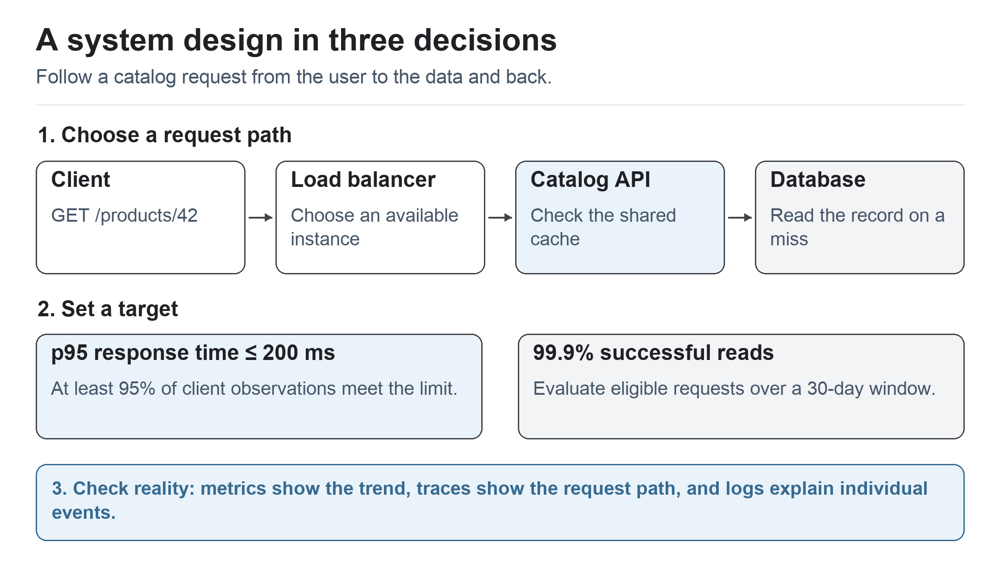

*A catalog read connects the request path to latency, availability, and observability.*

## How to divide work across the system

In a **client-server architecture**, the client makes a request, and the server performs an operation on the data and returns the result. To display the profile for user 5, for example, the client sends the identifier. The server checks access permissions, retrieves the record, and returns a representation of it. The server can use databases and call other services. These steps are hidden behind the interface the client uses.

With **file-based access**, the client retrieves a file or reads portions of it and processes the contents itself. If the data is distributed as a file containing a list of users, the application finds the relevant record. This works well for distributing documents, archives, and work files. If clients often need to filter data, a server-side interface that returns only the matching records can be more efficient. A file server is itself a form of client-server interaction.

In a **peer-to-peer network** (P2P), participants can both receive and provide data. A BitTorrent peer, for example, downloads pieces of a file from several nodes and uploads pieces it already has to other peers. Some P2P systems use servers for peer discovery. The data transfer itself can still take place directly between peers. The choice depends on who holds the data and who needs to perform the work.

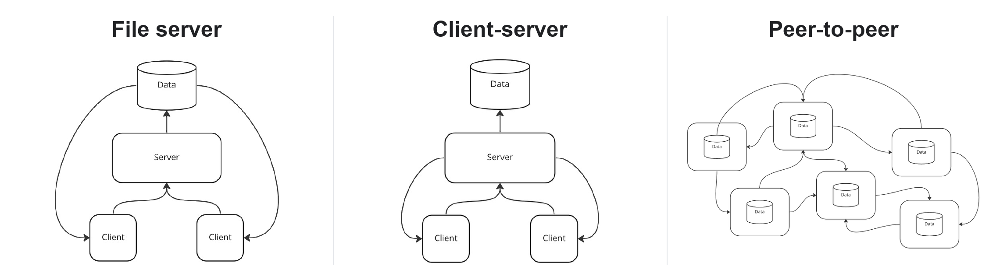

*File and client-server systems route requests through a server. In a peer-to-peer network, peers exchange data directly. Course slides 5–7.*

## How to evaluate a system

### Reliability, availability, and service levels

Reliability describes the ability of a system to keep performing its promised operations correctly over time. In banking, that includes preserving a confirmed transfer. In file sharing, it includes retrieving a file that was uploaded earlier. Availability measures how often users can perform the operation they need. A process can stay up while returning an error on every request. Measure host uptime and the availability of user-facing operations separately.

For time-based availability, 99.9% over 30 days allows about 43 minutes of downtime, and 99.99% allows about 4 minutes and 19 seconds. A request-based measure uses the number of eligible requests in the measurement window as its denominator. In that case, 99.9% allows an average of up to one unsuccessful request per thousand during the window. A few minutes of downtime during peak traffic can consume this budget faster than the same outage overnight.

An **SLI** (service level indicator) is a measurement, such as the fraction of successful requests to read a feed. An **SLO** (service level objective) sets a target for that measurement, such as 99.9% over a rolling 30-day window. With that SLI, the remaining 0.1% is the error budget. An **SLA** (service level agreement) is a customer agreement that specifies commitments and what happens if they are breached. It may provide compensation. Define where the indicator is measured, what counts as success, and which window applies. [Google SRE, Service Level Objectives](https://sre.google/sre-book/service-level-objectives/)

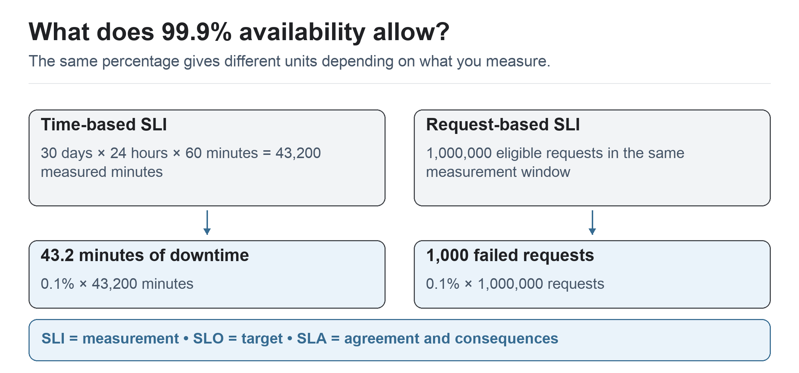

*The measurement determines whether the budget is time or failed requests.*

### Response time, latency, and throughput

Client-side response time covers the whole interval from sending a request to receiving the result. It includes network transit, queueing, server processing, calls to dependencies, and delivery of the response. The term *latency* can refer to this entire interval or to the delay in a particular step. State which interval a graph or requirement covers. For example, “p95 API response time as observed by the client is at most 200 ms” is a measurable requirement. In a direct count, this means at least 95% of observations fall within the threshold.

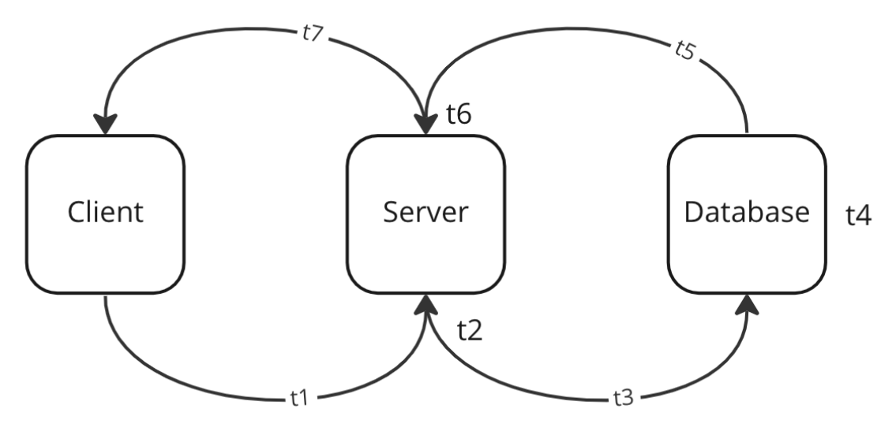

*The end-to-end interval covers the outbound request, server and database work, and the return trip. Course slide 21.*

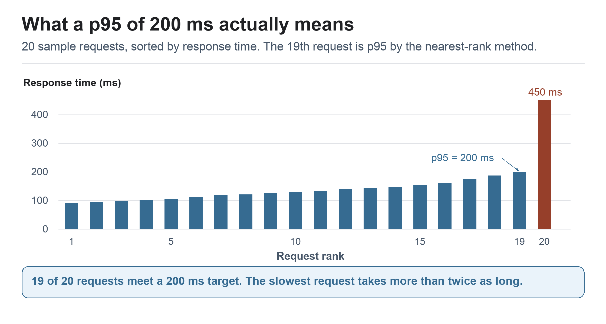

*A percentile describes where an observation falls in a sorted sample.*

Sometimes the result arrives separately from the initial response. An application may accept a job and enqueue it, then have a worker send an event with the result. Two measurements are useful here. The first tells you how quickly the job is accepted. The second tells you how long the user waits for it to finish. Use a monotonic clock to measure elapsed time on one node. Across nodes, correlate operations with a shared identifier or propagate trace context. Clock synchronization helps align timestamps, although residual differences still limit measurement accuracy. [Google SRE, Monitoring Distributed Systems](https://sre.google/sre-book/monitoring-distributed-systems/)

**Throughput** is how much work the system actually completes per unit of time. Common units include requests, operations, and bytes per second. A storage system might handle sequential uploads of large files efficiently while taking a noticeable amount of time to retrieve a small object at random. Batching reduces the number of network calls and writes. The first request in a batch may have to wait while the others arrive. Queues grow when the system is overloaded, so track both completed requests per second and tail response times.

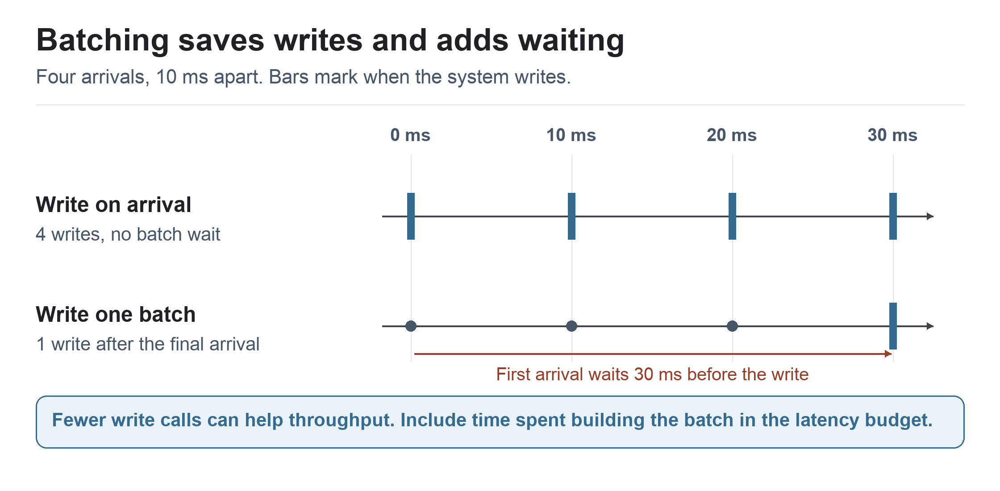

*Batching reduces write calls and adds a wait for earlier arrivals.*

### Workload and scaling

Before choosing hardware, find out which resource runs out of capacity first. Compression and complex calculations may be CPU-bound, large working sets may be memory-bound, and a file service may hit disk or network limits. A server can have idle CPU cores while it waits for I/O. The read-to-write ratio also shapes the design. A catalog typically has many reads that can be served from a cache or replicas. A log collection system is usually write-heavy, with occasional reads for investigation.

**Vertical scaling** adds resources to a node, such as CPU cores, memory, or faster storage. It can deliver fast results when the bottleneck is known and the application can use the added capacity. **Horizontal scaling** adds nodes. For an API with no local state, it may be enough to add application instances and distribute requests among them. For storage, you have to decide where data lives, how it moves, and what happens when one request needs records from multiple nodes. Measure improvements to individual request latency separately from the system's ability to serve a growing workload.

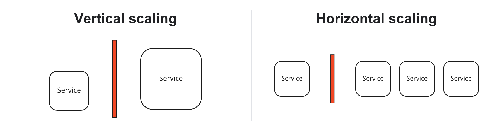

*Vertical scaling enlarges one instance. Horizontal scaling adds instances. Course slides 17–18.*

Maintainability depends in part on whether the team can deploy changes safely and diagnose degradation. Security is also a design requirement. TLS is commonly used for data in transit, stored data is encrypted as appropriate, and access controls limit which operations users can perform. End-to-end encryption adds further constraints. If only the parties to an exchange can decrypt its content, account for that when designing server-side search, content processing, and key recovery.

## Monoliths and services

A monolith is deployed as a single application. It can have well-defined modules for areas such as accounts, loans, and deposits. Calls between modules run in one process, and related changes can be made in a single transaction when they share a database. This can simplify launch and debugging. A monolith can also scale horizontally if its instances can handle requests independently. Adding an instance scales all of its modules together.

A service-based architecture gives parts of the system their own deployment and scaling cycles. If deposit operations suddenly start crowding out other requests, a separate deposit service can be assigned its own resources. Separation can contain a failure when neighboring services can operate without the failed capability or promptly stop waiting for a dependent request. The system also has to handle network calls, partial failures, version compatibility, and the need to reconstruct a request across processes. Transactions that cross service boundaries need their own design.

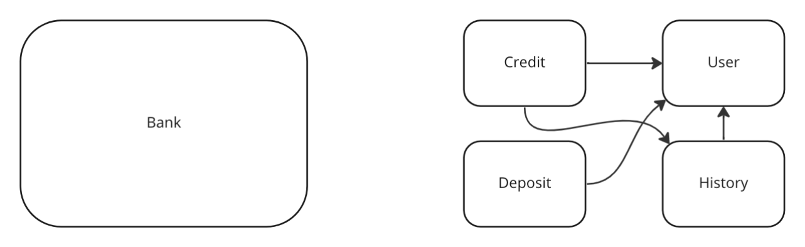

*On the left, one banking application owns the workflow. On the right, banking functions sit behind separate service interfaces. Course slide 40.*

When carving out a service, decide which business function and data it owns. Other parts of the system can use its API or exchange events with it. A table that multiple services update directly couples those services through its schema, locks, and write rules. A correctly configured queue lets senders and consumers be available at different times. They still share an event contract. Changing what a field means can break a consumer even when there is no direct call between the services.

## Load balancing and proxies

A load balancer chooses the instance that receives a request or connection. With **server-side load balancing**, the client talks to a single entry point, and a proxy selects the backend. With **client-side load balancing**, the client obtains a list of nodes and makes the selection. A service discovery mechanism can supply that list. Server-side balancing requires enough capacity and availability at the proxy. Client-side balancing requires each client to have current information about node membership and health.

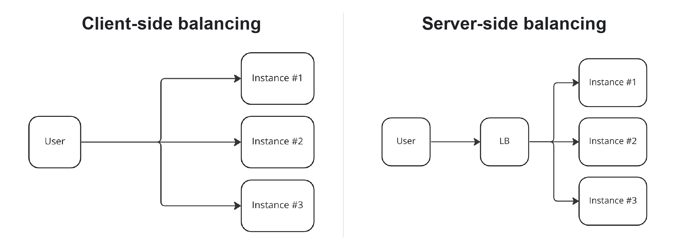

*The client selects an instance on the left. The load balancer selects an instance on the right. Course slides 47 and 50.*

**Round robin** is often sufficient when servers are comparable and requests cost about the same to handle. Weighted round robin accounts for differences in server capacity. If connections are long-lived and their number reflects load, choosing the node with the fewest active connections can be useful. That count is a weaker signal with multiplexing because a single connection can carry many requests. Health checks help remove unavailable nodes from consideration. [NGINX documentation, HTTP Load Balancing](https://docs.nginx.com/nginx/admin-guide/load-balancer/http-load-balancer/)

Session affinity, also called sticky sessions, directs requests from a client to the same instance. The routing key might be a cookie, a session ID, or the source address. With IP affinity, thousands of users behind the same address, such as a corporate NAT gateway, can all land on one node. When the backend pool changes, a mapping such as `hash(key) % N` reassigns many keys. Consistent hashing reduces the number of reassignments. If a node holds session state only in memory, that state is lost when it fails. Store any state needed after failure with the required durability.

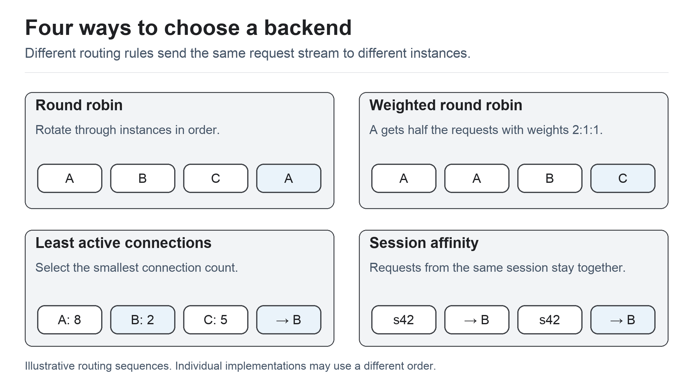

*The selection rule depends on what you know about instances and requests.*

At **Layer 4**, a load balancer routes transport connections using available network information such as IP addresses and ports. It can pass a TLS connection through to the application. At **Layer 7**, a proxy parses the application protocol and can route `/media` and `/api` to different server pools. To match the path on an HTTPS request, the proxy needs access to the decrypted HTTP traffic. Layer 7 supports HTTP routing and centralized checks. Choose the layer based on the information needed for routing and where TLS should terminate.

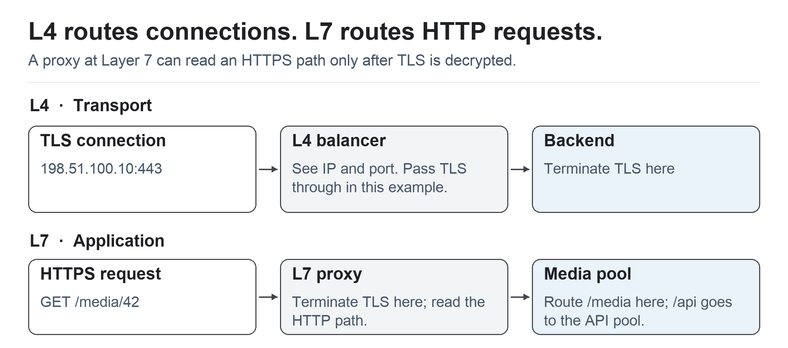

*TLS termination determines where an HTTPS path becomes visible.*

DNS can distribute clients across load balancers or regions. A name can return multiple addresses or select a response based on geography or estimated network latency. A resolver may cache the record until its TTL expires, while an open connection continues to use its chosen address. When testing DNS-based failover, account for clients that will keep calling the old region for a while. [Amazon Route 53, routing policies](https://docs.aws.amazon.com/Route53/latest/DeveloperGuide/routing-policy.html)

A **forward proxy** operates on the client's side. A company might use one to control outbound traffic from its applications. A **reverse proxy** receives requests on behalf of servers and forwards them to internal instances. It can terminate TLS, cache responses, or balance load. An API gateway often combines reverse proxying with API functions such as token validation, rate limiting, and routing by public API version. Translating between protocols, for example from HTTP/JSON to gRPC, requires an explicit mapping for requests, responses, and errors.

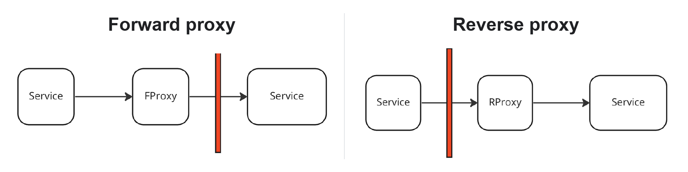

*The red line marks a network boundary. The forward proxy acts for the caller, and the reverse proxy acts for the destination service. Course slides 62 and 64.*

## Caching

### What a cache speeds up

A cache keeps copies of previously retrieved or computed results close to the consumer. Finding a value is a *hit*. Failing to find it is a *miss*. The *hit rate* is the fraction of cache lookups that hit. A key that receives a large share of the traffic is a hot key. When starting a new cache instance, you can preload popular data or gradually send traffic to it. Warming the cache helps prevent a sudden spike in requests to the source.

A simple model shows how much time a cache can save. Suppose a cache lookup takes 20 ms, and reading from the database after a miss takes another 100 ms. The average is `20 ms + miss rate × 100 ms`. At an 80% miss rate, the average is 100 ms, the same as reading directly from the database. This model assumes comparable requests and ignores the cost of filling the cache. Under load, also count how many database requests the cache saves and measure hit and miss latency separately.

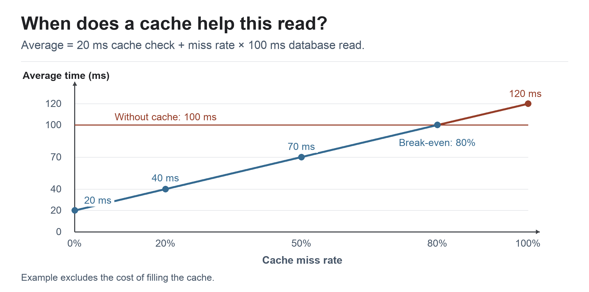

*The graph uses the same 20 ms cache lookup and 100 ms database read as the text.*

A time to live (TTL) limits how long a cached value can be used. Invalidation removes a stale copy when the source changes. For example, after a debit of 200 rubles from a 500-ruble balance, the cached balance may show the old amount. Use the authoritative record for financial decisions. For an indicative exchange rate or a reaction count, the product can set an acceptable age for cached data. You can also cache a confirmed “record not found” result, usually with a short TTL. Distinguish confirmed absence from a temporary error at the source.

Popular entries can expire at the same time, and a cache failure can leave an empty cache with a surge of misses. A database sized for the usual miss rate may become overloaded. Spare capacity, rate limits, gradual warm-up, and coalescing concurrent reads for the same key help limit the impact. Negative caching reduces repeated requests for a single missing key. A broader limit helps when requests span many different keys.

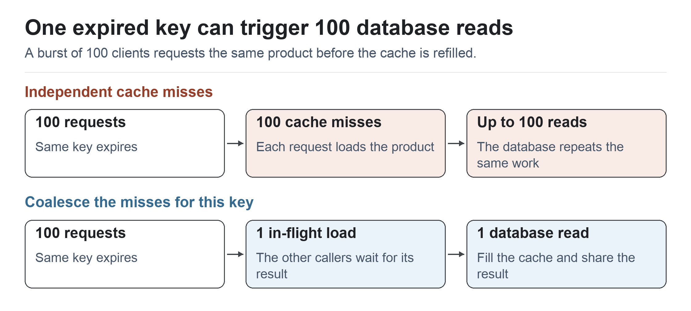

*Coalescing prevents simultaneous misses for one key from becoming repeated work.*

### Local and shared caches

A local cache lives in the application's process memory. A read requires no network call or serialization. Each instance holds its own copies, which increases total memory use and requires coordination for invalidation. A restart usually means warming the local cache again. An external cache such as Redis can be shared by several instances. It adds network latency and another dependency, and a single shared data set is easier to update centrally. Both layers can be used together when a small set of very popular data warrants local copies.

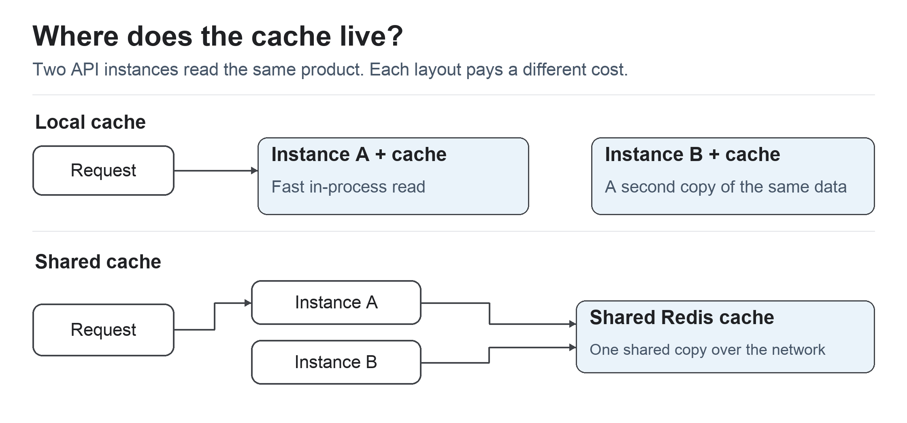

*Local copies avoid the network hop. A shared cache reduces duplication.*

### How data enters the cache

- With **cache-aside**, the application checks the cache first. On a miss, it fetches the value from the database, returns it, and fills the cache. On a write, it can update the database before invalidating the key. The design also needs to handle a delayed cache fill that would put an old value back.
- With **read-through**, the cache layer itself loads the value on a miss. The application uses a single interface for reads. If that layer fails, whether the application can bypass it depends on the architecture.
- With **write-through**, a successful write is reflected synchronously in both the backing store and the cache. Plan explicitly for a failure between the two updates. One external call alone provides no atomicity across two stores.
- With **refresh-ahead**, popular values are refreshed in the background so that reads continue to hit the cache. A worker can combine several replacements of one key into a single write if intermediate values are unnecessary. Deltas, such as three separate counter increments, must be summed or applied individually.

You can combine these patterns. The same catalog service might use cache-aside for rarely viewed items and refresh its most popular items in advance. Choose based on the cost of a miss and how stale the data may be. [Microsoft Azure Architecture Center, Cache-Aside](https://learn.microsoft.com/en-gb/azure/architecture/patterns/cache-aside)

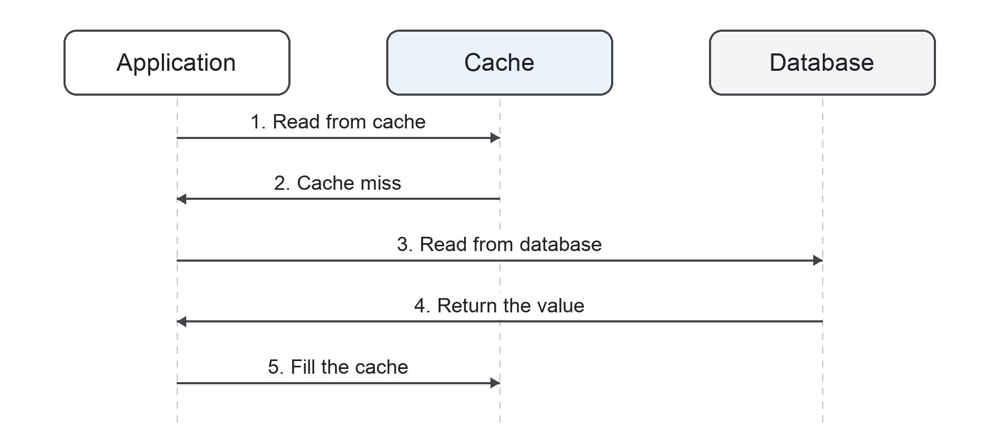

*On a cache miss, the application reads the database and fills the cache with the returned value. Adapted from course slide 82.*

### How to free cache space

Eviction frees space when the cache reaches its limit. **FIFO** removes the item that was inserted earliest. **LRU** (*least recently used*) selects the item whose most recent access was furthest in the past. **LFU** (*least frequently used*) favors items with more accesses. Suppose a four-entry cache holds users 1–4 in insertion order. If user 1's entry is read just before the fifth item arrives, FIFO evicts user 1 and LRU evicts user 2. With LFU, the result depends on the access counts. Decaying those counts helps the cache adapt when yesterday's popular keys fall out of use.

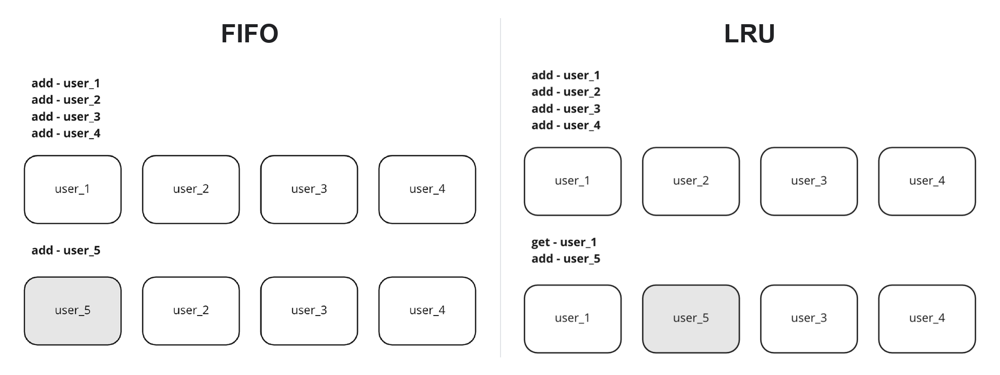

*The new value is shaded. FIFO evicts user 1, while LRU retains the recently accessed user 1 and evicts user 2. Course slides 93 and 95.*

Bélády's optimal algorithm would evict the item whose next use is furthest in the future, including an item that is never used again. A real system cannot usually know the future access sequence, so the algorithm serves as a benchmark. **Second Chance** adds a reference bit to FIFO. If an eviction candidate has its bit set, the algorithm clears the bit and continues scanning, giving the entry another chance. **Clock** scans the entries in a ring and avoids physically moving them in the queue.

A one-time sequential scan of a large data set can evict useful entries from an LRU cache. In the full **2Q** algorithm, new entries go into the FIFO queue `A1in`. After eviction, only their identifiers remain in the `A1out` queue. If one of those identifiers is accessed again, its reloaded entry goes into the main LRU queue, `Am`. **LRU-K** measures recency using the time of the Kth most recent access. K = 1 gives ordinary LRU. Both approaches use evidence of repeat access to distinguish sustained demand from one-off scans. [Johnson and Shasha, original 2Q paper](https://www.cs.cmu.edu/~natassa/courses/15-721/papers/P439.PDF)

Segmented LRU divides entries among queues with different promotion and eviction rules. In Memcached, for example, new entries start in HOT. Entries that are accessed again may spend more time in WARM, while eviction candidates come from COLD when the cache is full. An entry's TTL applies regardless of its position in the queues. [Memcached, segmented LRU](https://memcached.org/blog/modern-lru)

## API design

An API defines the operations a client can perform, what data it sends, what result it receives, and how it learns about errors. CRUD gives you a starting point for creating, reading, updating, and deleting data. Some actions fit better as separate operations or resources. A ride estimate, for example, can have its own identifier and expiration time.

REST organizes interaction around resources and their representations. Its constraints include a uniform interface, stateless requests, caching where allowed, and navigation through hypermedia. Many applications use resource-oriented HTTP APIs, where paths identify resources, methods express the semantics of operations, and JSON represents data. HTTP defines methods and status codes independently of the body format. [Roy Fielding, REST architectural style](https://ics.uci.edu/~fielding/pubs/dissertation/rest_arch_style.htm)

`GET` retrieves data. `POST` submits data for processing and is often used to create a resource. `PUT` creates or replaces state at a URI known to the client. `PATCH` applies a partial change. `DELETE` removes access to the resource through its URI as defined by the API contract. `PUT` and `DELETE` are idempotent in their intended effect. After a successful deletion, for example, a repeated request may return `404`, while the resource is absent after either request. For a `POST` that moves money or has another important side effect, you can define an idempotency key and store it with the operation's result. [RFC 9110, HTTP Semantics](https://www.rfc-editor.org/rfc/rfc9110.html#name-methods), [RFC 5789, PATCH](https://www.rfc-editor.org/rfc/rfc5789.html)

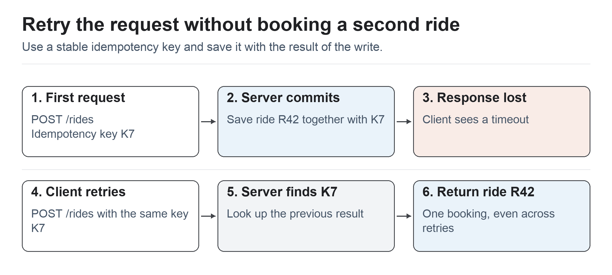

*Store the key with the write result so a retry can return the original booking.*

Status codes help clients interpret the result. `201 Created` means the resource has been created. `202 Accepted` means the request has been accepted for processing. The response can tell the client where to check its status. `409 Conflict` fits a request that conflicts with the resource's current state, such as an attempt to cancel a completed ride. The response body can include structured error details and suggest a valid next action where appropriate. [RFC 9110, HTTP status codes](https://www.rfc-editor.org/rfc/rfc9110.html#name-status-codes), [RFC 9457, Problem Details for HTTP APIs](https://www.rfc-editor.org/rfc/rfc9457.html)

An **RPC** interface is built around calls to procedures such as `EstimateRide` or `CancelRide`. gRPC commonly uses Protocol Buffers to describe services and messages. A compiler and plugin generate client and server code. The protocol runs over HTTP/2 and supports unary calls and streaming. A remote call can time out even after the operation has completed, so define explicit deadlines and retry rules. [gRPC documentation, Core concepts](https://grpc.io/docs/what-is-grpc/core-concepts/)

**GraphQL** lets clients choose fields and nested objects from a published schema. One screen might request an author's name and the post text, while another also requests the current user's reaction. The schema can expose mutations such as `addReaction` for changes. The server still checks access to the data and controls the cost of nested selections. A query that looks small to the client can generate substantial work on the server. [GraphQL specification, selection sets](https://spec.graphql.org/October2021/#sec-Selection-Sets)

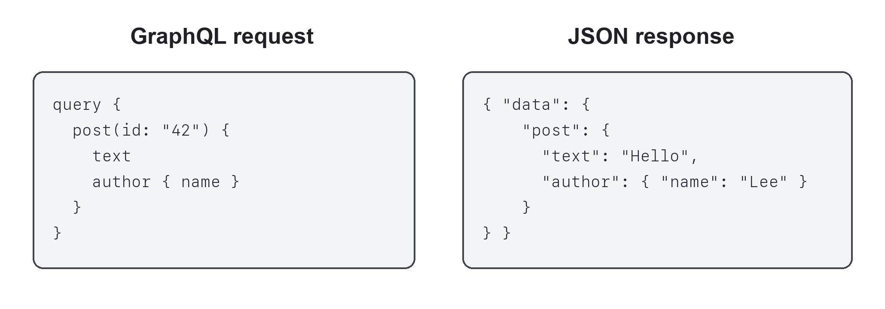

*The client selects the post text and author name, and the response follows those selections. Adapted from course slide 116.*

### An example ride-hailing API

| Request | Server responsibility |
| --- | --- |
| `GET /drivers/{driver_id}` | Return the driver profile fields the client is allowed to see. |
| `GET /passengers/{passenger_id}/rides` | Return the ride history the client can access, with pagination. |
| `POST /ride-estimates` | Estimate the fare and duration from the pickup and destination, and return the estimate ID and expiration. |
| `POST /rides` | Create a ride request and return its ID and initial status. If an estimate ID was supplied, verify that the estimate still applies and has yet to expire. |
| `POST /rides/{ride_id}/cancellations` | Record the cancellation if the ride's current state allows it. |
| `GET /rides/{ride_id}/events?after={cursor}` | Return new events such as driver assignment or arrival. |

A fare estimate is valid for a limited time. If it has expired, the server can return a fresh estimate and ask the passenger to confirm before booking. Creating the ride request and matching a driver are separate steps. The client can show `searching` right away, then poll for newer events with a cursor. A persistent connection can carry the same events when needed. Cancellation preserves the ride history, and repeating the cancellation should have a predictable result. The contract also specifies who can see profiles, ride history, and events for a particular ride.

## Observability

Metrics show how the system behaves over time. A counter accumulates requests or errors, a gauge reports the current queue depth, and a histogram records the distribution of response times. Common service metrics cover traffic, errors, latency, and saturation. For a database, also track query time and connections. For a queue, track depth and the age of the oldest job. A collector can scrape metrics periodically, or the application or an agent can push them to a receiver. Useful labels include the method, route template, and status class. Keep request IDs in logs or traces to avoid creating a separate time series for every request. [Google SRE, The Four Golden Signals](https://sre.google/sre-book/monitoring-distributed-systems/#the-four-golden-signals), [Prometheus, Instrumentation](https://prometheus.io/docs/practices/instrumentation/)

Distributed tracing shows the path of a request. A trace is made up of spans, which represent operations with durations and attributes. A call to a database or another service can create a child span. Trace context crosses process boundaries. For asynchronous work, it can travel with the message and be linked to the consumer's work. The trace shows which dependency accounted for most of the elapsed time. Library instrumentation can capture common operations automatically, while custom spans mark application steps that help with diagnosis. [OpenTelemetry, Context propagation](https://opentelemetry.io/docs/concepts/context-propagation/)

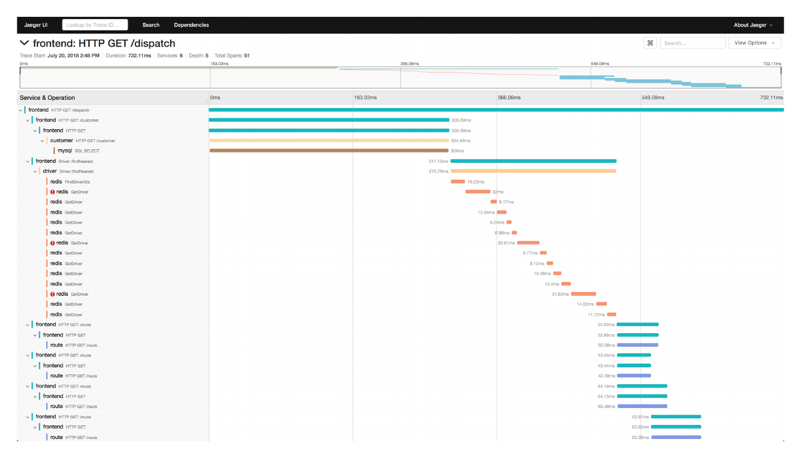

*Each horizontal bar is a span. Its position and length show when the operation ran and how long it took. Course slide 128.*

Structured logs capture details of individual events. Useful fields include the timestamp, error code, and trace ID. Centralized collection lets you search across instances. Error tracking systems can group exceptions and attach their stack traces.

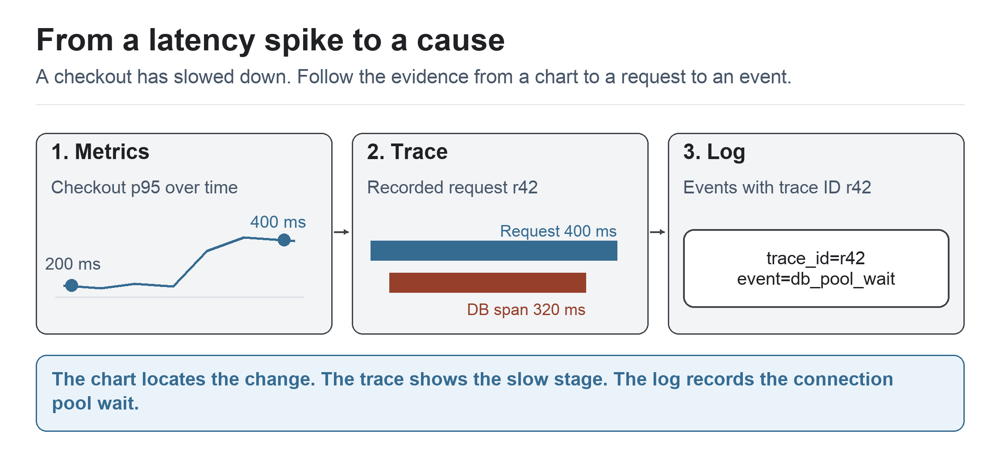

*Use the trace ID to connect an individual slow request to its log events.*

Continuous profiling collects CPU or memory profiles at intervals. If a process runs out of memory at 02:00, metrics show when memory usage began rising, and profiles from the previous minutes can help identify which code allocated it. Comparing profiles before and after a release shows where resource usage changed. Parca and Grafana Pyroscope are examples of continuous profiling systems. [Parca](https://github.com/parca-dev/parca), [Grafana Pyroscope](https://grafana.com/docs/pyroscope/latest/)

## Exercise

Design the HTTP API for a social network. Cover viewing profiles and friend lists, adding and removing friends, publishing posts and uploading attachments, reading a feed, viewing direct and group conversations, and sending and reading messages. Specify the path, method, parameters, response, and expected errors for each operation. Show where you need pagination, who can read or change the data, and what happens if a client repeats a request after the connection drops. You can document the contract in OpenAPI so that client-side scenarios can be checked against it. [OpenAPI Specification](https://spec.openapis.org/oas/v3.1.1.html)
