# Lesson 2. Data Storage

Storage design starts with the application's queries. A personal finance app needs to record an expense, retrieve an account balance, and generate a monthly report. A social network needs to display a profile, find a post by its text, and load a conversation's history. For each scenario, estimate how much data it touches, how often it occurs, and how much latency it can tolerate. Then determine which data must be current immediately after an operation and which changes must take effect together. This lesson looks at a single database instance. The next lesson covers placing data on multiple nodes.

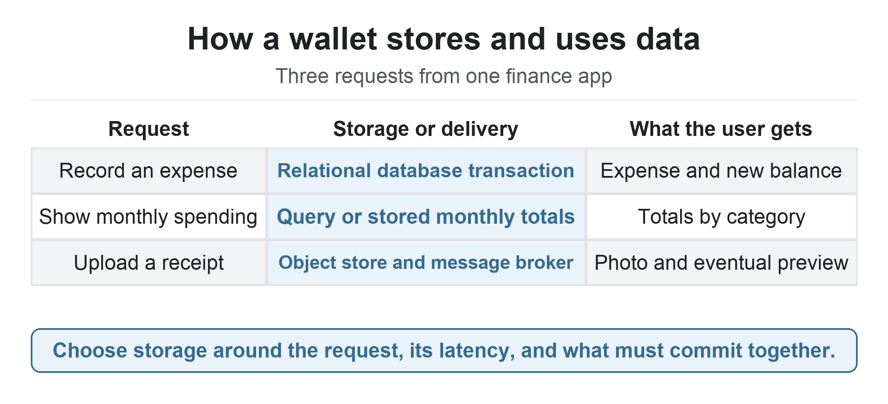

*An expense, a report, and a receipt upload need different storage and delivery behavior.*

## Data models and workloads

A **relational database** represents data as relations, typically expressed as tables in SQL. Columns have types, and constraints define valid values and relationships between records. For example, a user can own several accounts, and a follows table can represent a many-to-many relationship between users. Foreign keys verify that both ends of a relationship exist. A relational database is a good fit when the same entities appear in many different queries and changes to multiple tables must commit together. A common implementation stores rows on pages, a layout that works well for queries that retrieve a small number of complete rows. The data model, physical layout, and transaction support are separate properties of a database engine.

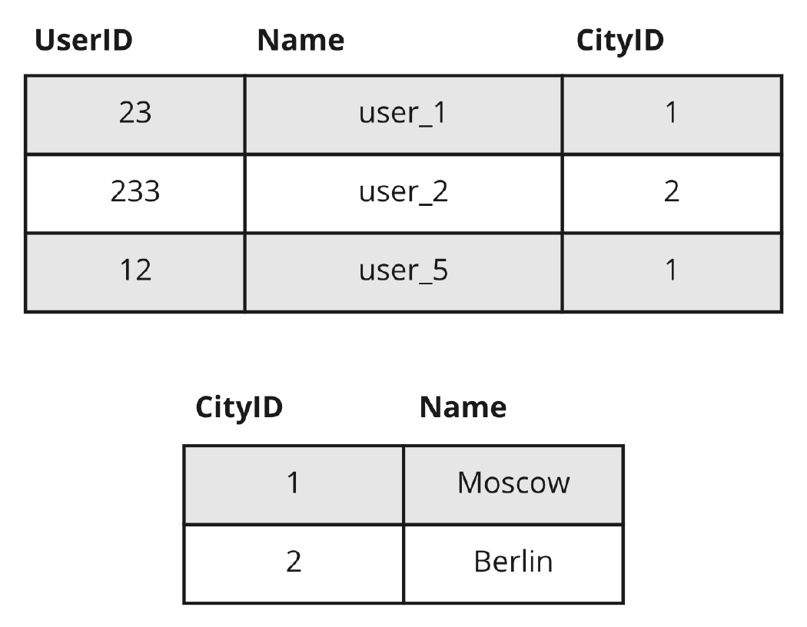

*The CityID recorded for each user identifies a row in the cities table. Course slide 5.*

A **document database** stores nested structures, such as BSON documents in MongoDB. A profile can include a name, a city, and lists of interests, jobs, and schools. If the interface usually displays the entire profile, the nested structure matches the way it is read. References are useful when many people share a related record that changes independently of their profiles. An application can combine both approaches. A flexible schema lets documents have different fields, and validation rules establish required fields and types where needed. NoSQL is a label for several data models. Check the query and transaction capabilities of the specific product. [Data modeling in MongoDB](https://www.mongodb.com/docs/manual/data-modeling/), [schema validation](https://www.mongodb.com/docs/manual/core/schema-validation/).

A **search engine** is useful when you need to search the text of posts, account for different forms of a word, rank results, or tolerate typos. An application can store posts in its primary database and send the relevant fields to Elasticsearch. At indexing time, an analyzer turns text into terms the engine can search. For a fuzzy query, Elasticsearch considers the edit distance between terms, including character insertions, deletions, substitutions, and, in a supported mode, transpositions of adjacent characters. Handling word forms depends on the analyzer, and prefix-based autocomplete requires its own configuration. A newly written post may take time to reach the search index and become visible after an index refresh. MongoDB also supports text search, including fuzzy matching in MongoDB Search. A dedicated engine makes sense when the search queries need its features and the team can maintain a second copy of the data. [Elasticsearch fuzzy queries](https://www.elastic.co/docs/reference/query-languages/query-dsl/query-dsl-fuzzy-query), [visibility of changes in Elasticsearch](https://www.elastic.co/guide/en/elasticsearch/reference/8.19/near-real-time.html), [text queries in MongoDB Search](https://www.mongodb.com/docs/search/query/operators-collectors/text/).

A **graph database** represents entities as vertices and their relationships as edges. Edges can connect services by dependency, people by friendship, or intersections by road. A typical query traverses several edges. It might find services that depend directly or indirectly on a failed component, mutual acquaintances, or a route through several intersections. If the application usually needs the immediate neighbors of a vertex, such as a list of followers, an indexed relationship table is often enough. Complex traversals over a changing graph give you a reason to evaluate a specialized store.

A **key-value store** suits workloads in which the application already knows the key. A post ID can retrieve a cached copy of the post or its view count. A networked store gives multiple processes shared access. Redis supports sets, hashes, and other data structures. Teams use etcd for coordination data and for watching configuration changes. Deleting every cached object with a given prefix goes beyond a single-key lookup. If that operation is common, you can track related keys, assign an expiration time, or change the version used in the keys. Scanning the entire keyspace can be expensive.

A **columnar store** works well for analytics. If a revenue report reads three columns from a table with dozens of fields, a columnar engine can read the required columns from disk and process them in batches. Similar values in the same column often compress well. ClickHouse engines in the MergeTree family use this layout. Check the selected engine's support for updating individual rows and the transaction guarantees it offers. The term *wide-column* describes a model for organizing and addressing data. A columnar layout describes how the data is physically stored. [Columnar storage in ClickHouse](https://clickhouse.com/resources/engineering/what-is-columnar-storage).

A **time-series database** is designed around timestamped records such as temperature readings or CPU utilization measurements. Common operations include filtering by time range, grouping by interval, and deleting records after a retention period. A relational database with an index on time can handle a moderate workload. Compression, precomputed aggregates, and retention controls become important as the volume of measurements grows.

An **object store** holds objects such as photos, audio, video, archives, and snapshots of source code. A service retrieves each object by its key and can store metadata alongside it. For example, an application can put a photo in Amazon S3 and store its object key, owner, and visibility rules in a database. The application handles searches based on business relationships and object contents. [Amazon S3 documentation](https://docs.aws.amazon.com/AmazonS3/latest/userguide/Welcome.html).

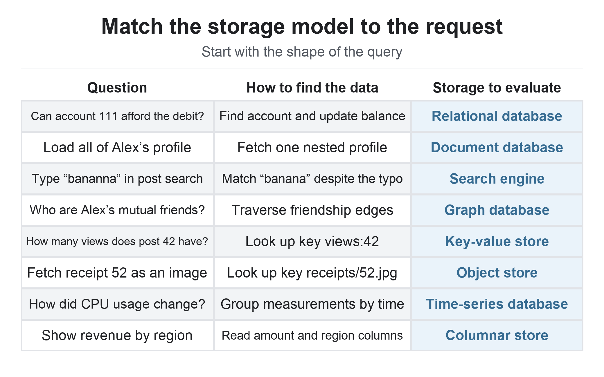

*The query shape suggests which storage model to evaluate.*

The distinction between OLTP and OLAP connects the data model with the workload. **OLTP** handles short application operations such as recording an expense or updating a profile. **OLAP** reads many rows, computes aggregates, and generates reports. A small product can run both on one database. If reporting consumes resources that affect the latency of user requests, move it to a separate instance or an analytics engine. Once there is another copy, decide how it will be updated and how much lag is acceptable.

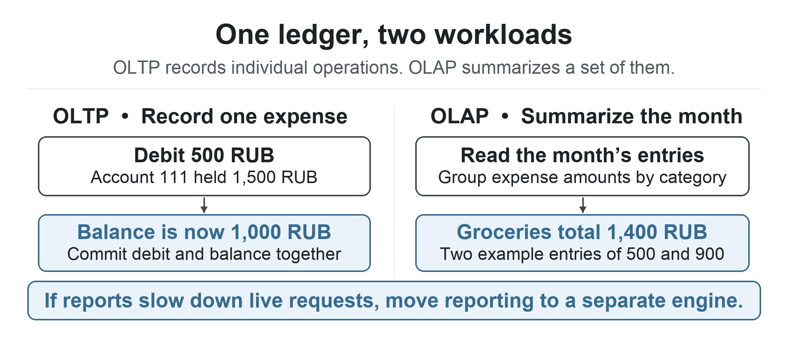

*A transaction records one expense. Analytics groups many entries into totals.*

For a small social network, one relational database can hold profiles, relationships, messages, and posts. You can start with its built-in text search and store media in an object store. As the workload grows, it may make sense to evaluate Elasticsearch for search, Redis for frequently read data, and a columnar database for analytics. Each component requires upgrades, monitoring, and expertise. Technology maturity and maintenance costs matter alongside performance.

Consider how the schema is likely to evolve. For a stable set of profile statuses such as “active” and “blocked,” an enum or a constraint may suffice. If administrators can add statuses and each one needs a description and localized labels, a separate lookup table is easier to manage.

## Memory, disk, and embedded databases

A disk-based database keeps its primary data on persistent storage and makes extensive use of memory to cache pages. An in-memory database keeps its working set in memory. That lowers access latency, limits the working set to available memory, and requires a way to recover the data. If the database is a cache, the application can fetch the records again from another source. If it holds the only copy, its persistence settings matter.

A **snapshot** captures the state at a point in time. If the database takes hourly snapshots, the most recent completed snapshot survives an unexpected shutdown. A **change log** makes it possible to recover later operations as well. How much data can be lost depends on when a log entry becomes durable and when the server acknowledges it to the client. In Redis, RDB creates snapshots and AOF logs operations that change the data. The `appendfsync` policy controls how often Redis forces AOF writes to disk. [Redis persistence documentation](https://redis.io/docs/latest/operate/oss_and_stack/management/persistence/).

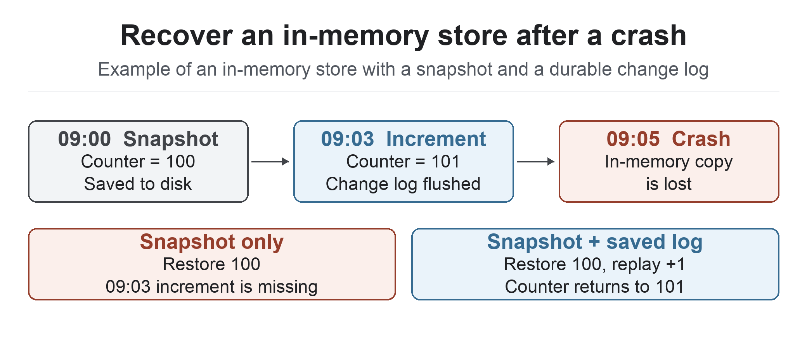

*The snapshot recovers the earlier value, and the durable log recovers the later increment.*

An **embedded database** runs as a library inside the application. SQLite, for example, executes SQL without a separate server. SQLite usually stores the main database state in a single file, but a rollback journal or `-wal` and `-shm` files can appear alongside it while it is running. Account for these files when copying a live database, or use the backup API. Embedding describes how the database runs. A single-file format describes how the data is laid out. An embedded engine can use a directory of multiple files. [SQLite's single-file format](https://www.sqlite.org/onefile.html), [WAL mode in SQLite](https://www.sqlite.org/wal.html).

## Indexes

An index provides another way to access data. Finding one user by ID in a billion-row table can require a full scan without a suitable index. An index narrows the search, takes up space, and adds work when rows are inserted or deleted or the indexed fields change. If a query returns a large fraction of a table, a sequential scan may cost less than many index lookups. The query plan shows the strategy the database chose.

**B-trees and B+ trees** work well for equality, sorting, and range queries. A node holds many separator keys and usually corresponds to a storage page. A high branching factor limits the height of the tree and the number of page accesses during a lookup. A query for `id BETWEEN 100 AND 200` can find the first match and then read keys in order. In a B+ tree, index entries live in the leaves, which are often linked for sequential traversal. The index can point to a row or store the needed values itself. The number of keys per page depends on the database and the size of the keys. The difference between reading adjacent and scattered pages is especially noticeable on hard drives. I/O size and granularity still matter with SSDs. [PostgreSQL index types](https://www.postgresql.org/docs/current/indexes-types.html).

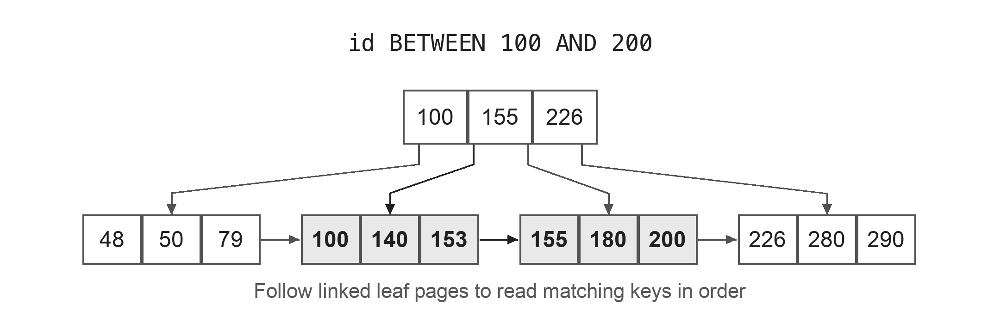

*The shaded keys match the range from 100 through 200. Leaf links let the database read the matches in order. Adapted from course slide 27.*

A **hash index** hashes the key and checks for a match in the corresponding part of the index, handling any collisions. A well-distributed hash makes point lookups fast, but it loses the natural order of the keys. Range queries usually need another access path. Even with constant expected work in the hash table model, disk access times can vary.

**Bitmaps** make it easy to combine attributes. In a venue directory, one bitmap can indicate outdoor seating and another can indicate live music. Each bit position corresponds to a record. Intersecting the bitmaps yields candidates that meet both conditions. Databases can support physical bitmap indexes or query plans that build a temporary bitmap. PostgreSQL, for example, can build in-memory bitmaps from regular index scans and combine them with `AND` or `OR`. [PostgreSQL documentation on bitmap scans](https://www.postgresql.org/docs/current/indexes-bitmap-scans.html).

**Spatial indexes** help find objects near a point or intersecting an area. A quadtree recursively splits a plane into four parts until it hits a stopping condition, such as a maximum number of objects per cell or a depth limit. A query can skip branches that fall entirely outside its area. An R-tree groups geometries by their bounding rectangles. When checking distances between coordinates, account for the coordinate system and the shape of the objects.

An **inverted index** maps a term to a list of documents. If “banana” appears in documents 1, 3, and 8, those IDs form its basic list of matches. Term positions let the engine check phrases, and term frequencies can help rank matches. Autocomplete is a related problem that involves prefix search. One possible data structure is a trie, in which strings that start the same way share a branch.

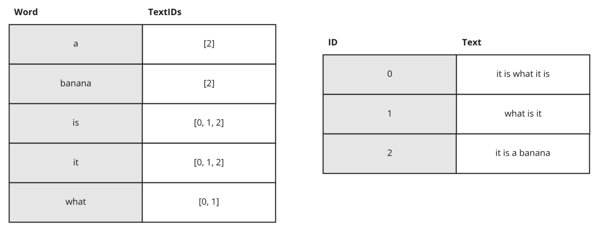

*In this set of three documents, the index points from “banana” to document 2. Course slide 31.*

Index names can describe the access method or how much data the index holds.

- A **sparse index** has entries for blocks of data. MergeTree in ClickHouse sorts rows within table parts and stores key values at granule boundaries. A query skips entire granules and then reads the blocks that may contain matches. The default `index_granularity` is 8,192 rows, and the volume of data can further limit the actual granule size. [Sparse indexes in ClickHouse](https://clickhouse.com/docs/concepts/core-concepts/primary-indexes).
- A **covering index** contains all the fields a particular query needs. For example, an index on `user_id` that includes `status` can return the status without reading the row itself. In PostgreSQL, an index-only scan also depends on the index method and whether the database can check row visibility without accessing the table. [PostgreSQL documentation on index-only scans](https://www.postgresql.org/docs/current/indexes-index-only-scans.html).
- **Clustering** aligns the order of access through an index with the physical layout of the rows. Rows in the same range can then be read from nearby pages. The semantics vary by engine. PostgreSQL's `CLUSTER` rearranges the table when the command runs. Subsequent writes gradually change that order. Secondary indexes provide other access paths without separately sorting the base table for each one. [PostgreSQL documentation on CLUSTER](https://www.postgresql.org/docs/current/sql-cluster.html).

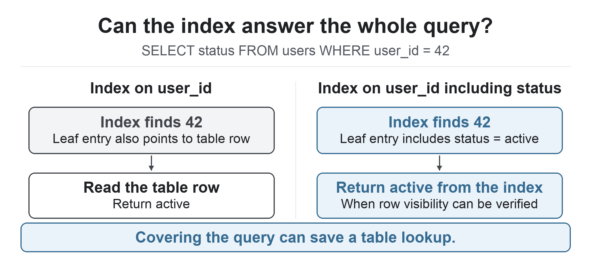

*Including status in the index can save a lookup when the database can verify visibility.*

## Transactions and ACID

Suppose you need to transfer 500 rubles from account 111 to account 222. If the debit succeeds and the credit fails, the money disappears from the ledger. A single transaction commits both changes together with `COMMIT`. Before committing, verify that both accounts exist and use the same currency, and check that the debit is allowed. For example, if a conditional debit affects zero rows, the application must roll back the transaction without crediting the second account. The four ACID properties describe different aspects of this operation.

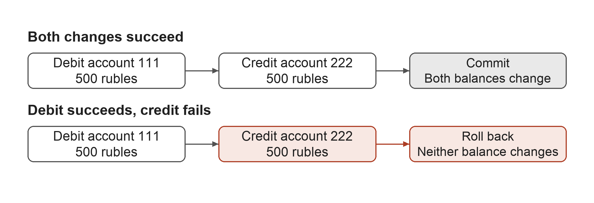

*The debit and credit change both balances on commit. If the credit fails, rollback preserves both original balances. Adapted from course slides 40–41.*

- **Atomicity.** The database applies all the changes in a transaction or rolls them all back. Coordinating an email or an external API call requires a separate mechanism.
- **Consistency.** A successful transaction preserves the specified invariants. For example, a foreign key requires a referenced account to exist, and a `CHECK` constraint can prevent negative balances where the product disallows overdrafts.
- **Isolation.** The isolation level determines which effects of concurrent operations are visible to a transaction. The application chooses a guarantee appropriate to the operation.
- **Durability.** Acknowledged changes survive the failures covered by the configuration. Losing a storage device or accidentally deleting data calls for additional protection.

Some constraints can be checked at the end of a transaction. Suppose two new rows in different tables reference each other. With immediate checking, the first insert fails because the second row is missing. If the foreign keys are declared deferrable and their checks are deferred, the database can insert both rows and validate the references at commit time. Support depends on the database and the type of constraint. [PostgreSQL documentation on SET CONSTRAINTS](https://www.postgresql.org/docs/current/sql-set-constraints.html).

### Concurrency anomalies

Two transactions read a counter with a value of 100, independently add one, and both save 101. This is a **lost update**. A query such as `UPDATE posts SET views = views + 1 WHERE id = ...` expresses the increment without an intermediate read by the application. A more complex calculation may require locking the row before reading it, checking its expected version, or retrying the entire transaction. When designing a counter, decide whether every increment must be reflected accurately as it occurs or whether asynchronous aggregation suffices.

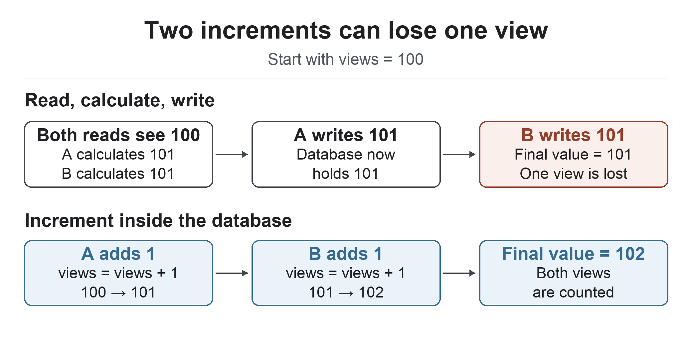

*Applying each increment in the database preserves both updates.*

In a **dirty read**, a transaction sees changes from another transaction that has yet to commit. If the other transaction rolls back, the application has received a value that was never part of the committed data. In a **nonrepeatable read**, a query sees a balance of 1,500, and the same query in the same transaction returns 1,000 after a concurrent update commits. A **phantom read** affects which rows belong to a result set. The first query finds three December expenses, and the repeated query finds four after an insert. A delete or an update that causes a row to stop matching the query can have the same kind of effect.

The SQL standard defines Read Uncommitted, Read Committed, Repeatable Read, and Serializable. Read Committed prevents dirty reads and allows a repeated query to see a newly committed change. Repeatable Read also prevents nonrepeatable reads, and the standard's minimum requirement permits phantoms. Serializable requires the results of committed transactions to be consistent with some sequential order. The engine can run transactions concurrently and abort one if it detects a conflict. The application retries the whole transaction. In PostgreSQL, Read Uncommitted behaves like Read Committed. Repeatable Read prevents phantoms and still permits some serialization anomalies. Check whether your specific write pattern is protected from lost updates in the database you use. [PostgreSQL documentation on transaction isolation](https://www.postgresql.org/docs/current/transaction-iso.html).

### Locks, row versions, and the log

Transaction A updates account 111 and then tries to update 222. At the same time, transaction B locks 222 and tries to update 111. Each waits for a resource held by the other. This is a **deadlock**. PostgreSQL detects the cycle and aborts one transaction. Acquiring row locks in a consistent order makes this situation less likely. If both transfers acquire locks in account ID order, the second transfer waits for the first to finish. [PostgreSQL documentation on locking](https://www.postgresql.org/docs/current/explicit-locking.html).

With **MVCC**, the database determines which versions of the data are visible using a transaction snapshot. In PostgreSQL, an update creates a new row version. The system columns `xmin` and `xmax` help track the transactions that created or deleted a version, with additional details for locks and transaction status. The database retains an old version for as long as an active snapshot needs it. The engine can then reclaim the space for reuse. Versioning lets many reads proceed while rows are being changed, and conflicting writes can still require locks. An application can also use an optimistic write that checks the expected version and handles conflicts. [MVCC in PostgreSQL](https://www.postgresql.org/docs/current/mvcc-intro.html), [system columns](https://www.postgresql.org/docs/current/ddl-system-columns.html), [cleaning up old row versions](https://www.postgresql.org/docs/current/routine-vacuuming.html).

A **write-ahead log (WAL)** records information about a change before the modified page is flushed to disk. After a crash, the database uses the log to recover its state. It can acknowledge a durable transaction once the necessary log records are persistent, even if the affected pages are still in memory. Ordinary PostgreSQL queries read visible versions from tables and indexes. WAL is used for recovery and replication. [PostgreSQL documentation on WAL](https://www.postgresql.org/docs/current/wal-intro.html).

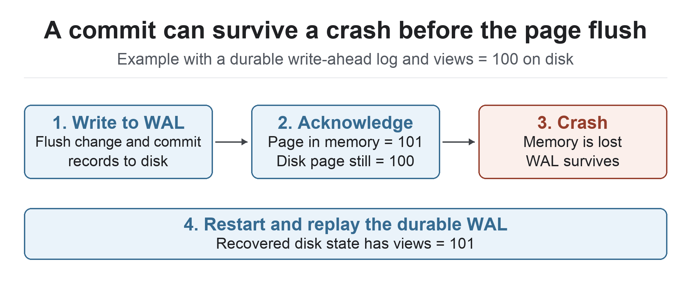

*The database replays the durable log when a crash happens before the page flush.*

Distributed storage discussions sometimes use **BASE** to mean Basically Available, Soft state, and Eventually consistent. The term emphasizes availability and the gradual convergence of copies. If new changes stop and replicas receive and consistently apply the outstanding operations, their states converge. Transaction properties and the visibility of changes on replicas can be considered independently. A database can atomically commit an expense and its balance update on the leader while an asynchronous replica temporarily returns the previous values.

## Logic close to the data

A **stored procedure** lets you invoke a sequence of operations by name. It is useful when multiple clients need to make the same changes to the same data. A **trigger** runs in response to an event such as an insert or update. For example, recording an expense can add an entry to an audit table or update a category total. This extra work increases write latency, and it may be invisible to the code that issues the write.

A regular **view** stores a query definition. A **materialized view** stores the result of that query. This saves repeated computation, but the result can lag behind the underlying rows. PostgreSQL uses `REFRESH MATERIALIZED VIEW` to update a materialized view. Other systems can refresh them differently. Periodic refreshes may suffice for a report on last month. A balance shown immediately after an operation needs a data source that meets the required freshness guarantee. [PostgreSQL documentation on materialized views](https://www.postgresql.org/docs/current/rules-materializedviews.html).

Some stores provide a **watch API**. For example, an etcd client can subscribe to changes to the key that holds a service address and update its local configuration upon receiving an event. If the connection drops, the client resumes watching from a known revision or reloads the current state if the relevant history has been compacted. [etcd API guarantees](https://etcd.io/docs/v3.6/learning/api_guarantees/).

To clean up records periodically, schedule deletions for timestamps older than a chosen cutoff. An index and batching reduce the work required for each operation. If the engine supports TTL, check how long expired records can remain before deletion. If historical data is partitioned by time, you can drop entire expired partitions. The partition granularity determines how closely the release of storage matches the retention policy.

## Practice. Design a personal wallet schema

Imagine a user who keeps several accounts, records income and expenses, and checks balances and monthly reports. A relational database is enough to start. Each account has an owner, a name, and a currency. Each entry has an account, a timestamp, an amount, a direction, and a category. You can store signed amounts. If categories are explicitly tied to a type of entry, storing the direction separately makes it easier to check that it matches the category. Store monetary amounts as integers in the currency's smallest unit or as exact decimals with a specified scale.

You can get `user_id` from the account. If queries for a user's history are frequent and the join becomes a bottleneck, you can add `user_id` to the entries and keep it consistent with the account, for example with a composite foreign key. An index on `(account_id, occurred_at)` serves queries for an account's history over a period. Once you've added `user_id`, an index on `(user_id, occurred_at)` can speed up queries that span all of the user's accounts.

You can compute a balance by summing entries or store it on the account record. Storing it reduces the work required for reads when the account has a long history. Adding the entry and updating the balance then belong in one transaction, and a retry uses the same entry ID. If the user has a small number of accounts, you can add the balances at read time, grouping by currency. To produce a single total across currencies, define a conversion rule.

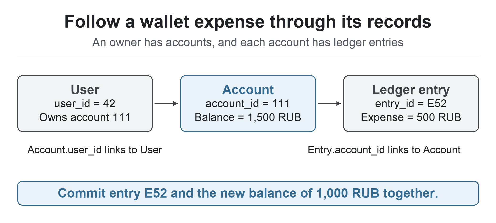

*The account links the user to each ledger entry. The entry and the balance change commit together.*

For a small data set, a date-range query can produce a monthly report. If those queries are frequent and expensive, use a table of monthly totals or a materialized view. A background job can calculate totals for closed months. Refresh the current month's total as often as the freshness requirement calls for. If users can edit old expenses, recalculate the affected periods. A date change can affect two months.

## Message brokers

A broker accepts records from producers and passes them to consumers. For example, a service accepts a photo upload and submits a job to generate a thumbnail. The user gets an acknowledgment, and workers can take jobs in batches and control their processing rate. If a worker is temporarily unavailable, the broker can hold jobs until the worker recovers, subject to resource and retention limits. Accepting a job and completing it are separate states.

In a **push** model, the sender initiates delivery. In a **pull** model, the consumer requests the next batch and controls its pace. In Kafka, a producer publishes a record to a topic divided into partitions. Each partition is an ordered log whose positions are called offsets. A consumer fetches batches and commits the offset at which its group can resume reading. That committed offset tracks the group's progress. Record deletion follows time- or size-based retention policies or the rules of log compaction. Kafka guarantees ordering within a partition. When events for a single account need to stay in order, they typically use the same key. The producer or its client library selects the partition. [Apache Kafka architecture](https://kafka.apache.org/40/design/design/).

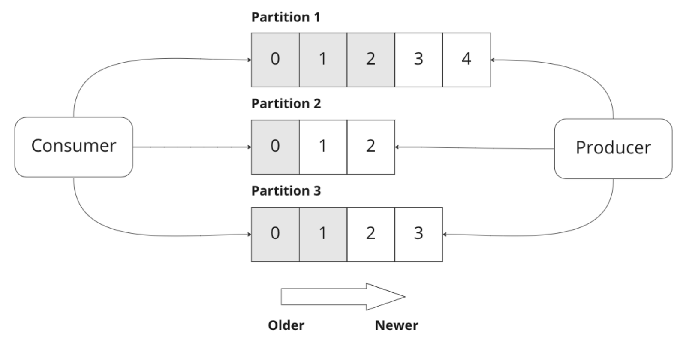

*Records get newer from left to right. Each partition keeps its own sequence of offsets. Course slide 74.*

In RabbitMQ, a producer publishes a message to an exchange, which routes it to one or more queues according to its bindings. A direct exchange matches an exact routing key, a topic exchange matches patterns, and a fanout exchange sends copies to its bindings. The queue delivers messages to subscribed consumers. With manual acknowledgments, an `ack` allows the broker to mark a successfully processed delivery for deletion. A separate mechanism confirms to publishers that the broker accepted a message. [RabbitMQ exchanges](https://www.rabbitmq.com/docs/exchanges), [consumer acknowledgments and publisher confirms](https://www.rabbitmq.com/docs/confirms).

Suppose a producer never receives an acknowledgment. The broker might have accepted the record and lost the acknowledgment, or it might never have received the record. Skipping the retry risks losing an unreceived record. Retrying risks duplicating an accepted record. A worker might also finish its task and then crash before committing its offset or sending an `ack`. If the broker or consumer group resumes from the last confirmed position, it will read that record again.

- **At most once** permits loss and limits delivery to one occurrence within the stated scope.
- **At least once** permits redelivery so that processing is reliable within the specified retry and retention conditions. To avoid recording an expense twice, the consumer can persist the event ID and apply the effect in the same transaction.
- **Exactly once** depends on the scope of the guarantee. Kafka can use one transaction to commit records in the output topic and consumer offsets for the input stream. For a side effect in an external API or database, coordinate persistence of the result, deduplication, and acknowledgment separately. [Kafka delivery semantics](https://kafka.apache.org/40/design/design/#semantics).

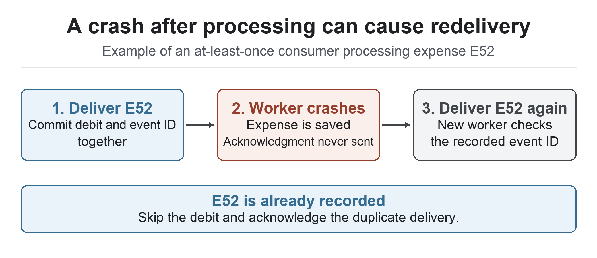

*A saved event ID lets a worker distinguish redelivery from a new expense.*

## Client-side storage and CDNs

An application client can store settings, recently accessed data, or material for offline use. The system defines which copy is authoritative and how to synchronize changes when the connection returns.

A CDN can serve photos and videos to an audience spread across regions. A request reaches a point of presence that may already have the object in cache. On a cache miss, the CDN fetches the object from the origin and stores it according to its caching policy. This populates the cache on demand. If the CDN supports it, loading content in advance can spare the expected audience the latency of the first miss. Either way, set the retention period, cache key, and refresh rules. [How CloudFront delivers content](https://docs.aws.amazon.com/AmazonCloudFront/latest/DeveloperGuide/HowCloudFrontWorks.html).

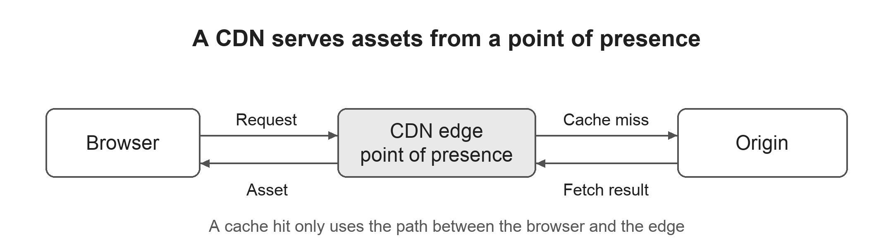

*A cache hit can be served directly from the point of presence. Adapted from course slide 81.*

## Exercise

Design a schema for a social network with profiles, posts, likes, comments, private chats, and relationships between users. Include views, hashtags, and attachments such as images, audio, and video. Draw an entity–relationship diagram or write out the schema with its keys and relationships. For each main query, specify what it reads, how it finds the data, and which changes must commit together. If you use multiple stores, justify them based on the queries or the volume of data. Revisit the messaging app sketch from the previous lesson and see which decisions change once you have designed the storage model.
