# Lesson 3. Distributed Data Storage

Putting data on multiple nodes creates two design problems. **Replication** copies the same data for fault tolerance, read capacity, and placement closer to users. **Partitioning** divides the original data set into pieces. Sharding usually means distributing those pieces across storage instances. The approaches can work together. For example, you can divide message history across shards and keep several replicas of each shard.

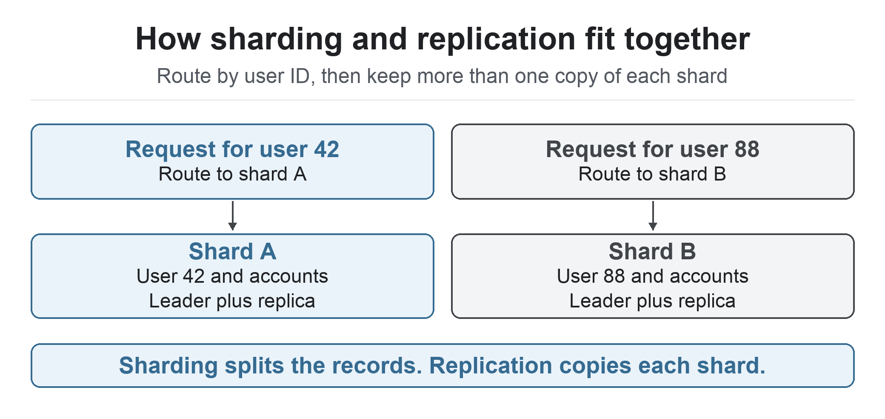

*Routing chooses which records to reach. Replication keeps multiple copies of those records.*

## Replication and recovery

A replica receives ongoing changes from the source database and can serve requests if its role and state allow it. A backup lets you return to an earlier state. If an operator accidentally drops a table, normal replication propagates the deletion. A backup kept outside that replication setup can help you recover. If you archive the log along with a base backup, some databases can recover to a specific point in time, such as the moment just before the accidental deletion. [Point-in-time recovery in PostgreSQL](https://www.postgresql.org/docs/current/continuous-archiving.html).

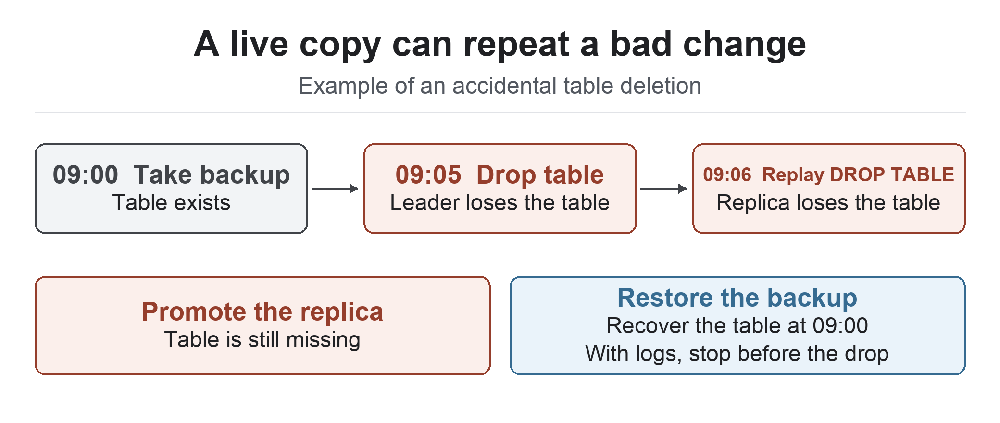

*The promoted replica is also missing the table. The earlier backup still has it.*

Set two recovery objectives during design. The **recovery point objective (RPO)** describes how much history you can afford to lose, and the **recovery time objective (RTO)** describes how long the service can be down before it returns to operation. If you take a backup every hour, the latest backup can be almost an hour old when a failure occurs. The restore itself takes additional time. A replica may shorten the outage. How useful it is depends on its lag and the failover process. Place copies in independent failure domains to survive the loss of an entire availability zone.

### Single-leader replication

In a single-leader configuration, inserts, updates, and deletes go to one node, the leader or primary. The leader establishes the order of changes, and its followers receive and apply them. Reads can go to the leader, and reads that tolerate stale data can be spread among the followers. This increases read throughput. The leader's resources and the acknowledgment policy still limit write throughput.

If the leader fails, the system selects a replica, promotes it to primary, and redirects clients. The write outage includes the time to detect the failure, decide what to do, promote the new leader, and reconnect. You can assign promotion priorities in advance. At failover, check whether a candidate is eligible and how far its log has progressed. PostgreSQL can promote a standby, while external tools handle failure detection and manage the switch. [PostgreSQL documentation on failover](https://www.postgresql.org/docs/current/warm-standby-failover.html), [recovery and streaming replication](https://www.postgresql.org/docs/current/warm-standby.html).

An unresponsive leader may simply be cut off by a network partition. If part of the system still accepts its writes, promoting a new leader creates **split-brain**. Safe failover requires a way to revoke the old leader's write authority. For example, a consensus protocol can elect a leader for a new term, and the nodes receiving its operations can reject commands from an older term. Once connectivity returns, the former leader must rejoin the cluster according to the database's rules. A list of promotion candidates helps with selection, and write authority needs its own controls. [PostgreSQL on safeguards during failover](https://www.postgresql.org/docs/current/warm-standby-failover.html), [the Raft paper](https://raft.github.io/raft.pdf).

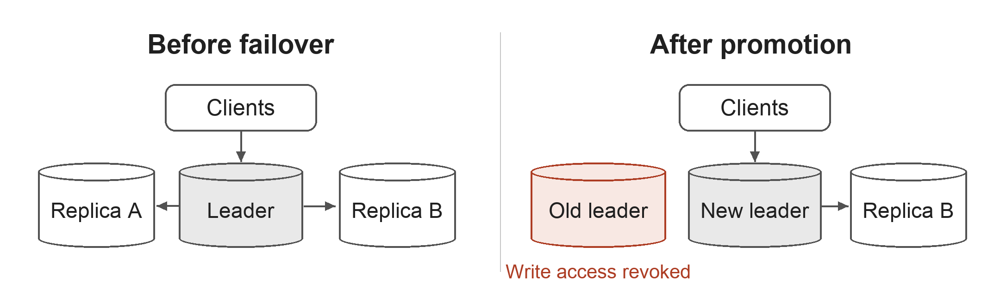

*Replica A becomes the new leader and clients reconnect to it. The old leader can no longer accept writes. Adapted from course slides 10–12.*

### Multi-leader replication

With multi-leader replication, several leaders accept writes. Regional nodes, for example, can process local changes and then relay them to other data centers. Clients get a nearby node they can write to, but the same entity can change in several regions before the leaders exchange their logs.

Suppose one leader saves Kazan as a user's profile city and a second leader saves Samara at almost the same time. A last-write-wins rule chooses a version by timestamp, with a tie-breaker for equal timestamps. Clocks can disagree in a distributed system, and retrying an old request may give it a new timestamp. Losing one change may be acceptable for a low-stakes profile field. If both regions independently debit the same balance, choosing the last version loses one of the operations and can hide a breach of a spending limit. You can route all writes for the account to one owner or use a protocol that preserves the required invariant.

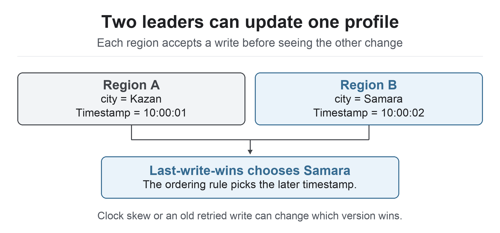

*Clock differences and retries can change the result of timestamp-based conflict resolution.*

The operations themselves can sometimes resolve the conflict. If replicas exchange two distinct events, “increment by 3” and “increment by 2,” applying them in either order yields the same sum. If an event can arrive more than once, you still need stable IDs and deduplication or a data structure that merges its state correctly. CRDTs are useful when you can define rules for updates and merges that guarantee convergence. Guarantees such as a shared spending limit need separate analysis. [Research on CRDTs](https://perso.lip6.fr/Marc.Shapiro/papers/2011/Comprehensive-CRDTs-RR7506-2011-01.pdf).

### Leaderless replication

In a leaderless system, a given write may have no permanent leader on its path. A request coordinator sends the operation to replicas and collects their replies, and any eligible node can act as coordinator. Let `N` be the number of replicas for a key, `W` the number of acknowledgments needed for a successful write, and `R` the number of replies needed for a read. If `R + W > N` and both operations select subsets of the same `N` replicas, those subsets must intersect.

With `N = 3`, `W = 2`, and `R = 2`, a read after a successful write contacts at least one node that acknowledged it. The read must be able to select the current version from the replies. With `W = 3` and `R = 1`, every write waits for all three copies, and losing one replica stops writes. With `W = 1` and `R = 3`, writes wait for fewer nodes and reads need them all. These parameters change the cost of a request and its sensitivity to failure. A coordinator can send operations in parallel. Latency depends on how quickly enough qualifying replies arrive.

Quorum intersection alone cannot guarantee linearizability. The result also depends on how versions are compared, what reads see while a write is in progress, and which nodes count during a failure. For example, a sloppy quorum may send writes temporarily to fallback nodes outside the key's usual replica set. In that case, check whether the original intersection assumption still holds. Systems use replica repair, state reconciliation, and forwarding of temporarily stored writes to converge. [The Dynamo paper](https://cdn.amazon.science/ac/1d/eb50c4064c538c8ac440ce6a1d91/dynamo-amazons-highly-available-key-value-store.pdf).

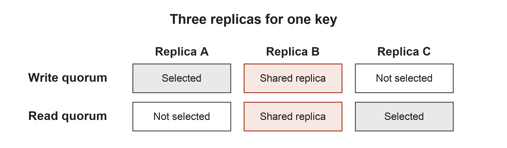

*In this example, both quorums choose two replicas from the same set of three. Replica B participates in both. Adapted from course slide 16.*

## When a write is acknowledged

With **asynchronous replication**, the client receives an acknowledgment without waiting for followers. This reduces write latency. If the leader is lost after it acknowledges a write and the replacement has yet to receive the latest changes, those changes can disappear during failover. While the leader is running, a lagging replica can return older data.

With **synchronous replication**, acknowledgment depends on designated replicas. Specify what each replica needs to finish. Receiving data over the network, writing it to operating system buffers, flushing the log to durable storage, and applying the change so reads can see it are separate events. With synchronous standbys configured, PostgreSQL distinguishes `remote_write`, waiting for a durable flush with `on`, and `remote_apply`, which waits for the selected replica to apply the write. Other replicas can still lag. You can wait for one replica from a set, several replicas, or replicas chosen in priority order. Network, disk, and apply latency on the required nodes affect response times. If too few synchronous replicas are available, writes can wait for them to recover. [PostgreSQL documentation on synchronous_commit](https://www.postgresql.org/docs/current/runtime-config-wal.html#GUC-SYNCHRONOUS-COMMIT), [configuring synchronous standbys](https://www.postgresql.org/docs/current/runtime-config-replication.html#GUC-SYNCHRONOUS-STANDBY-NAMES).

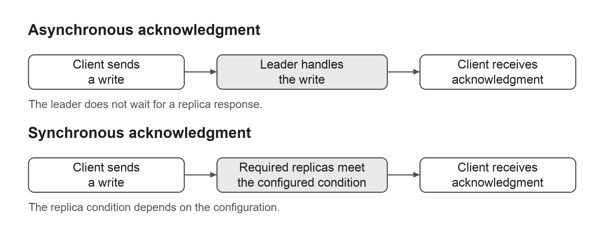

*The wait for replica confirmation depends on the replication mode. Synchronous replication also needs a precise condition, such as a durable log write or successful application. Adapted from course slides 19 and 21.*

**Semisynchronous replication** also depends on the product. In MySQL, a replica confirms that it has written the events to its relay log and flushed that log to disk. It can apply the transaction later. `AFTER_SYNC` waits for acknowledgment before the source commits the transaction in its storage engine. `AFTER_COMMIT` waits afterward. If the configured timeout expires, the source can fall back to asynchronous replication. These details matter when a successful response carries guarantees about data loss or the visibility of changes. [MySQL documentation on semisynchronous replication](https://dev.mysql.com/doc/refman/8.4/en/replication-semisync.html), [semisynchronous replication settings](https://dev.mysql.com/doc/refman/8.4/en/replication-semisync-interface.html).

### What users see when replicas lag

**Read-your-writes consistency** matters when someone publishes a post on a computer and then opens their profile on a phone. A request that reaches a lagging replica may temporarily omit the post. You can send reads after a write to the leader or pass the required log position and read from a replica that has reached it. If the change must be visible on another device, associate the log position or routing rule with the user on the server. Routing reads to the leader for a few seconds makes the problem less likely, and any guarantee depends on an upper bound on replication lag.

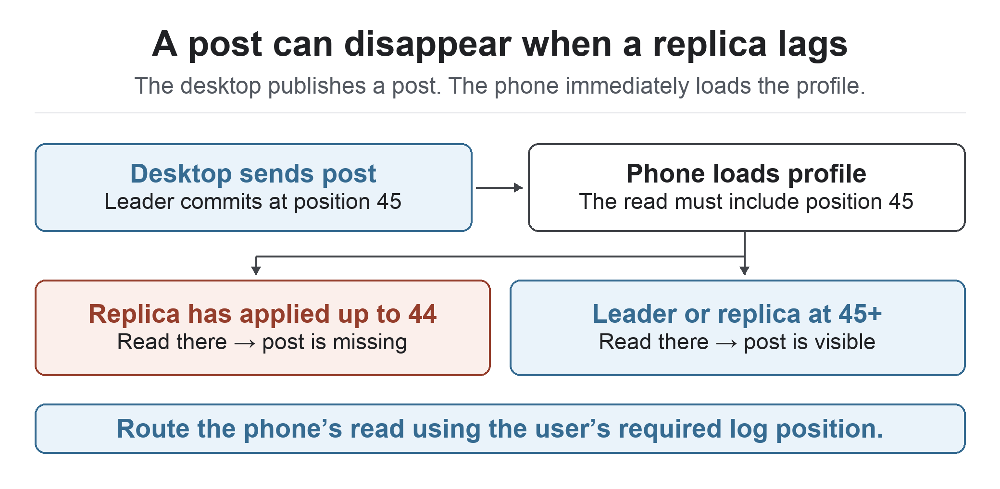

*Carry the required log position across devices to keep the new post visible.*

**Monotonic reads** mean that once a client has seen a newer version, later reads will never go back to an older one. If a feed first comes from a replica that has applied a new post and then refreshes from a lagging copy, the post appears to vanish. Keeping the client on one replica can preserve the order of reads while that replica is available. Before switching to another replica, check that it has caught up to the latest position the client observed.

**Causal consistency** matters when one action depends on another. Suppose a user sees a photo and reposts it. If the original and the repost live in separate partitions and replicate at different rates, someone else can see the repost while the original is still unavailable. You can store dependent changes within the same ordering domain or carry dependency information and show the result once the dependency is satisfied. A guarantee within one partition cannot cover arbitrary dependencies across partitions. If a response can tolerate a little lag, a simpler option is to hide the link until the system can read the original.

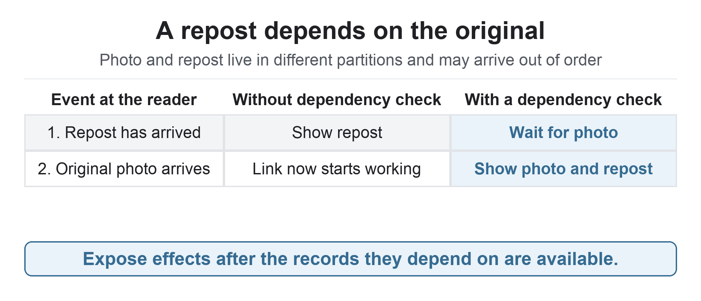

*The original photo must be available before its dependent repost is shown.*

## How replicas receive changes

**Statement-based replication** transmits commands. This is compact when a short statement updates many rows. Running the same statement safely on a different node requires reproducible conditions and results. For example, a value generated with `UUID()` can differ if each node evaluates it independently. MySQL supports statement-based, row-based, and mixed binary log formats. [MySQL documentation on statement- and row-based replication](https://dev.mysql.com/doc/refman/8.4/en/replication-sbr-rbr.html).

**Row-based replication** transmits changes to rows, so the replica receives values that have already been computed. The volume depends on how many rows changed and how the changes are represented. For example, MySQL lets you configure which parts of the row image go into the binary log. For a bulk update, the row events can be larger than the original statement. Choose a format based on reproducibility, stream size, and the systems that consume the changes. [MySQL binary logging settings](https://dev.mysql.com/doc/refman/8.4/en/replication-options-binary-log.html).

In PostgreSQL, **physical replication** transfers WAL records that describe changes at the storage level. A follower starts with a compatible base copy and then replays the log. This ties the scheme to the storage format. **Logical replication** transfers changes at the row and table level. You can choose which tables to publish and filter rows in supported cases. A subscriber typically receives an initial snapshot and then continues reading changes. The relevant schema elements and row identification need to be compatible on both sides. The differences allowed depend on the configuration. A replica can receive the stream directly from the leader or from an intermediate replica in a cascading setup. [PostgreSQL streaming replication](https://www.postgresql.org/docs/current/warm-standby.html), [logical replication architecture](https://www.postgresql.org/docs/current/logical-replication-architecture.html), [row filters](https://www.postgresql.org/docs/current/logical-replication-row-filter.html).

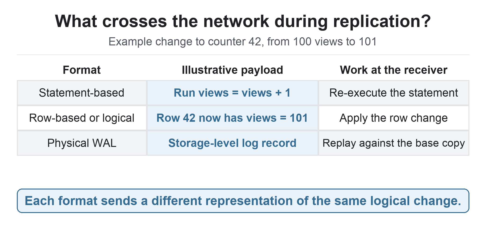

*Replicas may re-execute a statement, apply a row change, or replay storage-level records.*

## CAP and network partitions

In Gilbert and Lynch's formulation, CAP concerns availability and linearizable consistency during network partitions. **Linearizability** means that each operation appears to occur at a single point between its invocation and its response. If operation A finishes before operation B begins, A must come before B in that order. For example, if a write has finished and there are no other writes before a subsequent read completes, the read must return the written value. **Availability** in this model requires operations sent to nonfailed nodes to complete. Returning an error in place of the requested read or write does not meet that guarantee. A **network partition** means that messages between parts of the system may go undelivered. [Proof of the CAP theorem](https://www.comp.nus.edu.sg/~gilbert/pubs/BrewersConjecture-SigAct.pdf).

Imagine that two data centers lose contact. One acknowledges a profile update, and the other receives a request to read that profile. The second data center can serve its local copy and risk returning an old value. Preserving strong consistency requires it to delay or reject an operation it cannot safely complete. A quorum-based cluster can keep serving operations on the side that retains a majority while the other side limits what it will serve. Specify what each critical request should do in this situation. For example, a feed can temporarily show an older version, while confirming a transfer requires access to the authoritative account record.

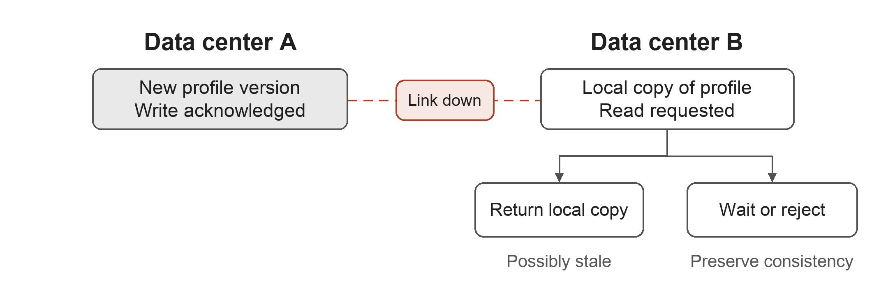

*The second data center can return a potentially stale copy or delay or reject the read to preserve consistency. Adapted from course slide 45.*

## Partitioning and sharding

**Vertical partitioning** divides the fields of an entity. A profile may have frequently read fields such as `id`, name, and status, along with a long description and rarely accessed data. You can keep the core fields in a compact table and move the rest to a related table keyed by the same ID. This reduces the amount of data read in the common case and adds a join when loading the full profile. It also works in a row-oriented database.

**Horizontal partitioning** divides rows. For example, you can organize messages by month under a common logical schema. If a query specifies a time range and its predicate matches the partitioning rules, the planner can prune unrelated partitions. To delete old history, drop an entire expired partition. If the engine supports separate storage tiers, you can use them to control the cost of retaining older partitions. A query with no predicate on the partition key may touch every partition. A large number of partitions also comes with overhead, such as planning and maintenance time. [PostgreSQL documentation on table partitioning](https://www.postgresql.org/docs/current/ddl-partitioning.html).

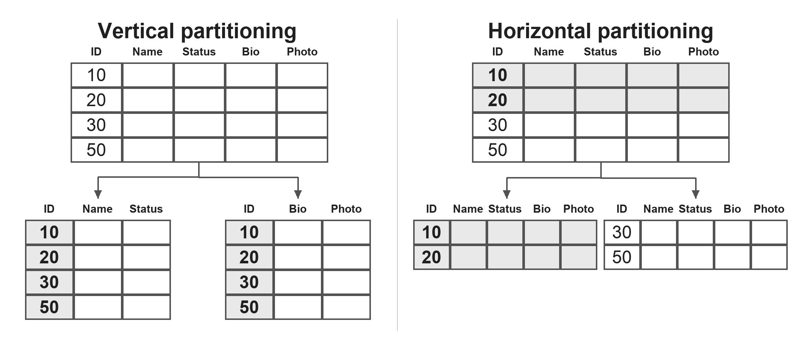

*The left side groups columns by how they are used. The right side groups rows under the same schema. Adapted from course slides 49–50.*

With **sharding**, separate instances serve different partitions. This distributes data volume and load and adds network requests and placement management. If the shard key is known, the router can send a read to one shard. Otherwise, it queries several shards and combines their replies. Scatter-gather costs are particularly noticeable for sorting, pagination, aggregates, and joins. Global uniqueness constraints and cross-shard transactions require additional support. Shards are typically replicated so that one server failure does not take an entire portion of the data offline. [MongoDB sharding architecture](https://www.mongodb.com/docs/manual/sharding/).

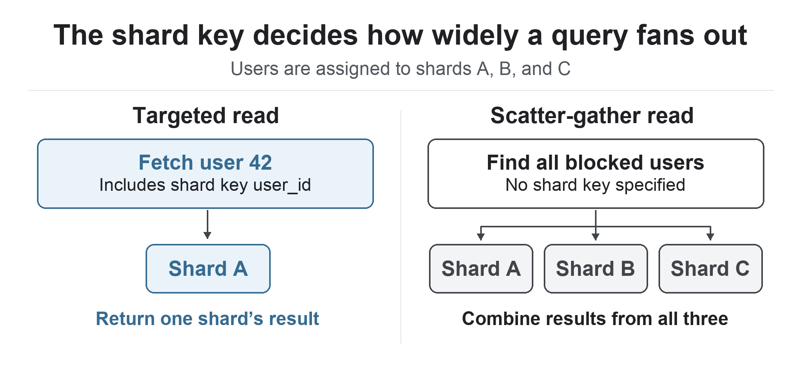

*The shard key lets a router narrow a lookup to one instance.*

### Choosing and using a shard key

A good key keeps common queries local and spreads data and load. Estimate how many distinct values there are, how usage is distributed across common values, and where you expect growth. Splitting users by the first letter of their name can produce uneven ranges. If you shard events by increasing timestamp, most writes will go to the current range and can overload one shard. Hashing user IDs usually distributes distinct IDs more evenly, but the activity of one large customer can still concentrate on one shard. [MongoDB guidance on choosing a shard key](https://www.mongodb.com/docs/manual/core/sharding-choose-a-shard-key/).

- **Range-based.** A key belongs to a specified interval. A query for a time period can go to the relevant intervals. As the data grows, you may need to adjust boundaries, split hot ranges, or move them.
- **Hash-based.** The router derives a shard from the key's hash, for example using a remainder. A good hash spreads distinct keys roughly evenly. A query for a range of original keys may touch many shards.
- **Directory-based.** A routing table records where a specific customer, group of keys, or geographic region lives. You can put a large tenant on a dedicated shard and publish its new location when it moves. The availability of the directory and the freshness of cached routes become part of the system's reliability.

Routing can live in a client library, a separate proxy, or a storage coordinator. A library removes a network hop, but you have to maintain configuration and compatibility across clients. A proxy centralizes routing and hides the topology. Account for its throughput and fault tolerance. A coordinator can send queries to several shards, assemble partial results, and coordinate distributed transactions if the engine supports them. Products combine these roles in different ways.

### Changing the shard count and moving data

With `hash(key) % N`, changing the number of physical shards `N` reassigns many keys. You can introduce a stable number of virtual buckets and use `hash(key) % B`, where `B` rarely changes. A placement table maps buckets to physical shards. When a new server joins, assign it some of the buckets and move the data they contain. All other keys keep their routes.

With **consistent hashing**, keys and node positions are placed on a hash ring. A key belongs to the next position along the ring in the chosen direction. Adding a position between two others transfers ownership of the interval from its predecessor up to the new position. The other intervals keep their owners. Multiple virtual positions per physical node typically smooth out imbalances and account for differences in server capacity. This evens out placement across many keys. One extremely popular key can still create a hot spot. [Original paper on consistent hashing](https://people.csail.mit.edu/karger/Papers/web.pdf).

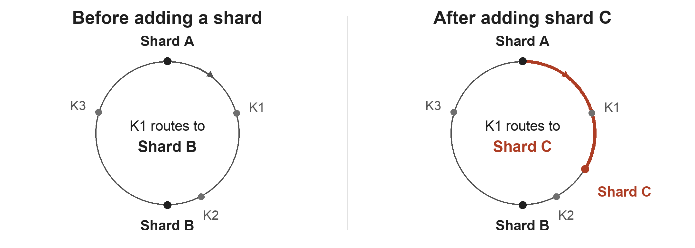

*Only keys in the highlighted interval change owners when shard C joins. Adapted from course slides 71–72.*

With **rendezvous hashing**, also called highest random weight, every key–node pair gets a deterministic score. The key is assigned to the node with the highest score. Adding a node changes the assignments of keys for which it wins. Removing a node reassigns its keys to the candidates with the next-highest scores. Nodes need stable identifiers and agreement on the list of participants. A direct implementation compares the scores of all candidates. [Original paper on highest random weight](https://www.cs.ucr.edu/~ravi/Papers/Jrnl/HRW98.pdf).

The placement algorithm identifies the new owner. You still need to move the data. A simple migration makes the range read-only during the move. To avoid a long interruption, copy a snapshot and replay changes up to an agreed position. Before switching routes, restrict the source's ability to accept writes for the range, verify that the copy is complete, and activate the new owner. Handle stale routes, retries, updates, and deletions that arrive during the move. The exact protocol depends on the database. If the old shard is suddenly lost, recalculating routes cannot recover missing rows. Recovery needs a replica or a backup of the old shard.

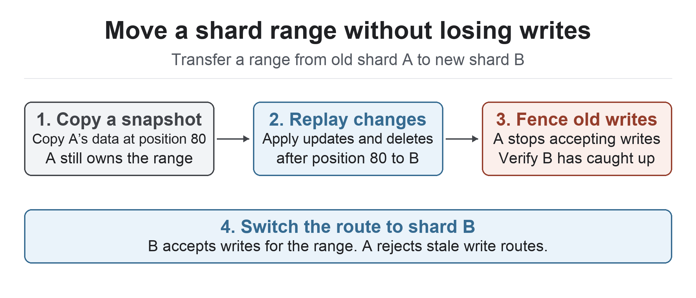

*The new owner catches up before traffic switches. The old owner rejects stale write routes.*

Base the decision to shard on measurable limits. Query and index optimization, moving older history to cheaper storage, adding resources to a node, or offloading reads to replicas can be sufficient. When a single write or storage node no longer meets demand and the forecast shows continued growth, sharding adds capacity. Consider future data placement when choosing a key because changing it requires a migration.

## Practice. Distribute the personal wallet's data

In the personal wallet from the previous lesson, assume that preserving acknowledged expense entries is the main requirement. A single leader with replicas and backups works as a starting point. To acknowledge an operation after it is durably stored on another node, select the corresponding acknowledgment mode and promote an eligible copy if the leader fails. A balance read immediately after a write can go to the current leader or wait for a replica to apply changes through the required position. Set the waiting policy based on acceptable response times and how the service should behave when replicas are unavailable.

If the workload calls for sharding, `user_id` can serve as the key. Store a user's profile, accounts, and entries together so that recording an entry and updating the balance happen within one shard. You can distribute a small shared category lookup table to all shards. A report for one user stays local. Global analytics needs a separate collection process. If the product adds transfers between wallets with different owners, a transfer can cross shard boundaries and will need a separate protocol.

If `user_id` is the shard key, you need the new ID before you can route a write. Independent databases with local auto-increment sequences can issue the same numbers. You can generate UUIDs in advance, assign disjoint ranges, include a permanent placement component in the ID, or use a shared generator. If the ID encodes where it was issued, decide how it will survive a data move. A user's unique identity can follow different rules from the current physical location of their records.

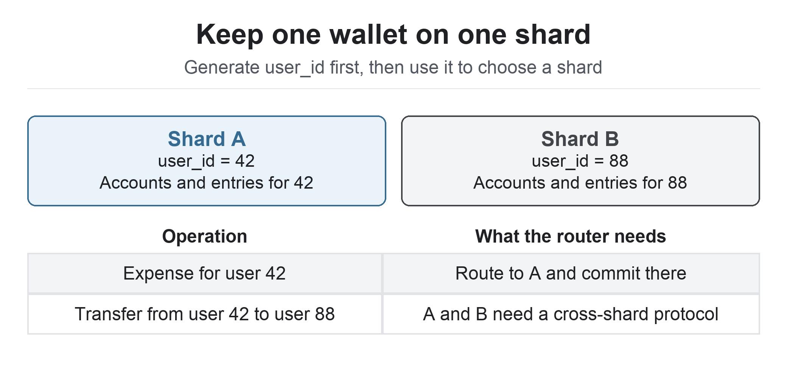

*Grouping accounts and entries by user keeps most wallet operations local.*

## Kafka partitions and database change streams

A Kafka topic consists of partitions. Each partition has a leader and, if replication is configured, follower copies on other brokers. One broker can lead one partition and hold a follower copy of another. A replication factor of 3 gives the partition three copies, including the leader. The `acks` and `min.insync.replicas` settings determine what acknowledgment the producer waits for and when the broker accepts a write. With `acks=all`, the leader waits for the current set of in-sync replicas, and `min.insync.replicas` sets the threshold below which the broker rejects the write. Managing cluster metadata and replicating the topic log are separate processes. To upgrade a Kafka cluster that uses ZooKeeper to Kafka 4.0, migrate to KRaft first. [Kafka replication architecture](https://kafka.apache.org/40/design/design/), [upgrading to Kafka 4.0](https://kafka.apache.org/40/getting-started/upgrade/).

**Change data capture (CDC)** provides events for changes in a source system. For example, an application saves an article in PostgreSQL, a connector reads logical changes from WAL and publishes them to Kafka, and separate consumers update a search index and an analytics table. Debezium typically starts with a consistent snapshot, records the corresponding position, and then continues with the change stream. Idempotent event handling covers restarts and retries. Also monitor consumer lag and the amount of WAL retained by the replication slot. [Debezium connector for PostgreSQL](https://debezium.io/documentation/reference/connectors/postgresql.html).

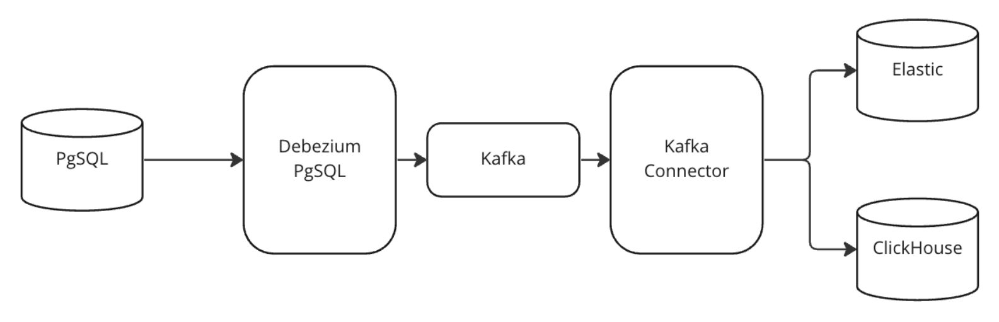

*PostgreSQL changes feed a search index and an analytics store through Kafka. Course slide 79.*

A service can use a similar approach to build a local projection. For example, a recommendation service keeps profile attributes in memory and updates them from the MySQL log. At startup, it needs to load the initial data set and resume at the corresponding position. After a connection drops, it needs to restore the stream or rebuild the projection. This saves a network request on the read path and adds memory use, update lag, and a recovery procedure. Specify how far the projection may lag for recommendations.

## Exercise

Take the social network schema from the previous lesson. For each database and critical query, specify where writes and reads happen, how many copies exist, and what has to happen before a write is acknowledged. Describe what happens if the leader fails or two zones lose contact. If you need shards, state the shard key and identify which queries go to a single node and which must visit several. Explain how to add capacity and move keys without losing data. Then revisit the messaging app schema and consider message ordering, reading a message immediately after sending it, and recovering conversation history.
