# Lesson 4. System Design Patterns and Techniques

*Start with the behavior you need to preserve, then choose a pattern.*

Releasing a new version without interrupting service, handling an external service failure, and showing users the progress of a long-running operation are three distinct problems. Each has its own techniques, and the right choice depends on the constraints. How much traffic can the rest of the system handle? Which data can users see after a delay? Which operations must complete together? In this lesson, we'll work through these questions with small examples and then estimate the load on a hypothetical messaging app. Familiar products illustrate possible approaches.

## Updating a running system

A **rolling update** gradually replaces application instances. The load balancer routes requests only to instances that are ready to serve traffic. For example, you can start a new replica, wait for it to become ready, and then take an old one out of service. If capacity is tight, you can reverse that order as long as the remaining replicas can handle the traffic. In Kubernetes, `maxUnavailable` and `maxSurge` control how many replicas may be unavailable and how many extra replicas may run during the update. Both versions run at the same time during the rollout, so verify that each can work with the shared data schema and API. Give in-flight requests time to finish before shutting down replicas. [Kubernetes deployment documentation](https://kubernetes.io/docs/concepts/workloads/controllers/deployment/)

In a **blue-green deployment**, one environment serves live traffic while you deploy and verify the new version in the other. Once the new version passes those checks, switch the routing. Keeping the previous environment available lets you route traffic back quickly. This requires extra capacity, and the time it takes to roll back fully also depends on the state of the data. For example, the previous version must be able to read records created by the new version. If the application uses an embedded database, plan which data each environment will see after the switch. [AWS guide to blue-green deployments](https://docs.aws.amazon.com/whitepapers/latest/blue-green-deployments/introduction.html)

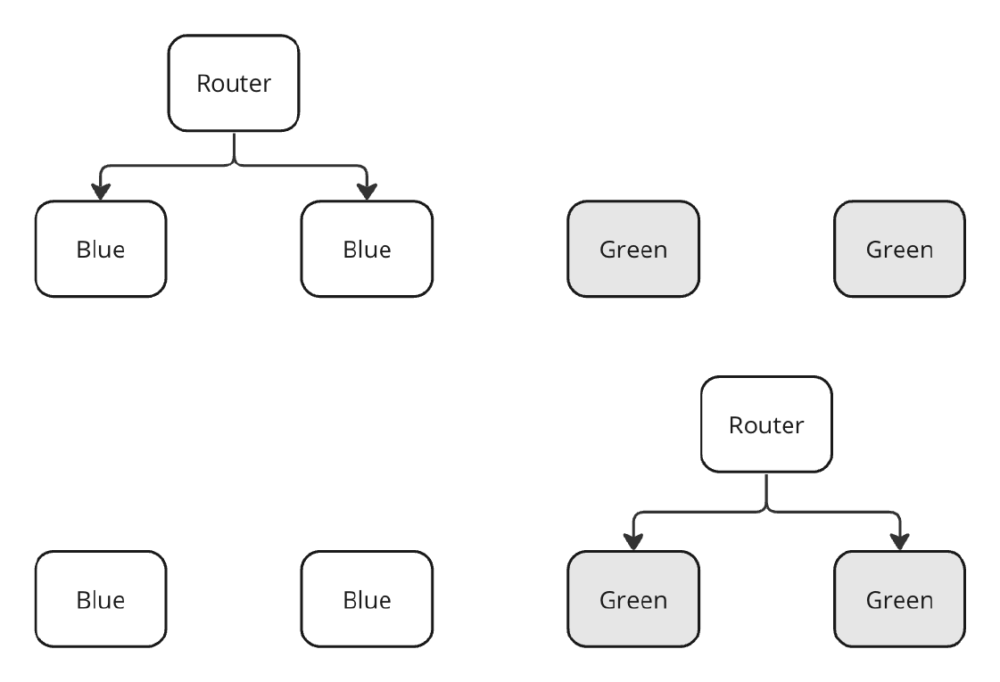

*The cutover moves traffic from Blue to Green. Course slide 7.*

In a **canary deployment**, the new version receives a small share of live traffic. The team compares errors, latency, and business metrics with a baseline, then increases the share in stages, for example from 5% to 30%, 70%, and 100%. The thresholds and observation window depend on how quickly problems will become visible in the chosen sample. If the metrics deteriorate, route traffic back to the stable version. You can also use a gradual traffic shift within a blue-green deployment. [AWS documentation on canary deployments](https://docs.aws.amazon.com/AmazonECS/latest/developerguide/canary-deployment.html)

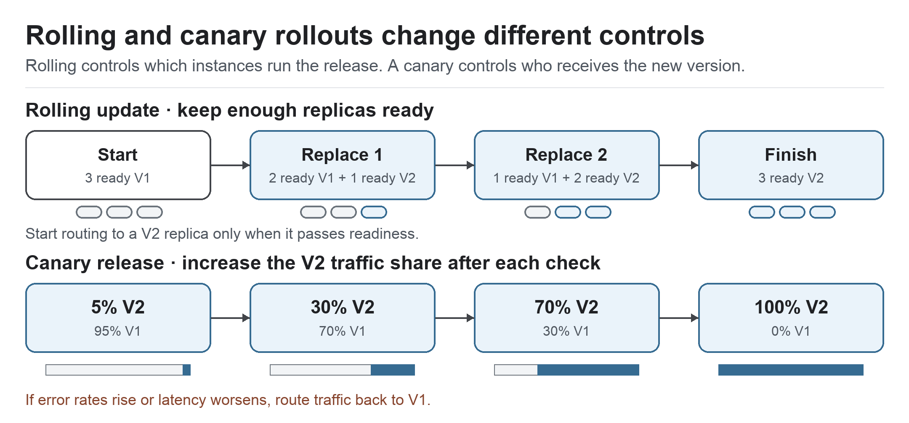

*Rolling updates progress replica by replica. Canary releases progress by traffic share.*

## Distributing work across components

### Static assets and client-side computation

For a minimum viable product, or MVP, you can package HTML, CSS, and JavaScript with the application. This is straightforward if the build produces a set of files that work together. During a rolling update, though, HTML served by one replica may reference an asset that the browser requests from a replica running a different version. A dedicated web server such as NGINX can serve static assets and forward API requests to the application. This lets you publish assets and scale their delivery independently. You can also store the files in object storage and add a CDN if the geography and volume of the traffic justify it. [NGINX documentation on serving static content](https://docs.nginx.com/nginx/admin-guide/web-server/serving-static-content/)

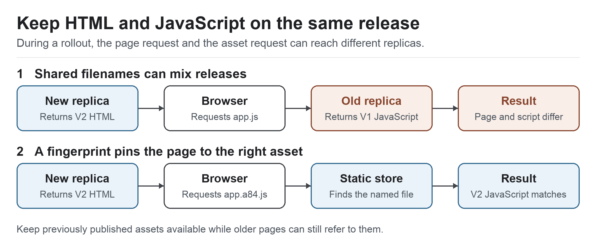

*The versioned filename keeps the HTML and its assets compatible during rollout.*

The user's device can do some of the computation. Suppose a continuous profiling service collects CPU or memory profiles and lets users compare two time windows. The server can accept a comparison request and return the result. If the aggregated profiles are compact, the client can download both and compute the difference locally. This saves server-side computation during interactive use. On the client, the cost comes from data transfer, memory, and CPU time, so the choice matters especially on phones. When comparing metrics over different time windows, also decide whether to show the difference between accumulated totals or between normalized values, such as CPU usage per unit of time. [Viewing and comparing profiles in Grafana](https://grafana.com/docs/grafana/latest/visualizations/simplified-exploration/profiles/choose-a-view/)

### Subscriptions, presence, and service discovery

Publishing a post may require notifying followers, updating analytics, and processing data for ads. In a **publish/subscribe** design, the posts service publishes a `PostPublished` event, and each interested service receives it through its own subscription. You can add a consumer without changing the calls made by the posts service. Giving each subscriber its own queue or read cursor keeps an analytics backlog from delaying notifications. Ordering and redelivery guarantees depend on the broker and its configuration. A transactional outbox can reliably tie event publication to saving the post. [AWS guide to publish/subscribe](https://docs.aws.amazon.com/prescriptive-guidance/latest/cloud-design-patterns/publish-subscribe.html)

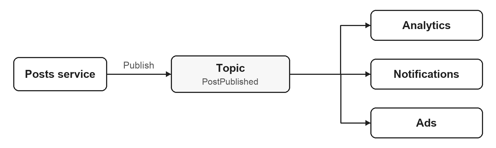

*Each subscriber can receive its own copy of the published event. Adapted from course slide 15.*

To show whether a user is online, the client can send a **heartbeat** every five seconds. The server records the time of the most recent heartbeat and changes the status to "Offline" after two or three missed intervals. To the server, a dropped packet, an app suspended in the background, and a disconnected client all look the same. "Offline" means the server has gone a while without receiving a heartbeat. If the user has multiple devices, the server can compute presence from the latest heartbeat across all active sessions.

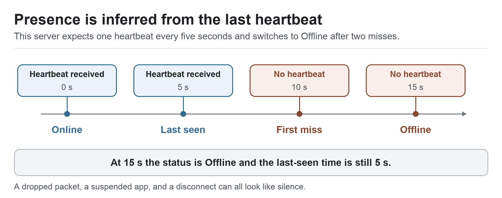

*Two missed heartbeats change presence. The server still shows the most recent heartbeat it received.*

A similar problem comes up in **service discovery**. When a new replica appears in the registry, the load balancer gets an updated list of addresses. The registry, orchestrator, or load balancer can monitor instance health. Checking whether a process is alive catches some failures. Readiness to accept requests can also depend on loaded configuration and completed warm-up. In Kubernetes, a readiness probe determines whether an instance should receive traffic routed through a Service. [Kubernetes documentation on probes](https://kubernetes.io/docs/concepts/configuration/liveness-readiness-startup-probes/)

### Ticket search and booking

Suppose train ticket search needs 99.99% availability and booking needs 99.9%. These operations have different load profiles, latency targets, and data freshness requirements. **CQRS** stands for *Command Query Responsibility Segregation*. Commands change state and enforce business rules. Queries use a model shaped for serving reads, such as a prepared view of scheduled trains and available seats. Both models can use a single database. Separate data stores let you scale them independently and require a way to keep the read model up to date. [CQRS in the Azure Architecture Center](https://learn.microsoft.com/en-us/azure/architecture/patterns/cqrs)

If synchronization takes time, search results may still show a seat that someone just bought. The write model enforces the invariant that each seat can be sold at most once. When booking a seat, it checks availability and updates the seat's state atomically. A read model can also produce a combined order history across several products. Order events can be normalized to a common schema and stored in a dedicated view so users can sort and filter them in their account.

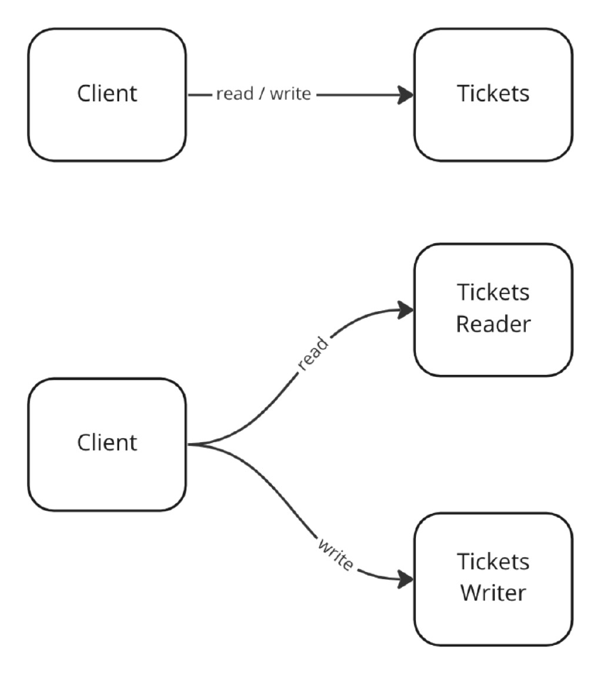

*Ticket lookups and bookings use separate models. Course slide 20.*

## Failures, overload, and degraded operation

### Retries and idempotency

A retry can help when a partner API has a transient failure. The client sets a timeout for each attempt, a retry limit, and an overall deadline. The delay between attempts can grow exponentially, for example from 100 ms to 200 ms and then 400 ms. Adding a random offset, or **jitter**, spreads out requests when many clients encounter the same failure. If each layer in a chain of services retries independently, the number of calls to the final dependency can reach the product of the attempt counts across all layers. Choose where to retry and stop when the overall deadline expires. [AWS Builders’ Library on timeouts, retries, and backoff](https://aws.amazon.com/builders-library/timeouts-retries-and-backoff-with-jitter/)

Suppose a ticket costs 20,000 rubles. The payment service charges the customer, but its response gets lost. Two retries without safeguards can bring the total charged to 60,000 rubles. An **idempotent** operation has the same intended effect whether you send the same request once or repeatedly. HTTP methods such as `GET`, `PUT`, and `DELETE` have these semantics. The response itself can vary. For example, the first `DELETE` removes a record, and the next can report that the resource is already gone. [RFC 9110 on idempotency](https://www.rfc-editor.org/rfc/rfc9110.html#section-9.2.2)

For a payment, the client sends an **idempotency key** and reuses it across every attempt for that operation. The server associates the key with the request parameters and outcome. If two attempts arrive at the same time, only one handler should get to execute the operation. A unique database record is one way to enforce this. A retry with the same key and a different amount is a conflict. When an external provider charges the customer, the charge itself needs protection, for example through a provider-supported idempotency key for the same operation. [Stripe API documentation on idempotent requests](https://docs.stripe.com/api/idempotent_requests)

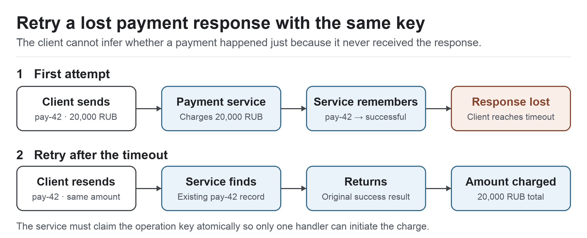

*Retrying the same payment key retrieves the original result without a second charge.*

### Backpressure, rate limiting, and circuit breakers

If a producer sends 150 requests per second and the consumer can handle 100, an unbounded buffer will accumulate 180,000 requests in an hour. A queue can absorb a short burst. If incoming traffic consistently exceeds processing capacity, reduce the incoming rate, shed some work, or add capacity. **Backpressure** lets the consumer influence the producer's rate. For example, it can request the next batch only after freeing space in its buffer. Slower responses will throttle a sender that waits for each request to finish or caps its concurrent requests. If the sender keeps issuing requests at the same rate, this will increase the number of outstanding requests. A **rate limiter** controls traffic admission and can signal that the client has exceeded a limit with a `429` response. A `503` response is appropriate for temporary server overload. The `Retry-After` header can tell the client when to try again. [Reactive Streams specification](https://www.reactive-streams.org/), [RFC 6585 on status code 429](https://www.rfc-editor.org/rfc/rfc6585.html#section-4), [RFC 9110 on Retry-After](https://www.rfc-editor.org/rfc/rfc9110.html#section-10.2.3)

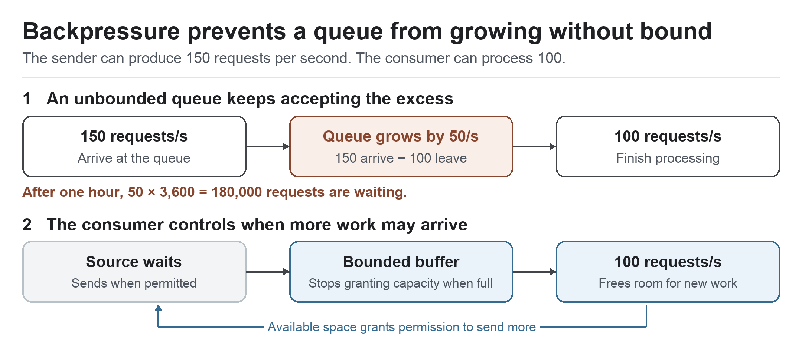

*At this processing rate, one hour of uncontrolled input leaves 180,000 requests waiting.*

A **circuit breaker** protects the system when a dependency frequently returns errors or times out. In the `closed` state, requests go through and failures are tracked. Once the failure threshold is exceeded, the circuit breaker switches to `open` and temporarily blocks calls. The client gets an immediate error or an acceptable fallback response. After a pause, the `half-open` state allows a limited number of trial calls. If they succeed, the circuit breaker returns to `closed`. If they fail, it opens again. The number of trial calls and the criteria for success depend on the implementation. [Circuit Breaker in the Azure Architecture Center](https://learn.microsoft.com/en-us/azure/architecture/patterns/circuit-breaker)

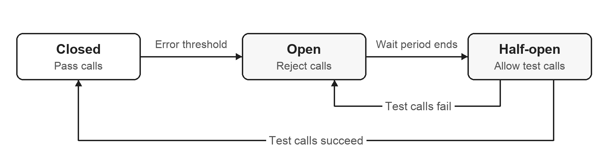

*Probe results determine whether the circuit breaker resumes normal traffic or waits again. Adapted from course slide 26.*

If processing can wait, the system can accept a job into a work queue and show its status. Messages that have exhausted their processing attempts can go to a **dead-letter queue**. It retains problem messages for investigation and controlled reprocessing. Accepting a job and handling a final failure call for different rules and retention periods. [Amazon SQS documentation on dead-letter queues](https://docs.aws.amazon.com/AWSSimpleQueueService/latest/SQSDeveloperGuide/sqs-dead-letter-queues.html)

### Graceful degradation

A ride-hailing service needs to handle the trip from driver assignment through payment. It can temporarily turn off ads, rewards, and some additional in-app suggestions if they overload the system or depend on an unavailable component. **Graceful degradation** means designing for those operating modes up front. For example, a feature flag can turn off optional calls to dependencies, and limits and timeouts can free resources for the core workflow.

An online store can use a prepared list of popular products as a **fallback**. If personalized recommendations are unavailable, the catalog and cart still work, and the user still sees a selection of products. A fallback should be possible with the available resources and suit the operation. Showing popular books temporarily may be fine. A payment should appear as confirmed only after the service receives confirmation. [Google SRE on cascading failures and degraded operation](https://sre.google/sre-book/addressing-cascading-failures/)

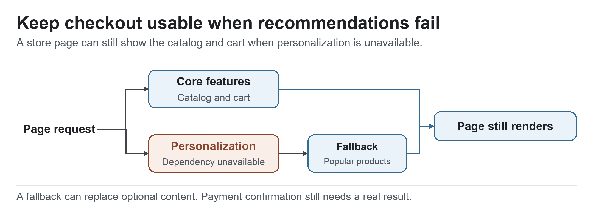

*The store replaces optional recommendations while preserving the core shopping flow.*

## Cache management

If a browser has cached `icon.png` at its existing URL, replacing the file on the server may become visible only once the cache entry expires or the browser revalidates it. On publish, you can put a version or content hash in the filename. The new HTML points to a new URL, and older HTML continues to work as long as its corresponding assets are available. You can use the same technique to change a server-side key namespace, for example from `products:v1` to `products:v2`. The new namespace fills on reads or during cache warm-up, and the old entries are removed according to their TTL or eviction policy. Changing the version across the system can cause a burst of requests to the backing store. [RFC 9111 on HTTP caching](https://www.rfc-editor.org/rfc/rfc9111.html)

**Tag-based invalidation** is useful when a single change affects several cached objects. A portal may cache news, exchange rates, and weather separately. When an exchange rate data source updates, you can remove entries tagged with the currency pair, including several versions of the same widget. Tags let you invalidate specific groups of keys. If related sections must show a strictly consistent snapshot, design a shared mechanism for versioning the data or assembling the response. Tag-based invalidation controls the freshness of the group. [Cloudflare documentation on purging cache entries by tag](https://developers.cloudflare.com/cache/how-to/purge-cache/purge-by-tags/)

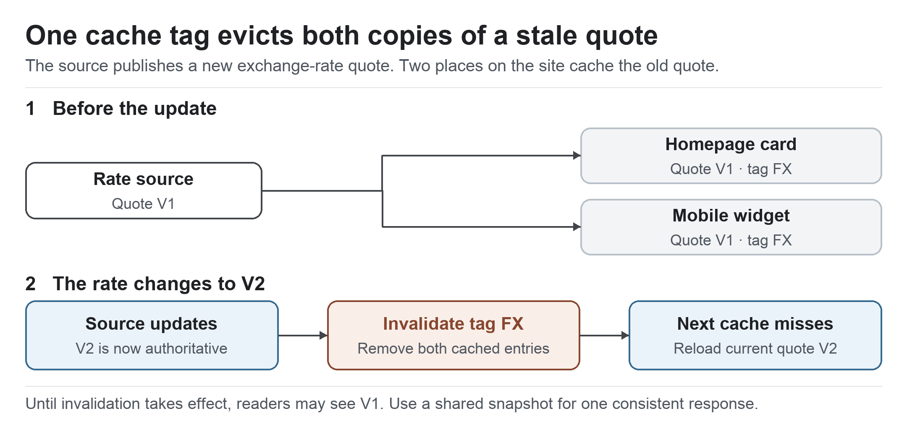

*A shared tag targets both caches. The entries can reload at different times.*

## Deferred processing

Video uploads can separate transferring the file from preparing it for playback. Once the original file is stored, the service accepts the job and returns a job ID. Workers take jobs from a queue and handle transcoding, preview generation, and checks. The user can close the page and check the status later. An asynchronous HTTP API can return `202 Accepted` with a link to a resource that shows progress. Transfer time depends on file size and connection speed. Processing time depends on the video's characteristics, the number of workers, and the work already queued. An estimate based on queue length should account for differences between jobs. [RFC 9110 on status code 202](https://www.rfc-editor.org/rfc/rfc9110.html#section-15.3.3), [Asynchronous request-reply in the Azure Architecture Center](https://learn.microsoft.com/en-us/azure/architecture/patterns/async-request-reply)

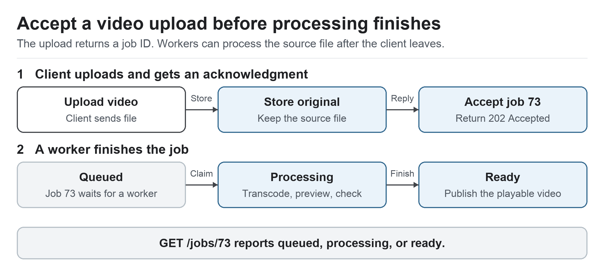

*The client gets an acknowledgment while transcoding and validation continue in a worker.*

### Polling, long polling, and streaming updates

If a page needs an up-to-date stock price, the browser can request it every three seconds. This kind of **polling** is simple, and the interval determines the trade-off between background request frequency and how current the display is. Updates in a messaging app arrive at irregular intervals, so many polls may return an empty result.

With **long polling**, the client sends an HTTP request, and the server holds it open until an event arrives or the request times out. After receiving a response, the client usually opens the next request immediately. To cover gaps between requests and recover from a disconnect, the client can send the ID of the last event it received. [RFC 6202 on long polling](https://www.rfc-editor.org/rfc/rfc6202.html)

For frequent updates, you can use a long-lived connection. With **WebSocket**, for example, both sides can send messages. The server sends a stock price update or delivers an incoming message as soon as it has it. When designing the system, account for the number of open connections, infrastructure timeouts, and how subscriptions recover after a disconnect. For a one-way stream from server to browser, **Server-Sent Events** are another option. [RFC 6455 on WebSocket](https://www.rfc-editor.org/rfc/rfc6455.html), [HTML standard on Server-Sent Events](https://html.spec.whatwg.org/multipage/server-sent-events.html)

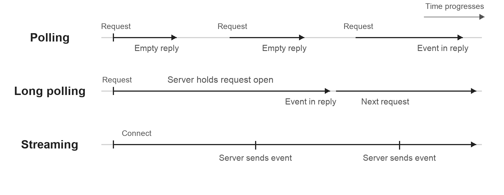

*Timelines showing how a client receives updates with polling, long polling, and streaming. Adapted from course slides 37–39.*

### Batch processing and MapReduce

Suppose you need to count word frequencies across a large collection of documents. In **MapReduce**, the `map` function reads chunks of the input and emits pairs such as `(word, 1)`. In the `shuffle` phase, the runtime distributes those pairs by key and groups the values for each word. The `reduce` function adds the ones to produce the total count. To find the most frequent words, a subsequent step collects the top `K` results by count. The runtime distributes tasks across nodes and reruns them after failures. Apache Hadoop implements this model. The approach lets you process a large amount of data in a single batch job. When estimating runtime, account for reading the data and moving intermediate results between nodes. [Google's original MapReduce paper](https://research.google/pubs/mapreduce-simplified-data-processing-on-large-clusters/), [Apache Hadoop MapReduce tutorial](https://hadoop.apache.org/docs/stable/hadoop-mapreduce-client/hadoop-mapreduce-client-core/MapReduceTutorial.html)

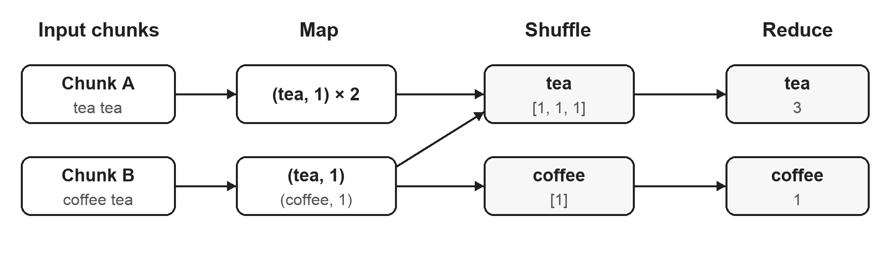

*The shuffle brings all counts for a word together before the reducer adds them. Adapted from course slide 41.*

## Service calls and events

An aggregator builds a response from several services. For a profile page, it might fetch user details, rating, and history in parallel where possible. Latency depends on the slowest required part. For optional sections, you can allow a partial response. A **Backend for Frontend**, or BFF, serves the needs of a particular client, such as a mobile app. It can aggregate data, convert it to a convenient format, and shape responses with the detail the client needs. Calls can also form a sequential chain. If the orders service calls the payments service before responding, the latency of each step counts against the overall request deadline. [Gateway Aggregation in the Azure Architecture Center](https://learn.microsoft.com/en-us/azure/architecture/patterns/gateway-aggregation), [Backends for Frontends in the Azure Architecture Center](https://learn.microsoft.com/en-us/azure/architecture/patterns/backends-for-frontends)

Ordering food takes longer than an HTTP request should remain open. The orders service can accept the order, give the client an ID, and return control to the user. The restaurant then confirms the order, the kitchen prepares it, and the system assigns a courier. The order history shows each stage. Events allow consumers to react to each completed step at their own pace.

An **event notification** is typically a small message announcing that something changed. It can include an order ID so the recipient can look up the details if needed. With **event-carried state transfer**, the event includes the fields that consumers need to update a local view. A delivery service, for example, can keep a copy of the details it needs to fulfill an order and save a synchronous call to the orders service. Each consumer needs to decide which data it needs and how to apply late or duplicate events. [Martin Fowler on event-driven patterns](https://martinfowler.com/articles/201701-event-driven.html)

At checkout, the cart service can publish `OrderRequested`. The orders service validates the request and publishes `OrderValidated`, after which the payments service attempts the charge. When it receives `PaymentProcessed`, the orders service records the outcome and publishes `OrderConfirmed`. A shared event bus can carry these events. Each service owns its local operation, and the sequence emerges from how services react to events. The bus becomes a shared dependency. You can deploy it with redundancy and track message backlog and age during failures. To trace the sequence, carry both the order ID and a correlation ID through every step.

## Two small systems

### Store recommendations

A service can continuously collect product views and purchases and recompute recommendations on a schedule. Events flow into a broker and then into an analytics store. Once a day, a batch job analyzes the events and writes prepared results to a serving store. An online request reads the prepared list by user ID. For a user with no history, it can show popular products. How often the recommendations are recomputed is a requirement. A daily snapshot can work for long-term interests. Responding to actions in the current session requires updating at least some features more frequently.

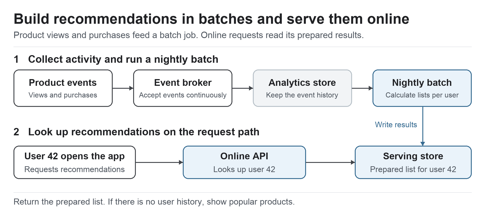

*The online API reads the list prepared by the batch job.*

### Query autocomplete

A **trie**, or prefix tree, works well for prefix suggestions. A path along its edges spells the start of a string. In a compressed trie, a path with no branches is stored as a single edge labeled with multiple characters. A node for a short, common prefix can have thousands of possible completions. Scanning them for every request is expensive. If the response is limited to, say, five suggestions, you can store a prepared list of the most popular completions at each prefix you serve. This uses more memory and speeds up reads.

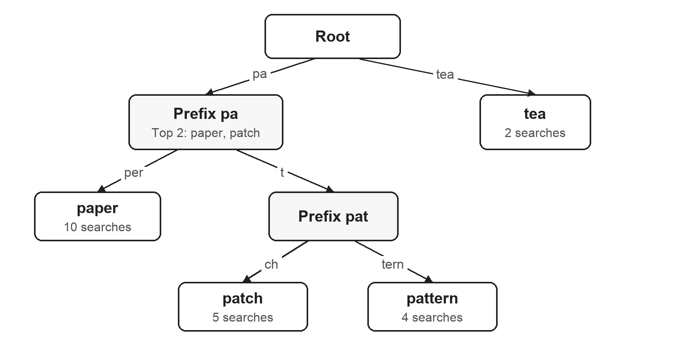

*A cached top-two list lets the service answer a request for the prefix pa without scanning the whole subtree. Adapted from course slide 58.*

You can count frequencies from completed searches and periodically build the trie outside the serving system. Multiple replicas load the snapshot into memory. To update it, you can roll out replicas with the new trie or load the new structure alongside the old one and atomically swap the root reference. With a swap, requests already reading from the old trie must retain safe access to it until they finish. During the replacement, there must be enough memory for both snapshots.

In the browser, **debouncing** delays a request until the user pauses typing for a short time, such as 100 ms. **Throttling** limits how often requests go out even if the user keeps typing. To handle out-of-order responses, check each response's prefix or request ID against the current input. That way, a response for "pa" arriving after the response for "pat" leaves the newer suggestions in place.

## Coordinating actions in a distributed system

Network delays, lost messages, and restarts force participants to agree on state with an incomplete picture of what's happening. In distributed **consensus**, nodes agree on a value such as the next entry in a replicated log. Atomic commit has its own requirements for a distributed transaction. The participants must agree on a single outcome, and every participant must be ready before the transaction can commit. [Jim Gray and Leslie Lamport, Consensus on Transaction Commit](https://arxiv.org/abs/cs/0408036)

### Two-phase commit

In **2PC**, a coordinator asks each participant to prepare its local transaction. Each participant performs the changes and durably records that it is prepared to commit them. In the second phase, the coordinator durably records the final decision and sends `COMMIT` or `ABORT`. The transaction can commit after every participant votes yes. If the commit decision has been saved and one participant has already applied it, the coordinator keeps sending the same decision after recovery. A prepared database that loses contact with the coordinator may keep holding locks while it waits for the decision. The decision log is part of the protocol's recovery mechanism. To include a database and a broker in the same 2PC transaction, both must support participation in that kind of transaction. The database system and data access protocol determine the isolation level. [PostgreSQL documentation on PREPARE TRANSACTION](https://www.postgresql.org/docs/current/sql-prepare-transaction.html), [Gray and Lamport on blocking in 2PC](https://arxiv.org/abs/cs/0408036)

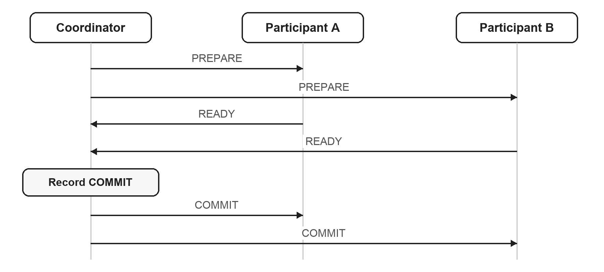

*On the successful path, all participants vote ready before the coordinator records and sends the commit decision. Adapted from course slide 64.*

### Saga

A **saga** runs a business operation as a series of local transactions. For example, the orders service records the `Pending` state and publishes an event. The customer service reserves part of the customer's limit and reports the result. Based on that result, the orders service confirms the order or runs a compensating transaction that cancels it. If the reservation went through, compensation may include a separate step to release it. Compensation itself can fail, so its ordering, ability to be retried, and recovery behavior are part of the design.

With **choreography**, participants subscribe to the events they need and trigger the next steps themselves. With **orchestration**, a dedicated component tracks the workflow and sends commands to the participants. In both cases, participants commit local changes at the end of each step, and a reader may see an order awaiting confirmation. The reader is seeing committed intermediate state. Explicit statuses help the user understand what's happening. Rules for reservations and state transitions protect against conflicting actions. [Saga in the Azure Architecture Center](https://learn.microsoft.com/en-us/azure/architecture/patterns/saga)

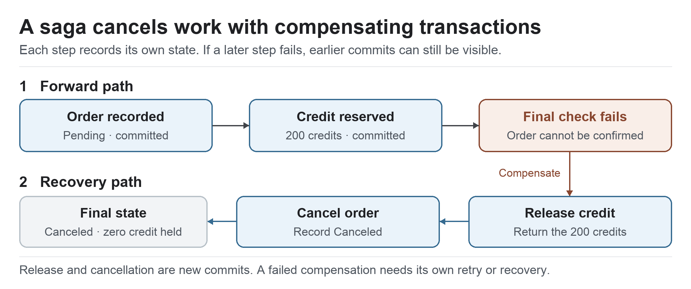

*The saga records compensation as new work after the reservation has committed.*

### Transactional outbox and inbox

Suppose you're extracting a discounts service from a monolith. You need to save each discount in the old database and notify the new service. With a **transactional outbox**, the application saves the discount and writes the event to an `outbox` table in the same local transaction. When it commits, the application can return the result to the client. A worker or a process that reads the change log then sends the event to the broker. If the broker is temporarily unavailable, the record remains in the database. If the worker crashes after publishing the event but before marking it as sent, the event may be sent again. The committed record durably captures the intent to publish. Delivery depends on the worker and broker recovering, and the handler must be able to recognize duplicates. [Transactional outbox in AWS Prescriptive Guidance](https://docs.aws.amazon.com/prescriptive-guidance/latest/cloud-design-patterns/transactional-outbox.html)

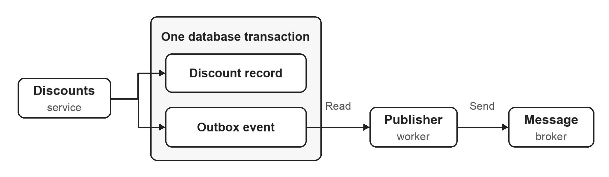

*The discount and its outbox event commit together. A separate worker publishes the event. Adapted from course slide 71.*

With a **transactional inbox**, the recipient stores the incoming message with a unique ID and acknowledges it to the broker after the write commits. A local worker processes stored jobs. Starting a virtual machine, for example, may take longer than the broker's acknowledgment deadline. The inbox decouples that deadline from processing and detects redelivery. For local data changes, you can update the processing status in the same transaction as the data. For an external action such as creating a virtual machine, you also need an idempotent operation or a way to check what actually happened after a failure. [Chris Richardson's Idempotent Consumer pattern](https://microservices.io/patterns/communication-style/idempotent-consumer.html)

### Distributed locks and leader election

Suppose only one worker at a time should process a given file. On a single Redis instance, a worker can try to acquire a lease with `SET lock:file:1 <token> NX PX 30000`. `NX` sets the key only if it does not already exist, and `PX` sets the expiration time in milliseconds. Of two simultaneous attempts using the same key, one succeeds. The other worker can try again later. The value must be unique to each acquisition attempt. To release the lock, compare the value and delete the key in a single atomic operation. Otherwise, a delayed request from the first owner could delete the new lock. [Redis documentation on distributed locks](https://redis.io/docs/latest/develop/clients/patterns/distributed-locks/)

A separate problem arises when a worker pauses for a long time. Its lease may expire during the pause, and it can still send a write request when it resumes. For a critical operation, the storage system can check a **fencing token**, a monotonically increasing number assigned to each acquisition. Once the storage system has seen a write with a newer number, it rejects subsequent requests with older numbers. The unique random token in the Redis example identifies the owner when releasing the lock. Rejecting delayed operations requires tokens with a verifiable order of issuance. [Martin Kleppmann on distributed locks and fencing](https://martin.kleppmann.com/2016/02/08/how-to-do-distributed-locking.html)

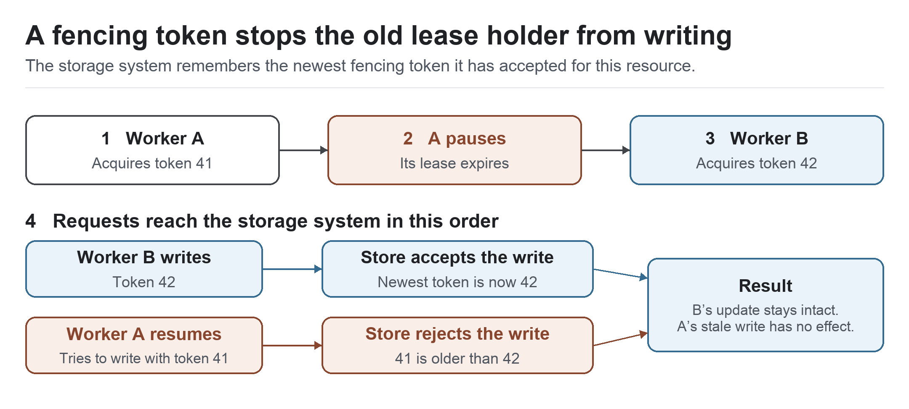

*Storage rejects the delayed write after it has accepted a newer fencing token.*

Leader election with **etcd** can work on a similar principle. A node attaches the leadership key to a lease and renews it regularly. To acquire leadership, it can run a transaction that checks whether the key is available or use the dedicated election API. If the lease expires, etcd deletes the attached key. Waiting participants can discover this through a watch and resume the election. The application must handle loss of leadership and protect external writes against delayed commands from the former leader. [etcd documentation on the election API](https://etcd.io/docs/v3.5/dev-guide/api_concurrency_reference_v3/), [etcd documentation on transactions and leases](https://etcd.io/docs/v3.5/learning/api/)

In the **Bully** algorithm, nodes have different priorities. A node that suspects the leader has failed starts an election and contacts nodes with higher priority. The nodes that respond carry on with the election. A participant that gets no responses from higher-priority nodes declares itself the leader. If the node ranked 5 fails, the node ranked 4 may become the new leader. The algorithm relies on assumptions about failure detection and the network. In a network partition, a simplified implementation can elect separate leaders in different partitions. [Hector Garcia-Molina, Elections in a Distributed Computing System](https://homepage.divms.uiowa.edu/~ghosh/Bully.pdf)

**Raft** and **Paxos** solve the consensus problem under certain failure assumptions. In Raft, a node becomes leader for a *term* if it receives a majority of votes. The voting rules take into account how up to date the candidate's log is. The leader replicates the log, and advancing the commit point for new entries in its term requires a majority. In a five-node cluster, three nodes can reach agreement as long as they can communicate. The other two need connectivity restored before they can make progress. Classic Paxos agrees on a value through intersecting quorums. Running repeated rounds of agreement lets you build a replicated log. [Raft paper](https://raft.github.io/raft.pdf), [Interactive Raft visualization](https://raft.github.io/raftscope/index.html), [Leslie Lamport, Paxos Made Simple](https://lamport.azurewebsites.net/pubs/paxos-simple.pdf)

## Requirements for a hypothetical messaging app

"Build a messaging app like WhatsApp" gives you a direction. To design it, you need to identify what belongs in the first release and which service qualities matter. Functional requirements describe available actions and observable behavior. Nonfunctional requirements cover availability, latency, and security goals, as well as limits on data volume and retention. Write down the scope and numerical assumptions so you can refer to them when choosing the architecture.

Our example includes one-on-one and group chats, text messages, read receipts, notifications, online status, and last-seen timestamps. Users can open the history for a conversation. The chat list is sorted by most recent activity. Clients run in the browser, on Android, and on iOS. Media attachments, message forwarding, and editing can wait until a later release. Decide separately how users find one another and which authentication flows the app needs to support.

For a rough estimate, assume 100 million **DAU** (*daily active users*), a limit of 1,000 characters per message, and up to 1,000 participants per group. DAU counts unique active users in a day, and MAU counts them in a month. Define which action counts as activity in advance. In this example, each active user sends an average of two messages and makes ten read requests per day. We'll start with countries in the Commonwealth of Independent States (CIS). If the business has provided only a growth forecast, agree on an initial load and potential growth scenarios. If you're integrating with a known source of traffic, you can use the expected requests per second directly.

"A message should appear within five seconds" becomes testable once you choose when the clock starts and stops and what share of deliveries must meet the target. For example, measure the time from the server accepting the message to a connected recipient receiving it, and target delivery within five seconds for 99% of those messages. Define a separate flow for offline recipients. An availability target of 99.95% also needs a clear denominator and measurement period. If you measure the share of successful requests over a month, 0.05% of requests can fail. For time-based availability measured continuously, the same fraction amounts to 21.6 minutes of downtime in 30 days. Agree on a target based on how failures affect users and what it costs to achieve the target. [Google SRE on service level indicators and objectives](https://sre.google/sre-book/service-level-objectives/)

Some details emerge after the initial sketch. In a messaging app, group message ordering, recovery after a disconnect, and the number of simultaneous client connections all affect the architecture. You can refine these questions as you design. **EventStorming** is a collaborative format for modeling a domain through events. Routine conversations with stakeholders also help establish the scope. [Alberto Brandolini on EventStorming](https://www.eventstorming.com/)

## Estimating load and capacity

### Reads and writes

There are 86,400 seconds in a day. To calculate average RPS (*requests per second*), multiply the daily active user count by the number of operations per user, then divide by the number of seconds in a day. In this example, one write request creates one message, and one read is one request for message history.

| Operation | Daily volume | Average load |
|---|---:|---:|
| Reads | 100 million × 10 = 1 billion requests | 11,574 requests/s |
| Writes | 100 million × 2 = 200 million messages | 2,315 requests/s |

The average gives you a sense of scale. You also need the peak to size the system. Peak load depends on where users are across time zones, evening activity, major events, and bursts of reconnects after a failure. These RPS figures describe two external operations. A write to a large group may trigger many notifications, and a single history request may return a whole page of messages. Estimate internal requests, outbound traffic, and the load from presence updates separately.

### Traffic, retention, and replication

Assume a payload of 2,000 bytes per message. In UTF-8, a code point takes one to four bytes, and a visible character can consist of multiple code points. A limit of 1,000 characters still leaves the size in bytes variable. For a production estimate, use the average encoded size from a sample and add IDs, timestamps, and metadata. We use decimal units here, so 1 MB equals 1,000,000 bytes. [Unicode Consortium on UTF-8](https://www.unicode.org/faq/utf_bom.html), [Unicode Consortium on counting characters](https://www.unicode.org/faq/char_combmark.html)

| Metric | Approximate volume |
|---|---:|
| Write payload per second | 4.63 MB |
| New messages per day | 400 GB |
| New messages per year, 365 days | 146 TB |
| New messages over two years | 292 TB |
| Same data with two copies | 584 TB |

If you retain messages indefinitely, use two years as the initial planning horizon for hardware purchases or cloud capacity. After that, the volume continues to grow. This estimate covers only the payload. You also need to account for indexes, database overhead, compression, the write log, free space for maintenance, and separate backup capacity. Replicas help the system survive some failures. Backups let you recover from incidents such as an accidental deletion that has already propagated to the replicas.

### Choosing drives and a shard count

At 6 TB per drive, a single 292 TB copy would take at least 49 drives. In this example, each copy of a shard gets eight drives, so each shard can hold 48 TB per copy. With an even distribution, that works out to `ceil(292 / 48) = 7` shards. Two copies of each shard require 14 shard placements and 112 drives. This configuration is based on capacity alone. Account for failure domains when placing replicas, skew in data and load when sharding, and headroom for failures and recovery when sizing the cluster. Larger drives change the calculation. Several shards can share a host if the resources and isolation requirements allow it.

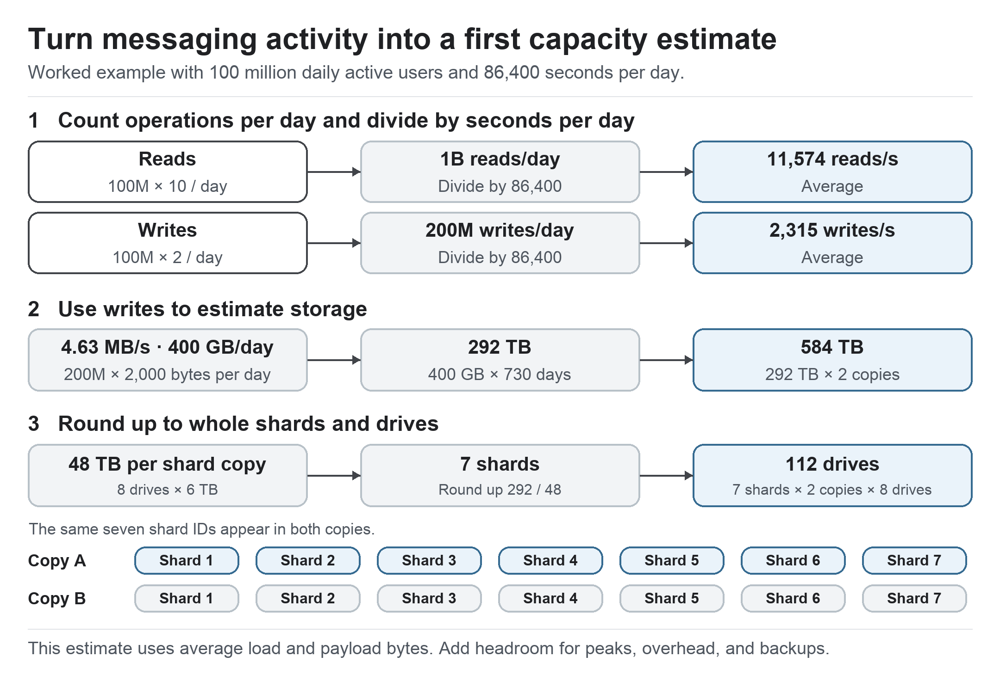

*The worked example connects usage, daily write volume, retention, and replicated drive count.*

Average megabytes per second give you one measure of storage load. For random reads and writes, **IOPS** (*input/output operations per second*) and per-operation latency also matter. For hard drives, the time it takes to move the head and wait for the platter to rotate is especially noticeable during random access. Buffering and batching can turn some reads and writes into more sequential operations. You can keep older, rarely accessed history on cheaper storage as long as retrieval latency is acceptable. The choice among hard drives, SSDs, and cold storage depends on the actual requests and latency targets. [Amazon EBS documentation on storage volume types](https://docs.aws.amazon.com/ebs/latest/userguide/ebs-volume-types.html)

Before buying hardware, test a prototype against realistic data and requests. Measure RPS, high-percentile latencies, IOPS, memory and CPU usage, and behavior during replica lag or failure. The RPS that PostgreSQL, MySQL, or any other data store can sustain depends on the workload and configuration. On one project, increasing the number of trace collectors raised the insert rate in ClickHouse. Increasing the batch size from 60,000 to 100,000 spans reduced the insert rate in that setup. For a different stream, choose a batch size based on delivery latency and buffer memory. [ClickHouse guidance on bulk inserts](https://clickhouse.com/docs/optimize/bulk-inserts)

## Practice

Work with a partner to design a small subsystem, such as recommendations or autocomplete. One person explains their design during the first half of the session, and the other presents during the second half. For an initial sketch, show where the data comes from, where it is processed, and how the system builds a response. If you're stuck, start with a simple design and talk through what happens when traffic grows or a component fails. On a team, it also helps to review the design with colleagues who know different parts of the system.

For an individual exercise, use the social network model from Lesson 1. Record the functional and nonfunctional requirements and your assumptions in the README. Estimate the size of the message database, the incoming traffic from post creation, the average and peak RPS for reading and writing posts, and the drive capacity needed to retain five years of messages and posts. Use dated audience statistics or an agreed growth scenario to estimate audience size. Include the time period, units, and copy count so someone can recalculate the results when the assumptions change.
