# Lesson 5. Social Feeds and Ride-Hailing

Consider two system design exercises. On a social network, people read feeds much more often than they publish, and a single author can have a very large following. In a ride-hailing service, frequent location updates generate most of the load, while assigning a driver requires a consistent state change. For each system, we will identify the main scenarios and estimate traffic, then trace how data and requests flow and what happens during a failure.

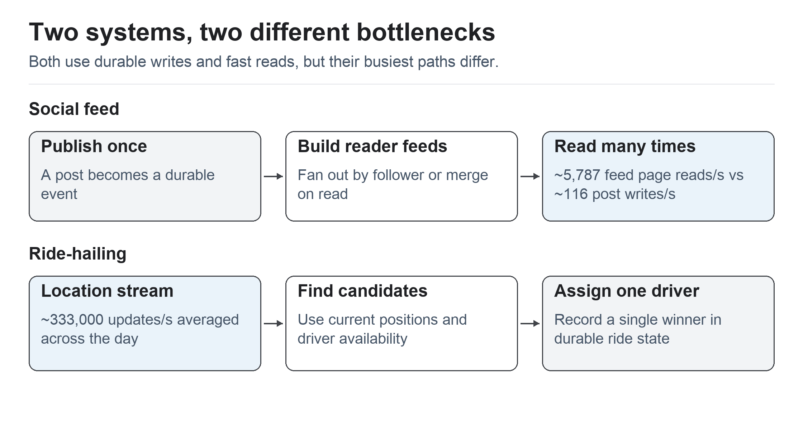

*The two systems differ in load and in the state they must protect.*

## A social network feed

### Requirements and workload estimates

Users can publish posts with text and images, open an author's page, read a home feed based on whom they follow, like posts, and write comments. Posts appear in reverse chronological order. The feed only needs to show counts for likes and comments. The comments themselves and the list of people who reacted are loaded separately, one page at a time.

Assume 50 million daily active users for this exercise. On average, each person publishes one post every five days and opens a feed page ten times per day. These assumptions give us the order of magnitude.

| Operation | Daily volume | Average rate |
| --- | ---: | ---: |
| Publish a post | 50 million ÷ 5 = 10 million | About 116 requests/s |
| Read a feed page | 50 million × 10 = 500 million | About 5,787 requests/s |
| Like a post, assuming an average of five likes per page | 500 million × 5 = 2.5 billion | About 28,935 operations/s |

Five likes per page is a workload scenario. For capacity planning, use the observed reaction rate or run the numbers for several scenarios. Estimate comments separately. At one comment per user every five days, the system would receive about 116 new comments per second. Time of day, viral posts, and the share of active users in each region all affect peak load. Daily averages give you the scale, and peaks determine how much headroom you need.

At an assumed 4 KB of metadata per post, publishing generates about 0.46 MB/s and 40 GB/day before indexes, replicas, or internal overhead. Account for photos and videos separately. If a page contains ten posts at 4 KB each, reads send about 231 MB/s of metadata on average before compression, also excluding attachments. Check byte sizes against real records. UTF-8 text varies in size with the characters it contains, and protocols and metadata add overhead.

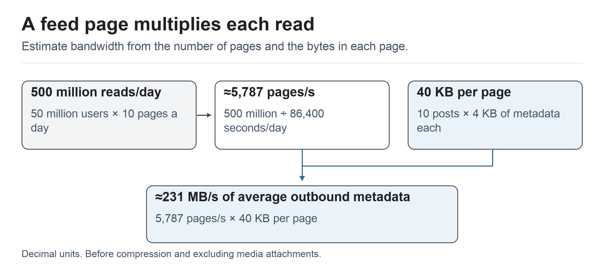

*Page rate and page size together determine bandwidth.*

### Publishing a post with attachments

Web and mobile clients reach the API through a load balancer. The gateway checks credentials, shields clients from the internal topology, and applies rate limits. The post service owns publications, the relationship service owns follows, and the media service manages uploads and access to objects. These boundaries make the architecture easier to read and clarify who owns each operation.

An image upload can start before the post is published. The client asks the media service for permission and a temporary object key, then sends bytes directly to object storage using a short-lived presigned URL. When creating the post, it submits the text and IDs of the completed attachments. The server verifies that the objects were uploaded, belong to the author, and passed the necessary checks. Sending large files directly reduces load on the API gateway. [Amazon S3, uploading with presigned URLs](https://docs.aws.amazon.com/AmazonS3/latest/userguide/using-presigned-url.html)

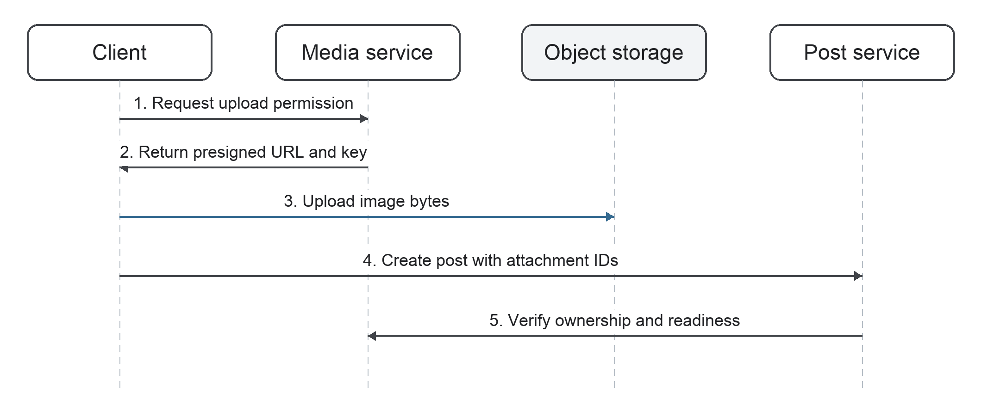

*The client uploads directly to object storage. When the client publishes the post, the post service checks the attachment IDs.*

If the user abandons a draft, its uploaded image remains in storage. One option is to use a staging area with limited retention and move confirmed objects to permanent storage. Another is to track attachment state and remove only unconfirmed objects that have expired. In both cases, coordinate cleanup with publication. If an attachment is still being moved, keep the post pending until the move finishes or publish it only once the attachment is confirmed ready. Otherwise, cleanup could delete a file that a published post still uses. Serve public images through a CDN where appropriate, and check whether the reader can view a private attachment before issuing a URL for it.

The post service stores posts in PostgreSQL. An index on `(author_id, created_at, post_id)` helps retrieve an author's history. The post ID breaks ties when timestamps match. In the same transaction, the service writes a publication event to an outbox table. A separate process forwards the event to Kafka. This closes the failure window between committing the post and recording the intent to notify the feed service. The publisher might send an event again after a failure, so the feed consumer uses the post or event ID to update the feed idempotently. [AWS Prescriptive Guidance, Transactional outbox](https://docs.aws.amazon.com/prescriptive-guidance/latest/cloud-design-patterns/transactional-outbox.html)

### Reading and updating the feed

An author's page shows posts by one person. A home feed brings together posts from the people a reader follows. To build a home feed on read, the service queries the follow list, gets recent posts for those authors, and merges them by time. This approach is straightforward to start with and produces a fresh result. As the follow list grows, the service needs more lookups and may take longer to respond.

With **fan-out on write**, a worker reads the publication event from Kafka, looks up the author's followers, and adds the post ID to their precomputed feeds. It also updates the author's own list of recent posts. A home feed request reads the prepared IDs, fetches the corresponding posts in batches, and filters out any that the reader can no longer access. An in-memory store such as Tarantool or Redis can hold the first page or several pages of recent posts. Use scroll depth, cache hit rate, and entry size to choose an initial list length. A bounded queue can work when updates arrive in order. If events may be delayed or arrive out of order, order entries by timestamp and post key and deduplicate them.

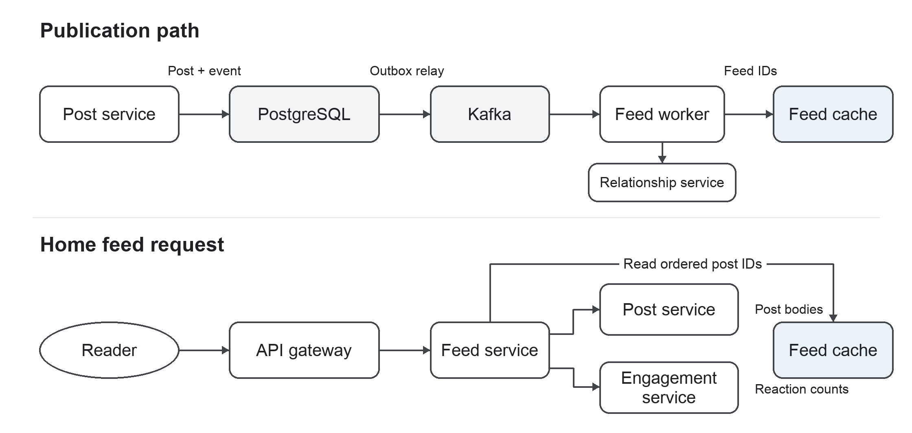

*Publication builds the feed index asynchronously. Reads fetch ordered IDs, then retrieve posts and reaction counts. Adapted from the course whiteboard at 00:57:40.*

Keeping ten full records of 2 KB each for all 50 million users takes about 1 TB of payload for one kind of feed, or about 2 TB for both, before replicas and metadata. If an entry uses 16 bytes for identifiers and ordering information, the same ten entries take roughly 8 GB per feed type before overhead. Post text can be stored separately and reused. Full records make cache hits faster to serve. An ID list cuts duplication and makes edits easier. Measure the entry size and data structure overhead in the store you plan to use.

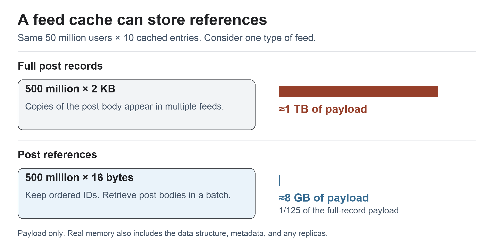

*Storing references saves payload space and requires a second lookup for post content.*

Later pages need a cursor. For an author's page, it holds the pair `(created_at, post_id)`. For the home feed, it must also work across the merged sources. The first request sets an upper bound, and later pages continue from the last item. If a feed is empty because the cache is cold, the service can build it from source data or enqueue a rebuild. Limit that work so a mass cache restart does not overload the database. Previously generated feeds must also respect private profiles, deleted posts, and unfollows.

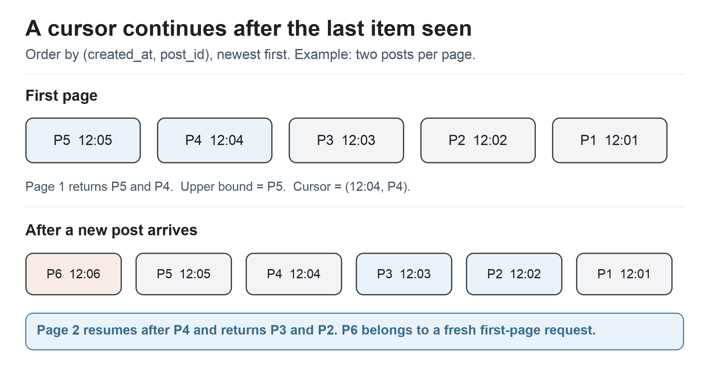

*The cursor records the last item seen and keeps later pages anchored.*

### Popular authors and overload

A single post from an author with one million followers can trigger up to one million feed updates under full fan-out. The initial publication is small, and the write amplification happens afterward. For authors with large audiences, keep a separate author feed and add relevant posts at read time. Continue to fan out posts by other authors when they publish. The home feed merges the precomputed entries with posts from high-follower accounts and returns one sorted page.

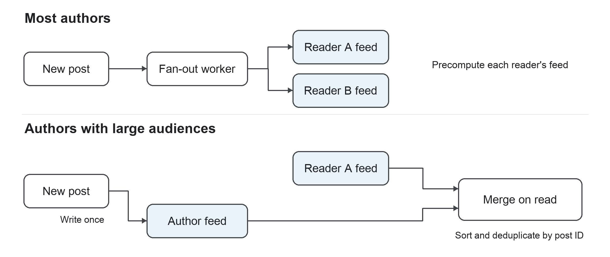

*For an author with a large audience, record the post in the author feed and merge it into the reader’s feed at read time.*

The lesson used 5,000–10,000 followers as a starting hypothesis for this threshold. The right value depends on the share of active followers, posting frequency, the cost of background writes, and how long reads may take. When switching an author between modes, allow readers to retrieve the same posts safely through both paths and merge by ID during the transition. Splitting the recipient list into batches can further distribute the workload from a popular author.

Partitioning Kafka by author key preserves record order within a partition as long as the key maps consistently to that partition. Different partitions can be processed in parallel. One large task can still create a backlog if one consumer handles it from start to finish. In that case, separate publication from delivery to batches of recipients. Monitor consumer lag, the time from publication to feed visibility, and queue depth. [Apache Kafka documentation, Design](https://kafka.apache.org/41/design/design/)

### Reactions, comments, and counts

The engagement service owns reactions and comments. Store a like with the key `(post_id, user_id)` so a repeated request cannot create a second entry. A comment has its own ID and references the post and author. The feed service requests counts for several post IDs in one call. A separate cursor-based endpoint returns the comments or the people who liked a post. This lets each reaction update its own data without rebuilding the whole feed.

To keep a count exact, update it in the same transaction as the corresponding record. For a very popular post, this can cause contention on one row. If the product permits a delay, a worker can update the aggregate in batches or combine partial counts on read. A user may then see a new comment in the list before the count above it changes. A TTL or periodic reconciliation limits the time the counts can remain out of sync. Keep the authoritative comment record in a transactional model. An analytics store is useful if you need to analyze reaction trends and user activity over time.

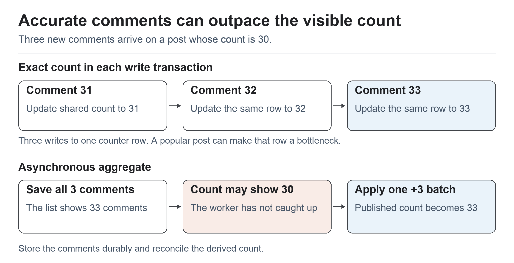

*The comment list can be up to date before the displayed count catches up.*

### Sharding and operating across regions

Choose a shard key based on the main queries. If you shard posts by `author_id`, one shard typically serves an author's history. Sharding by `post_id` keeps direct lookups by ID simple, but retrieving an author's history needs a secondary index or queries across multiple shards. Home feeds fit naturally on shards keyed by reader ID, and reactions and comments fit on shards keyed by post ID. A single popular post can create a hot shard even when posts are distributed evenly overall.

Suppose users are located in central and eastern regions. DNS or a global load balancer directs them to a nearby region that is available. A CDN serves attachments from a nearby point of presence. Each reader's region needs access to posts and publication events, even for authors in another region. You can keep precomputed home feeds in users' primary regions if another region can rebuild them from posts, follows, and events. Assess the cost of rebuilding under load separately.

With synchronous cross-region replication, commits that require a remote acknowledgment must wait for it. This increases write latency and may stall writes if the remote region is unavailable. Asynchronous replication acknowledges writes sooner, while some acknowledged writes may still be missing after failover. If a local queue acknowledges a write before the second region receives it, that acknowledgment alone provides no guarantee that the write will survive the loss of the local region. Posts, comments, and derived counts can have different latency and data-loss requirements. Accepting concurrent writes across regions also requires rules for data ownership and conflict resolution. [PostgreSQL documentation, Synchronous Replication](https://www.postgresql.org/docs/current/warm-standby.html#SYNCHRONOUS-REPLICATION)

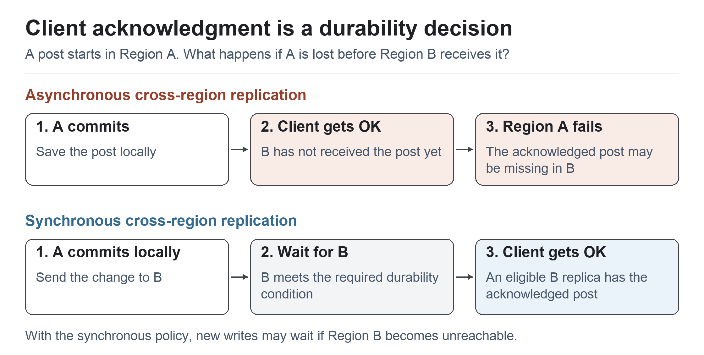

*The acknowledgment policy trades write latency for a stronger durability guarantee.*

## Ride-hailing service

### User flows and workload estimates

Passengers request rides, wait for a driver to be assigned, track the ride, and later view their ride history. Drivers start and end shifts, send location updates, and accept or decline offers. A short delay in the map position is acceptable. Assignment must prevent two drivers from being assigned to one ride and prevent a driver from being assigned to overlapping rides.

The exercise assumes 100 million passengers per day, one ride per passenger on average, and 5 million daily active drivers. If each ride lasts 30 minutes and a driver handles 20 rides per day, that driver would spend 10 hours on rides alone. These assumptions need to be reconciled with an eight-hour shift. At half an hour per ride, the theoretical limit over eight hours is 16 rides per driver, assuming no idle time or time spent driving to pickups. The 100 million passenger requests therefore estimate demand, while driver supply needs its own calculation.

During an eight-hour shift, a driver sends their location every five seconds. That gives `8 × 3,600 ÷ 5 = 5,760` updates per shift. For 5 million such shifts, the total is 28.8 billion updates per day, or about 333,000 updates per second on average. If all five million drivers are online at once, the rate reaches one million per second. At the assumed demand, ride requests average about 1,157 per second. Estimate traffic for a particularly busy city, events per ride, and open connections separately. If the assignment target is one minute, specify the fraction of ride requests that must meet it and what the service returns when no driver is available.

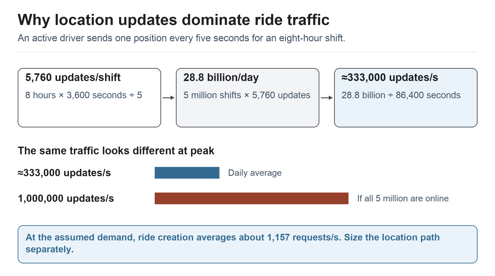

*Location ingestion needs its own capacity estimate apart from ride creation.*

### Location service and candidate search

The driver's client sends `driver_id`, coordinates, and a timestamp or update sequence number. The location service stores the latest accepted position, shift status, and an index of available drivers. A fast store is sufficient for live coordinates because the phone can send them again. The service must prevent delayed updates from overwriting newer positions. Use a timestamp or TTL to exclude a driver if their location has gone stale.

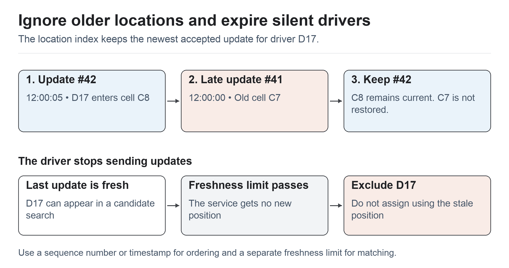

*Order location updates and check freshness before matching.*

Geohash encodes a geographic position as a string. A prefix identifies a cell, and a longer string gives finer bounds. The physical width of a cell varies by latitude. The spatial index can keep a set of drivers for each cell and a separate mapping, `driver_id → latest position and cell`. When a driver moves to a neighboring cell, remove the old index entry and add the new one. If the move crosses shards, verify each candidate against the latest position and version so that a temporary duplicate or gap does not produce an invalid assignment. [PostGIS, ST_GeoHash](https://postgis.net/docs/ST_GeoHash.html)

For a ride request, the matching service queries drivers in the pickup cell and in neighboring cells within the search radius. The closest car may be a few meters away on the other side of a cell boundary. The spatial index quickly yields a short list, which the service ranks by distance or estimated pickup time. Index available drivers separately from those who are busy. Check the candidate again at assignment time because location or availability may have changed since the lookup.

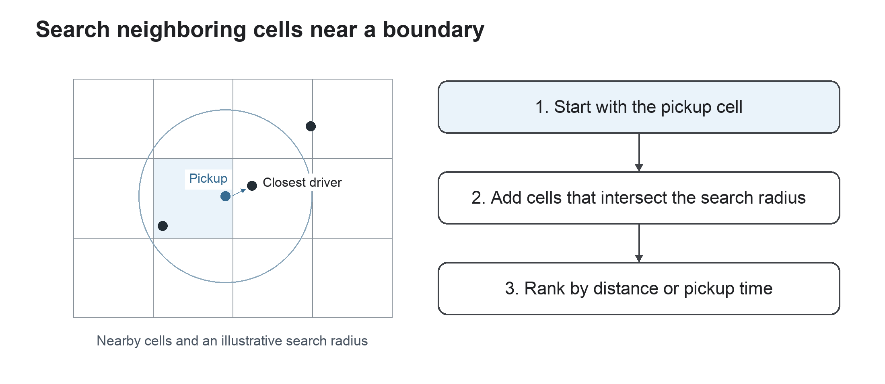

*Search the neighboring cells before ranking candidates. The closest driver can fall outside the pickup cell. Adapted from the course whiteboard at 01:21:30.*

Geographic sharding reduces the number of queries that cross shards. Searches near a boundary may still need to read several adjacent shards, and dense neighborhoods may require a finer split. Active rides can be sharded by ride request ID. The next step depends mainly on that ride's state, with driver coordinates handled by the separate location service.

### Creating a ride request and assigning a driver

The load balancer routes passengers and drivers to APIs with permissions for their respective roles. When a passenger requests a ride, the booking service records the request ID, pickup and destination, and the `searching` status, then starts matching. It can return the creation response immediately and send the matching outcome later. Retrying with the same idempotency key should return the existing request even if the first response was lost.

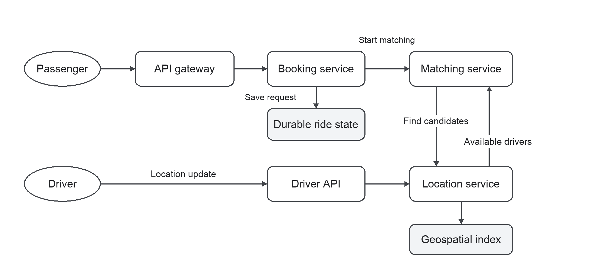

*The booking service records the request before matching. The matching service queries the current locations of available drivers. Adapted from the course whiteboard at 01:37:15.*

The matching service finds candidates and sends offers. The lesson considered sending up to ten offers in sequence, with each driver given five seconds to respond. That allows up to 50 seconds of waiting and leaves about ten seconds for search, networking, and recording the assignment. The sequential approach is easier to explain to drivers because only one driver has an active offer at a time. Sending a limited number of offers in parallel reduces waiting when responses are infrequent, but several drivers may accept almost simultaneously. Either way, acceptance requires an atomic transition from `searching` to `assigned`. Check that the driver is available in the same authoritative operation or reserve the driver explicitly. Reject responses to expired offers using the offer ID and expiration time.

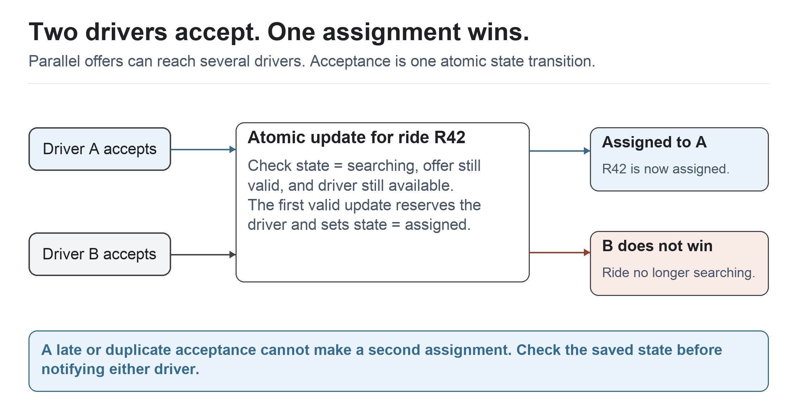

*The saved state decides which driver wins.*

Matching needs to survive the loss of a process. Keep the current status, offers already made, the deadline, and the outcome in durable storage. Another worker can resume from that record after a failure. Use the same attempt ID while resolving an offer with an unknown outcome, including when deciding whether to retry it or move on to the next candidate. Respond to the passenger based on the recorded outcome. Locks, conditional updates, or transactions protect the state. A notification reports the transition once it has happened.

### Ride progress, history, and event delivery

After assignment, the ride service moves the ride through states such as `assigned`, `arriving`, `in_progress`, `completed`, and `cancelled`. To recover after a failure, store the ride request and driver IDs, pickup and destination, status, version, and a route reference if needed. Current coordinates still come from the location service. Completed rides are read from the history store by user and time. ClickHouse can analyze large batches of events, while a transactional store holds the authoritative status of active rides and changes requested by users.

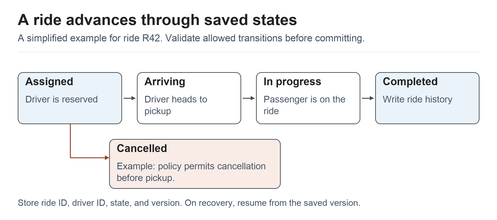

*Store the state and its version so another worker can resume the ride after failure.*

The notification service sends offers to drivers and informs passengers of assignment, arrival, and completion. A persistent WebSocket reduces polling and supports updates in both directions. A driver can accept an offer through an API call or over the same connection, with the same server-side checks. On connection, the service authenticates the client and binds the socket to that user. In a distributed setup, routing can use a registry that maps `user_id → notification service instance` or a broker with subscriptions for individual instances. Broadcasting to all instances is easier to implement and increases internal traffic as more instances are added. [RFC 6455, The WebSocket Protocol](https://www.rfc-editor.org/rfc/rfc6455.html)

If a WebSocket connection drops, the client reconnects and fetches the current status or the events after the last one it received. It can skip older location updates and use the latest coordinates. If a notification fails to arrive, the client must be able to recover the assignment or cancellation from stored state. After a location service node fails, new updates gradually repopulate the index. Replication shortens the period when matching is unavailable, and version checks and TTLs help prevent assignments based on stale locations. Tarantool's in-memory engine can recover from snapshots and a write-ahead log (WAL) when persistence is configured. The guarantees depend on that configuration. [Tarantool, storing data with memtx](https://www.tarantool.io/docs/tarantool/en/3_x/platform/engines/memtx)

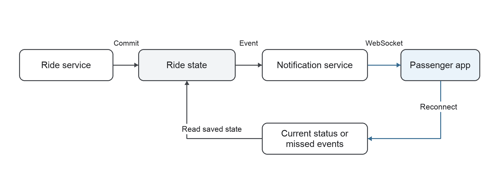

*A WebSocket delivers live notifications. On reconnect, the client fetches the current ride status or missed events from the server.*

### Validating the estimates

For the feed, measure how long a new post takes to appear, first-page latency, cache miss rate, and system behavior when an author with a large audience posts. For ride-hailing, measure peak location-update traffic, candidate search latency in a busy city, time to assignment, and how many clients reconnect successfully after a failure. Load tests should include bursts and temporary dependency outages. Observe where queues build up and what share of requests miss their deadline. The daily estimates help size the first test environment and choose scenarios to exercise.

## Exercise

Use the social network API from Lesson 1 as the basis for an architecture proposal. Document the use cases, availability and freshness requirements, and input assumptions. Calculate peak load separately. Show the sequence for publishing a post with media, assembling a feed page, updating reactions, and recovering from a cache failure.

In the C4 model, a system context diagram shows the users, external systems, and system boundary. A container diagram shows the applications and data stores. Component and code diagrams add detail where needed. For post publication, a sequence diagram can show when the post and event are committed and when the reader sees the update. With the Structurizr DSL, you can describe the elements and relationships in text and keep the model alongside the requirements, calculations, and README. [C4 model, diagram types](https://c4model.com/diagrams), [Structurizr DSL documentation](https://docs.structurizr.com/dsl)

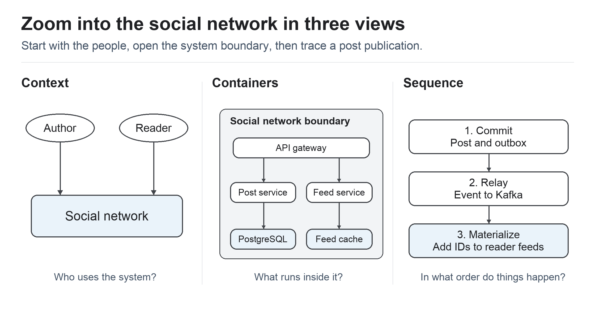

*The context, container, and sequence views answer different architecture questions.*
