# Lesson 6. File Storage and Hotel Reservations

In this lesson, we’ll design a file service inspired by Google Drive and a hotel reservation service inspired by Booking.com. Both are exercises with their own requirements and scale. Most of the load on the file service comes from transferring and storing bytes. In the reservation service, the most consequential operation uses relatively few resources. The system must guarantee that two guests never receive confirmation for the last room on the same dates.

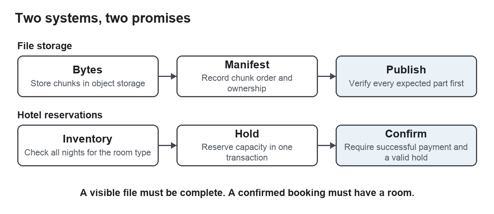

*The file workflow protects completeness. The reservation workflow protects availability.*

## File storage

### Requirements and traffic estimates

Users can create folders and upload, download, and delete files. The service needs high availability. The exercise assumes a single geographic region and no seasonal peaks. We’ll support files up to 100 GB. For our estimates, assume 50 million daily active users, each storing an average of 100 files at 1 MB apiece and performing six operations a day.

As a first approximation, assume each user uploads three files and downloads three files per day. That works out to `50 million × 3 / 86,400 ≈ 1,736` files per second in each direction. At an average of 1 MB per operation, that’s about 1.74 GB/s, or 13.9 Gbps, each way. If some of the six operations are deletions, they add load to the metadata database and garbage collector. An API request to delete a file carries none of the file’s bytes.

Until we have statistics on actual uploads and downloads, we can estimate traffic using the average size of a stored file. At 10 MB per operation, traffic would be roughly ten times higher at the same request rate. A 100 GB file takes time to transfer. To estimate peak connections and concurrent uploads, we need to know the distribution of file sizes, clients’ connection speeds, and how traffic varies over the day.

These numbers shape the load balancer’s role. NGINX or another load balancer can handle folder requests and upload management. Passing the file through each intermediary adds network traffic and consumes resources at every hop. After checking permissions, the service can issue short-lived presigned URLs to upload or download specific objects. The bytes then travel directly between the client and object storage, while the application server manages the session, verifies parts, and publishes the file. [Amazon S3 documentation on presigned URLs](https://docs.aws.amazon.com/AmazonS3/latest/userguide/using-presigned-url.html)

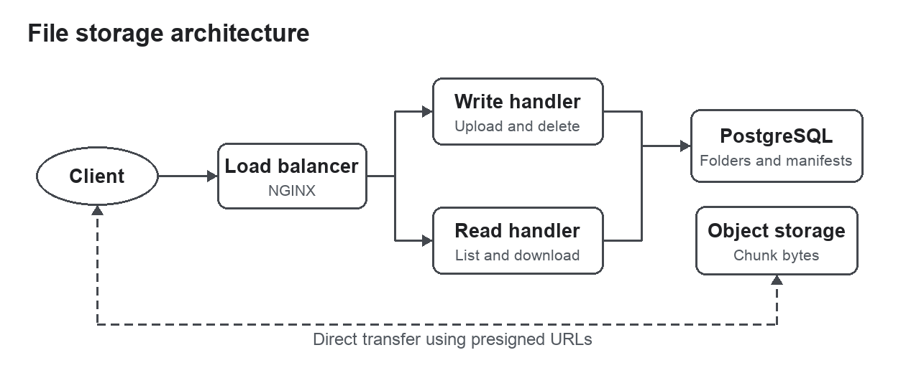

*Adapted from the course whiteboard at 00:58:30. The dashed connection shows the direct transfer option described in this lesson.*

### Files, folders, and chunks

We’ll store the bytes and metadata separately. File chunks go in an object store with an S3-like API. PostgreSQL holds the folder tree, file ownership, and the list of chunks that make up each file. A `FileEntry` has an ID, an owner, a parent folder, a name, an entry type, and a state. File entries also carry a size. Each user can have a dedicated root folder. To list a folder’s contents, query by owner and `parent_id`. The same name can appear in different folders, so `file_id` serves as the stable identifier.

Splitting files into chunks lets us transfer multiple parts in parallel, distribute them across storage when needed, and resume an upload after a connection drops. If 50 GB of a 100 GB file has already been transferred, the client retries only the parts the server hasn’t accepted. For typical files in this exercise, we can evaluate a chunk size of about 1 MB. A 100 GB file would then contain 100,000 parts, each adding an object, requests, and a record in the metadata database. Choose a chunk size based on these costs, how often connections drop, the level of parallelism, and the sizes of the files. A fixed size simplifies offset validation and deduplication. Larger chunks reduce the number of operations for large files. In this design, each application chunk is a separate object. Uploading a single object through Amazon S3’s native multipart upload allows up to 10,000 parts, each at least 5 MiB except the final part. [Amazon S3 multipart upload limits](https://docs.aws.amazon.com/AmazonS3/latest/userguide/qfacts.html)

The `FileChunk` table associates a file with a chunk’s position, object ID, and, when needed, length or byte offset. The key `(file_id, chunk_index)` lets the same chunk appear at multiple positions in a file. A composite key based on the file and hash would prevent that. The client assigns each chunk its index based on its position in the original file before sending it. With parallel uploads, the third chunk can arrive before the second. The index lets us assemble the file in order, retry any part, and read a range. A large array of references is cumbersome to update when an upload resumes. A linked list requires traversing the chain and complicates parallel inserts.

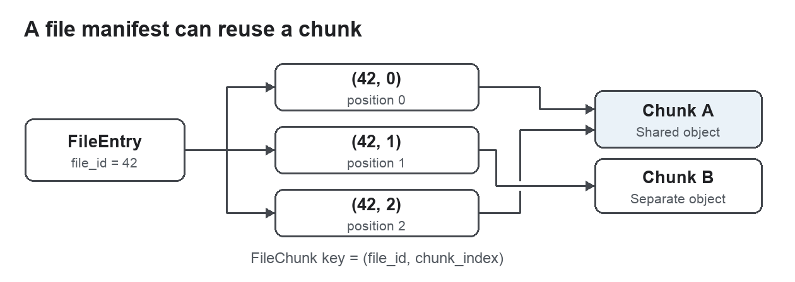

*Two positions in the same file can point to one stored chunk. The manifest still records each position separately.*

### Deduplication and integrity

Multiple files often contain identical data. For example, users might save the same image several times. In content-addressable storage, we look up data by a fingerprint of its bytes. Multiple `FileChunk` records can point to the same immutable object. Changing a file can create a new version of its manifest. The new manifest reuses unchanged chunks and adds entries for new ones. This is an application of copy-on-write.

A hash serves as the lookup key for a potential match. Different byte sequences can theoretically produce the same fingerprint. For user content, a collision-resistant hash such as SHA-256 is a reasonable choice. Practical collisions are known for MD5, so it’s unsuitable where collision resistance is required. If we need to establish exact equality, we compare the bytes after finding a matching hash and size. Different content with the same fingerprint gets a separate ID. This works much like separate chaining in a hash table. The fingerprint index points to candidate objects, and the manifest stores the exact ID of the object it uses. This lets us assign object keys freely without following a hash table’s probing sequence. [NIST Secure Hash Standard](https://csrc.nist.gov/pubs/fips/180-4/upd1/final) · [RFC 6151 on MD5 collision resistance](https://www.rfc-editor.org/rfc/rfc6151.html)

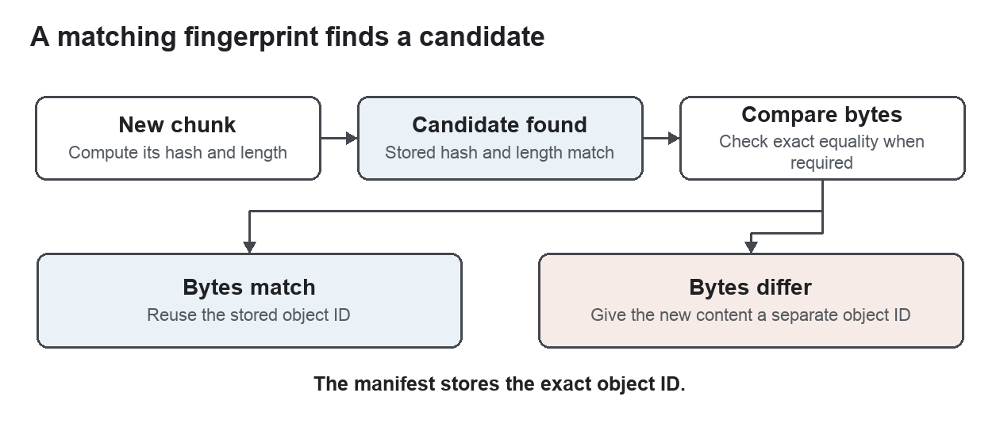

*The manifest refers to an object ID after the comparison resolves a potential match.*

We can scope deduplication to a single owner or organization so that object reuse doesn’t reveal whether a file exists in another account. Access checks use the file that owns the reference. If two processes discover the same new chunk at once, a uniqueness constraint and atomic metadata insert coordinate which object they use. When both writes target the same key, S3 can prevent an existing object from being overwritten with `If-None-Match: *`. [Conditional writes in Amazon S3](https://docs.aws.amazon.com/AmazonS3/latest/userguide/conditional-writes.html)

We can calculate the verification hash over the original bytes and store them compressed. Client-side compression reduces network traffic at the cost of CPU and battery use. Server-side compression shifts that cost to the service. Text often compresses well, and recompressing video or archives may save very little. A checksum on each part detects data corruption. The manifest establishes completeness and ordering, since swapping two intact parts still corrupts the assembled file. To verify the full assembly, we can keep a hash of the file or a hash of the ordered manifest. Adding the individual hashes together loses the order of the parts. [Verifying upload integrity in Amazon S3](https://docs.aws.amazon.com/AmazonS3/latest/userguide/checking-object-integrity-upload.html)

### Resumable uploads and downloads

An upload begins with a session that records its ID, the expected file size, and the rules for splitting the file. The client sends each chunk with its index or offset. The server writes the object, verifies its contents, and records the reference in the metadata database. If a retried request carries the same index and bytes, the server can return its previous result. If different data arrives for the same position, the server rejects the conflict or requires a new session.

After a connection drops, the client asks which indices or byte ranges the server has accepted. If the upload calls for ten parts and the metadata database confirms parts 0 and 3, the client sends the other eight. A count alone would be insufficient. Once the upload finishes, the client asks the server to finalize the session. The server checks that the parts cover the expected range, have the correct lengths, and don’t conflict, then moves the file from `uploading` to `ready` in one transaction. The download API serves the file only after this transition.

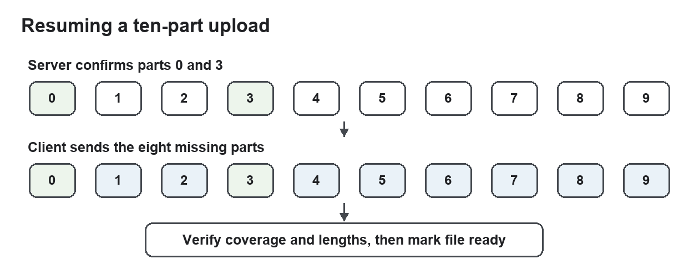

*The server verifies the parts it expects before making the resumed upload available for download.*

For a direct upload, a short-lived URL grants write access only to the object for that session. Before confirming a part, the server verifies its checksum and length. To prevent reuse of a still-valid URL from replacing bytes the server has already accepted, we can use a conditional write tied to the session key or publish the verified data under a separate immutable key. [Conditional writes in Amazon S3](https://docs.aws.amazon.com/AmazonS3/latest/userguide/conditional-writes.html)

The S3 write and the PostgreSQL transaction complete independently. The object write may succeed even if a failure prevents recording the part in the metadata database. A retry checks the existing object and finishes recording its reference. A background process collects objects from abandoned sessions after they expire. A shared metadata database and idempotent requests let different service instances accept parts of the same upload. The client can use any instance.

A download starts by checking permissions and reading the manifest of a ready file. The service can stream the required parts in order or issue URLs for the client to fetch them. The client can save its progress and request the remaining parts after a connection drops. If the interface serves the file as a single HTTP resource with range support, the client supplies an offset and the server maps it to chunk indices. Separate read and write handlers let us scale traffic handling, compression, and decompression independently. Creating a folder and deleting a file still use the metadata database.

### Deletion and garbage collection

Deleting a file removes its references to chunks. A chunk remains available as long as another file references it. Background cleanup can use a reference count updated in the same transaction as `FileChunk` records, or an index on the chunk ID to check whether any references remain. Deleting an object after observing a zero count creates a race. While the deletion waits in a queue, another upload might add a reference to the same object.

To close the race, the garbage collector atomically moves the unreferenced record to `deleting`. Adding a reference is synchronized with that transition through the same record. Once the object is marked, new uploads use a different object with a separate key. The background process deletes only the marked key and can safely retry after a failure. The check accounts for active upload sessions and, if downloads already in progress must be allowed to finish after a file is deleted, outstanding read permissions. Periodically reconciling S3 inventory can reveal leftover objects. The inventory check alone leaves a window in which a new reference can appear.

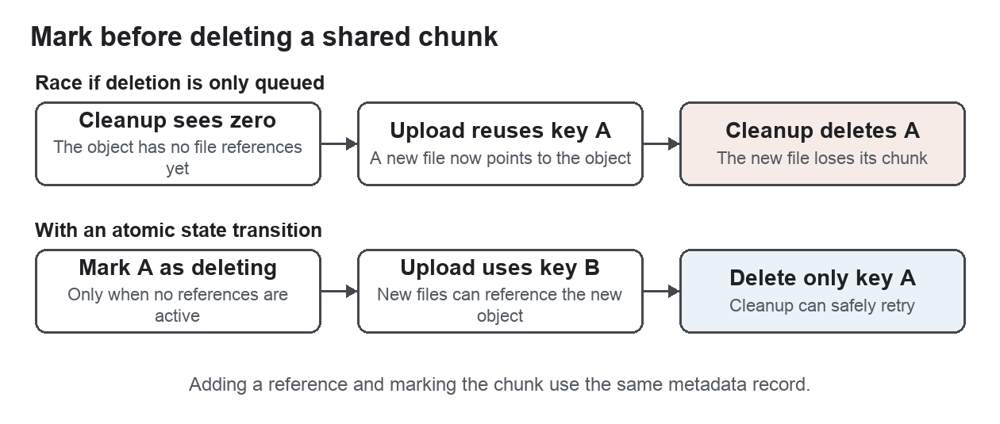

*Marking the old key closes the gap between finding zero references and deleting it.*

### Data volume, replication, and scaling

Estimated existing user data comes to `50 million × 100 × 1 MB = 5 PB`, assuming this estimate covers the full set of files we care about. At 150 million uploads per day, we also receive about 150 TB of incoming data daily. If every upload adds new bytes and no files are deleted, we’ll accumulate about 164 PB over three years, excluding the initial volume. Compressing the data to half its original size would bring that to about 82 PB before replication. That’s a planning scenario, and the actual ratio needs to be measured on representative file types. Deduplication and deletion reduce stored content. Storage redundancy, internal data, and indexes increase physical usage. The potential number of metadata rows also matters. The initial estimate already represents about 5 billion files, before folders and chunk records.

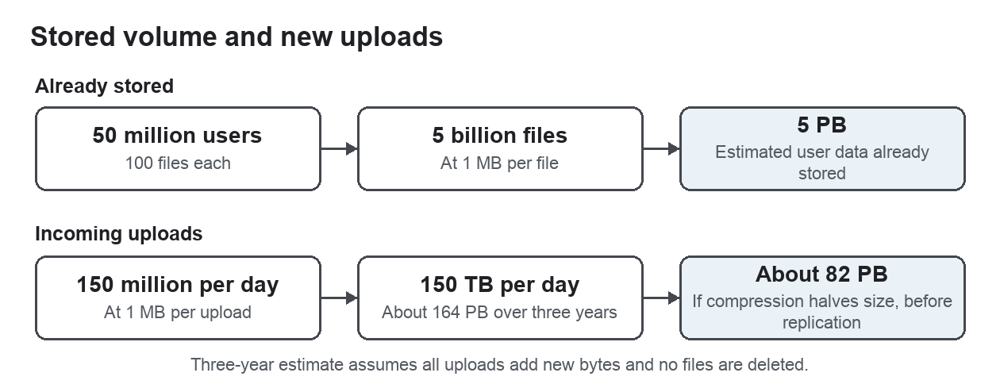

*Existing storage and incoming traffic are calculated separately.*

Infrequently accessed files can move to a less expensive storage class if retrieval still meets the expected recovery time. Product requirements determine when files can expire. Any savings from automatically deleting user data depend on having those rules in place.

We can start with a single metadata cluster and leave room to shard by owner. That keeps a user’s folder tree and manifests on one shard. Sharding folder-tree records by `file_id` could make an ordinary folder listing query several servers. Horizontal partitioning makes sense when one cluster reaches its limits in capacity, write throughput, I/O, or CPU. Offloading reads to replicas or provisioning a more powerful node can defer that step.

An asynchronous replica of the metadata database may temporarily miss a newly uploaded file. To give users read-after-write behavior, route their reads after publication to the primary or to a replica that has already applied the relevant transaction. Failover to a lagging replica can lose acknowledged metadata even if the objects survive. If that outcome is unacceptable, critical commits must wait until a synchronous standby has written the log, and the failover policy must preserve that guarantee. To make the data visible on the replica itself, we must also wait for it to replay the log, for example with PostgreSQL’s `remote_apply` mode. [PostgreSQL documentation on streaming and synchronous replication](https://www.postgresql.org/docs/current/warm-standby.html)

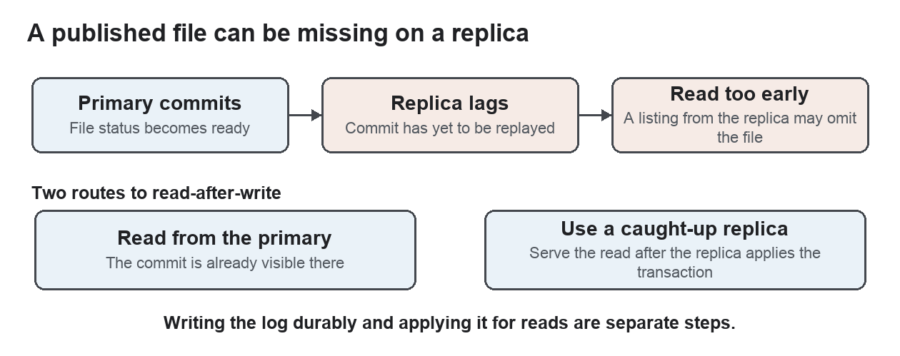

*A read just after publication needs a database node that has applied the change.*

## Hotel reservations

### Catalog, search, and availability by date

Guests search for hotels and room types, check availability for their dates, make reservations, pay, and cancel. Hotel administrators manage listings and room inventory. Assume 30 million daily active users, 300,000 hotels, ten listing views per user per day, and one reservation per user per month. Applying both rates to the same population gives an average of about 3,472 views and 12 reservations per second. Each reservation triggers several internal operations. Peak demand varies by season and region.

`Hotel` records the name, description, address, and coordinates. `RoomType` includes the category, amenities, base price, and capacity. A hotel might have 50 standard rooms, 30 upgraded rooms, and two suites. If guests book by room type, the hotel can assign a physical room later. A capacity change, such as a room going out of service for repairs, applies on the affected dates. For each night, we store either the available count or separate counts for capacity and occupied or held rooms. The date range is `[check_in, check_out)`, since another guest can occupy the room on the night of the checkout date.

When rooms of a given type are interchangeable, the minimum nightly availability tells us how many rooms of that type we can promise for the whole stay. When reservations are tied to specific rooms, we check that the same room is available for every night. Suppose room 101 is the only room available Monday night and room 102 is the only one available Tuesday night. The minimum nightly availability is one, but the hotel can accommodate a two-night stay only if the guest changes rooms.

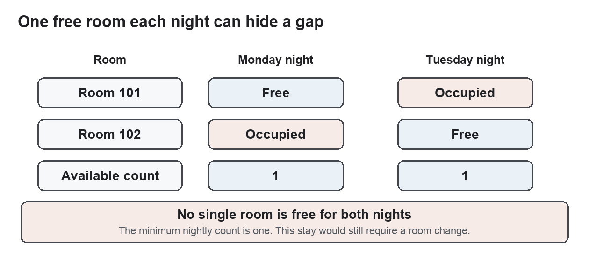

*Nightly counts alone can hide the need to switch rooms.*

For search by name and description, we’ll build a derived index in Elasticsearch. Fuzzy search based on edit distance can handle typos. Separate filters cover geography and room amenities. Documents are indexed from the primary database and become searchable after an index refresh. Stale catalog results are acceptable if we verify availability at booking time. Likewise, we can cache the displayed room availability and let the transactional database decide whether to allocate a room. [Elasticsearch fuzzy queries](https://www.elastic.co/docs/reference/query-languages/query-dsl/query-dsl-fuzzy-query) · [Near real-time search in Elasticsearch](https://www.elastic.co/docs/manage-data/data-store/near-real-time-search)

### Room holds and payment

Two guests may both see the same last available room on their screens. Both can send a request, so checking and decrementing availability must happen atomically. In PostgreSQL, we can lock the required rows by date in a consistent order, then check availability in every row and decrement the counts in one transaction. If there are too few rooms on any night, the entire transaction rolls back. An approach based on conditional updates must likewise check that every date was updated and roll back if capacity is insufficient. Replication protects the result after commit, while the transaction controls concurrency. [Row-level locking in PostgreSQL](https://www.postgresql.org/docs/current/explicit-locking.html)

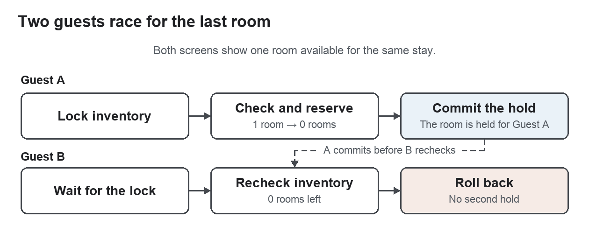

*The second request checks the inventory after the first transaction commits.*

At this reservation volume, a modular monolith that handles the booking record and room hold in one local transaction is still practical. For the exercise, we’ll use separate services for hotel inventory and bookings, with an external payment provider. The booking stores its owner, hotel, room type, dates, room count, agreed price, currency, and status. The room count matters when a sports team books several rooms at once, for example.

We can model the reservation as a saga made up of local transactions and compensating operations. Each handler uses the booking or hold ID to recognize steps it has already completed. For publishing events, we use a transactional outbox. The service writes its change and the event in one database transaction. A separate process then delivers the event to the broker. Idempotent handlers can tolerate duplicate delivery. [Saga pattern](https://docs.aws.amazon.com/prescriptive-guidance/latest/cloud-design-patterns/saga-patterns.html) · [Transactional outbox pattern](https://docs.aws.amazon.com/prescriptive-guidance/latest/cloud-design-patterns/transactional-outbox.html)

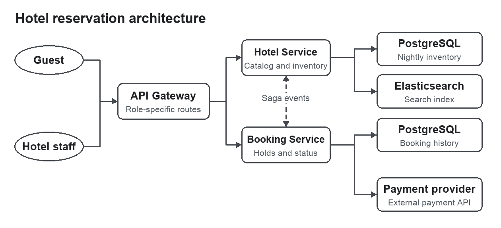

*Adapted from the course whiteboard at 01:39:00. The diagram separates the search index, nightly inventory, booking history, and external payment provider.*

1. The Booking Service creates a booking in `pending` and requests a room hold. The Hotel Service checks inventory for every night and either records a temporary hold or reports that there are too few rooms.
2. Once the hold is in place, the booking moves to `awaiting_payment`. The guest sees a payment deadline, such as 20 minutes. The rooms are held for that booking during this window.
3. After payment confirmation, the Booking Service asks the Hotel Service to confirm the hold. If it’s still active, the Hotel Service changes its state atomically. The booking becomes confirmed once the Hotel Service responds. If an unpaid booking is canceled or expires, a separate idempotent operation releases the hold. The booking stays in the history with its final status. Canceling after payment may also require a refund under the rate’s terms.

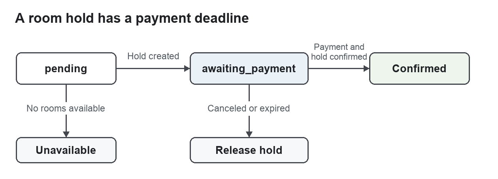

*A booking reaches confirmation only if payment succeeds and the hold can still be confirmed.*

A background worker can find expired holds with an index on `expires_at` for the relevant statuses. A small table of in-flight bookings gives us the same lookup if its records are written atomically with booking updates. A race can occur when the provider confirms payment as the hold expires. Confirmation and release compete to transition the hold out of the same state. If payment is confirmed after the hold has been released, the service reconciles the payment attempt and issues a refund according to policy. The booking remains unconfirmed because the room may already have gone to another guest.

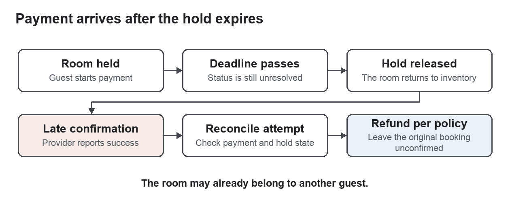

*A late payment does not bring an expired hold back.*

Guests need to know when their room is on hold, when they’ve initiated payment, and when payment has gone through. Payment confirmation can arrive after the original request, including via a webhook. A network timeout leaves the outcome unknown. When retrying a request for the same payment attempt with the provider, we reuse the same idempotency key and check its status. We start an attempt with a backup provider only after resolving the previous one. Otherwise, a single reservation could produce two charges. If the payment system is unavailable, the interface tells the guest and product policy determines how much longer to hold the room. [Stripe PaymentIntent lifecycle](https://docs.stripe.com/payments/paymentintents/lifecycle) · [Stripe idempotency keys](https://docs.stripe.com/api/idempotent_requests)

### Hotel operations and seasonal peaks

Taking rooms out of service for repairs uses the same transactional model. The revised inventory for those dates must account for all confirmed bookings and active holds. If a room floods while the hotel is full, the hotel needs to decide what to do about existing reservations. It can offer a replacement room or initiate a cancellation, with a refund if needed. The hotel administrator uses the existing cancellation process, which checks their permissions and records the reason.

Guests and hotel staff can use a shared load balancer. They can have separate API Gateway routes or separate gateways if they need independent policies. At ingress, we authenticate callers, enforce rate limits, and log requests. The Booking Service and Hotel Service also verify permission for the specific action. A guest can view their own booking, and hotel staff can change inventory only for their own property. Service-to-service calls carry verifiable request context and authenticate the calling service.

The catalog and reservations have different fault-tolerance requirements. We can rebuild the search index from the primary data. For confirmed bookings and holds, committed changes must survive failures. If one cluster stops meeting demand, we can distribute hotel records and room inventory by `hotel_id`, keeping all dates for a hotel together. A geographic key reduces cross-shard queries for regional searches, but popular vacation spots can make a shard hot. Booking histories can be sharded by `user_id`. Each shard can have its own queue for processing expired bookings.

Summer demand may concentrate in beach destinations, and winter demand in ski areas. To prepare, measure peak traffic, latency, database throughput, and queue depth. Run a load test in which many guests try to book a popular hotel at the same time. Until there’s historical data, use scenarios to estimate headroom. After peak season, compare the forecast with observed traffic and adjust capacity. Some of the growth may persist.

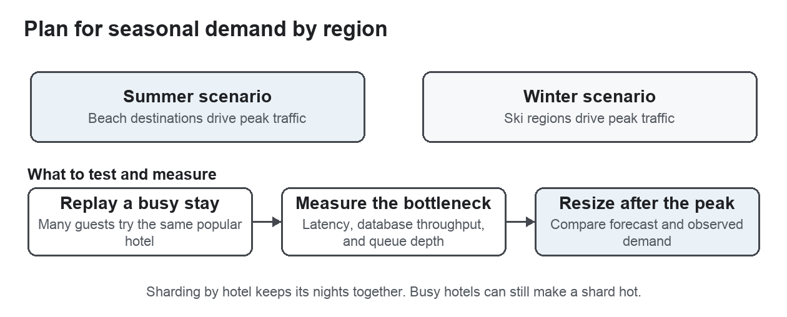

*Seasonal load tests should exercise the hotels and regions where demand concentrates.*