# Lesson 7. Code Judging and Messaging

In this lesson, we’ll design two systems as exercises. The main challenge for a platform inspired by LeetCode is running code submitted by users safely and predictably. A messaging app inspired by WhatsApp needs to preserve conversation history, deliver new messages, and synchronize state across devices. The scale, limits, and components are specific to the exercises.

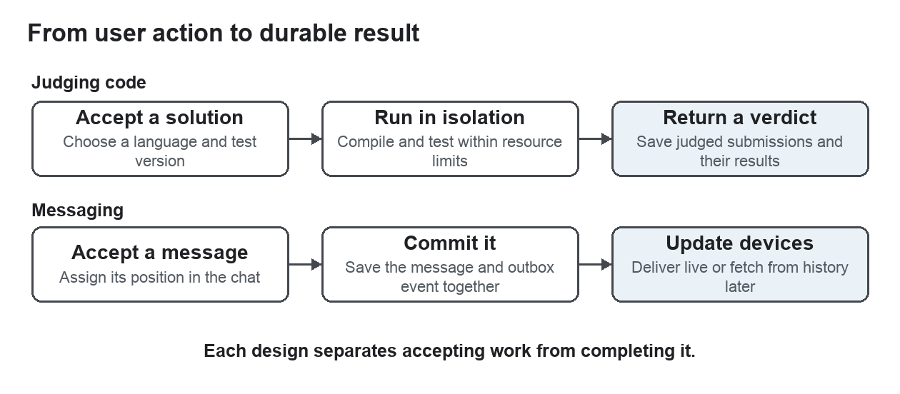

*The overview follows a code submission and a message from acceptance to result.*

## A platform for judging code

### Problems, trial runs, and submission history

The platform supports C++, Java, and Python. A user reads a problem, writes a solution, and can click `Run` to try it without adding an entry to their history. Clicking `Submit` starts judging and saves the source code and verdict even if the solution fails the tests. LeetCode makes this distinction between a trial run and a judged submission in its interface. [LeetCode help on Run Code and Submit](https://support.leetcode.com/hc/en-us/articles/360012016874-Start-your-Coding-Practice)

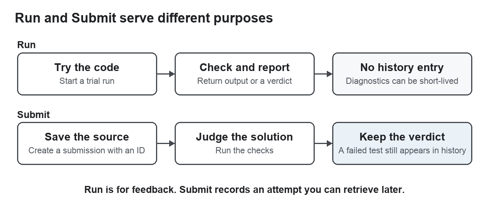

*Only Submit creates a history entry, including when the solution fails.*

The API for the exercise needs four operations. It retrieves a problem by ID, starts a trial run, submits a solution, and returns a submission’s status. A problem has an ID, a title, a statement, sample inputs and expected outputs, a creation time, and a test suite version. Task Service shares the statement and public examples with the user. Hidden tests go only to the internal judging system. For problems with a single valid answer, we can record the expected outputs ahead of time. If the problem accepts several correct outputs, we need a trusted checker that evaluates the answer against the problem’s rules.

Problems are usually retrieved one at a time and change infrequently. MongoDB can store them as documents. PostgreSQL works equally well for a small catalog with simple queries. Large test suites can be stored separately and referenced by an immutable version. If the catalog serves reads from asynchronous replicas, newly published problems may take time to appear. Every evaluation still needs to use a specific version of the tests so that an update during a run cannot change its result. [MongoDB replication and replica sets](https://www.mongodb.com/docs/manual/replication/)

### Isolated execution and capacity planning

The exercise assumes 10 million daily active users and five runs per user per day. That’s 50 million runs a day, or about 579 per second. The source code is limited to 2 KB. Most of the cost comes from starting the environment, compiling the code, and running it. Assume each run can use up to one vCPU and 100 MB of memory. At 579 jobs per second and an average slot occupancy of one second, we need about 579 slots. If every job occupies a slot for the full five seconds, we need about 2,900 slots. At the same limits, that represents a nominal budget of about 2,900 vCPUs and 290 GB of memory before platform overhead. Estimate actual capacity separately for each language, taking into account compilation and execution times, CPU utilization, peaks, and isolation overhead. For the JVM, 100 MB is just an example. Check it against the selected image and tests.

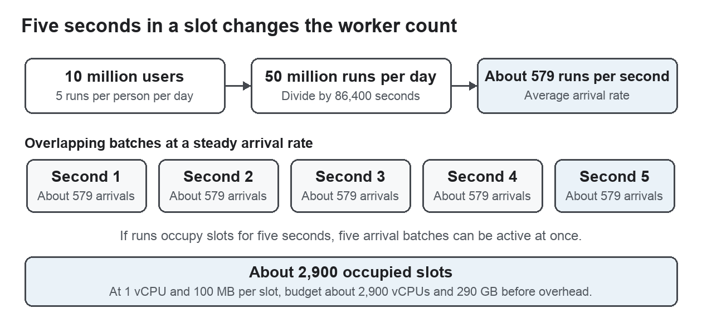

*Capacity depends on the arrival rate and how long a run occupies its slot.*

An infinite loop can tie up a slot until someone stops it. Several such jobs can crowd ordinary checks out of the pool. We’ll set a hard execution limit of five seconds for the exercise. We also set separate budgets for compilation, environment startup, and queue wait. To give users a meaningful verdict, distinguish time limit exceeded, memory limit exceeded, compilation errors, wrong answers, and infrastructure failures.

Treat both source code and program output as untrusted. The compiler and the running program both need isolation. For a public service, dedicated execution nodes and a hardened sandbox or microVM are reasonable choices. Standard containers on the same host share the kernel, so the isolation boundary depends on the risk the service can accept. Each run gets a temporary workspace, unprivileged access, and limits on CPU, memory, process count, and output size. Block access to the network, host, secrets, and service accounts. Isolation must hold regardless of what the source code looks like. [Tenant isolation in Kubernetes](https://kubernetes.io/docs/concepts/security/multi-tenancy/) · [gVisor security model](https://gvisor.dev/docs/architecture_guide/security/)

Enforce the time limit from outside the sandbox. If the submitted code gets stuck in a loop, stop the entire run and its child processes at the deadline, release the resources, and return a verdict. When a gRPC deadline expires, the waiting call ends. The worker is responsible for stopping the job and cleaning up the environment. Process limits and enough spare worker capacity also help prevent correct code from timing out on an overloaded host. [gRPC deadlines](https://grpc.io/docs/guides/deadlines/) · [Container resource requests and limits in Kubernetes](https://kubernetes.io/docs/concepts/configuration/manage-resources-containers/)

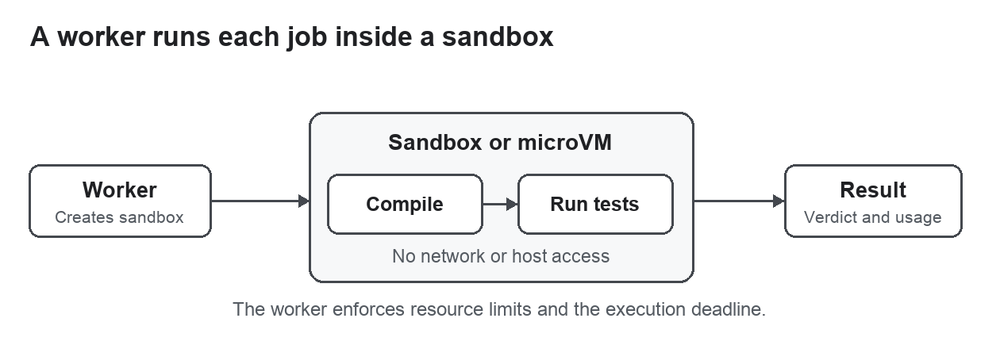

*The deadline and resource limits are enforced from outside the sandbox.*

### Dispatching jobs and handling retries

API Gateway accepts the request, checks the source size, and enforces the quota. The Running Engine selects the version of the test suite and sends the job to a worker for the right language. For quick trial runs, the engine can use gRPC and return the verdict in the same request if a slot is available and there’s enough time to compile and run the code. A queue gives us a resilient asynchronous path. The worker takes a job when it becomes free, and the client retrieves the result by run ID. The queue can be a broker or a table that allows workers to claim jobs concurrently. PostgreSQL supports `SKIP LOCKED` for scenarios like this. A long run can take place outside the transaction. The transaction only needs to grant a temporary claim on the job. [PostgreSQL locking clauses for SELECT](https://www.postgresql.org/docs/current/sql-select.html#SQL-FOR-UPDATE-SHARE)

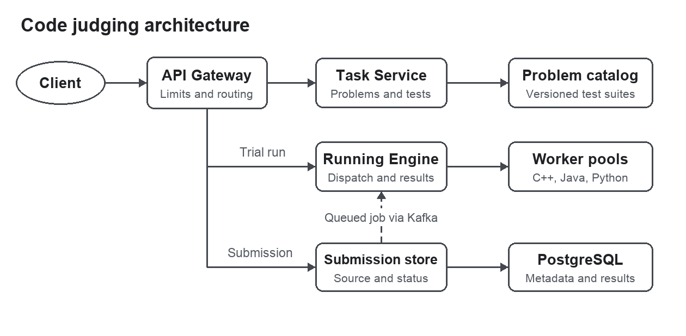

*Adapted from the course whiteboard at 00:40:30. Trial runs take the interactive path, and stored submissions can dispatch jobs through Kafka.*

Each language has its own images and resource profile. Separate C++, Java, and Python pools let us update compilers and runtimes independently, set different limits, and add workers where demand grows. Round-robin dispatch can send a job to an occupied slot. The dispatcher gets a list of healthy workers from service discovery and assigns an available slot atomically. If multiple dispatchers are running, a shared coordinator or the worker itself decides who gets the slot. Keeping workers warm reduces startup latency. We can scale automatically based on wait time, queue length, or the share of slots in use. [Horizontal Pod Autoscaling in Kubernetes](https://kubernetes.io/docs/concepts/workloads/autoscaling/horizontal-pod-autoscale/)

Each assignment gets an attempt ID and a lease with an expiration time. If the dispatcher loses a response, it can check the attempt’s status. If a worker disappears, the job can be reassigned once its lease expires. If the original worker eventually responds, discard the stale result. Sharing state in Redis lets a dispatcher restart without losing the assignments. A Redis failover can still lose some assignments, so workers must reject new assignments for occupied slots, and the service checks the attempt ID before accepting a result. [Redis replication](https://redis.io/docs/latest/operate/oss_and_stack/management/replication/) · [Redis persistence](https://redis.io/docs/latest/operate/oss_and_stack/management/persistence/)

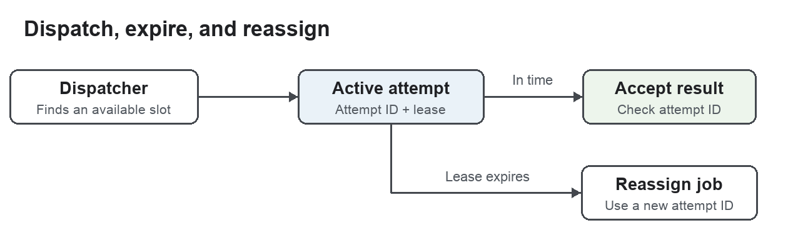

*The active attempt ID identifies the result the dispatcher can accept.*

We can cache popular test suites by problem ID and version. We can also cache results for users who repeatedly run the same code, for example after a compilation error. A short-lived cache can return the same deterministic result. The key includes the access scope, source hash, `Run` or `Submit` mode, problem, test suite version, language, runtime version, and any additional inputs. Keep worker failures and network timeouts out of the result cache because they say nothing about the program itself. A new `Submit` creates a new history entry even on a cache hit. An idempotency key identifies a retry of the same request after a network failure.

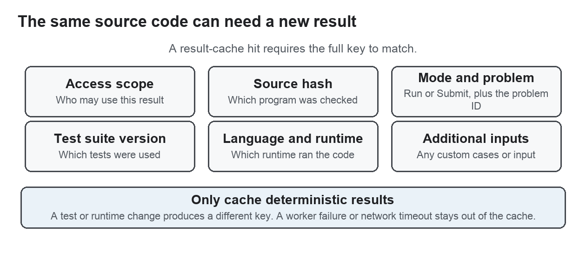

*A changed test version or runtime produces a different result-cache key.*

For admission control, limit both the request rate and the number of concurrent runs per user. If each gateway instance has its own counter, requests across instances are counted together only after synchronization. A shared atomic counter enforces the quota more precisely at the cost of an extra network call. Local rate limiters that periodically share state are fast and allow temporary overshoot. A hard quota requires a shared atomic decision or a fixed allotment from the overall quota for each gateway. The worker pool still needs its own admission limit to withstand overload if the rate limiter fails. [Redis documentation on the rate limiter pattern](https://redis.io/docs/latest/commands/incr/#pattern-rate-limiter)

### Saving submissions and recovering from failures

For `Submit`, we first save the accepted source code and a record with the submission ID, user, problem, language, runtime version, timestamp, and `queued` status. The user receives an ID they can use to retrieve the result even after closing the page. We can publish the job to Kafka through a transactional outbox entry written in the same transaction as the submission metadata. The worker or results service records the verdict, execution time, and memory usage idempotently. A trial run may leave diagnostic and short-lived data. Only submissions appear in the submission history. [Transactional outbox pattern](https://docs.aws.amazon.com/prescriptive-guidance/latest/cloud-design-patterns/transactional-outbox.html)

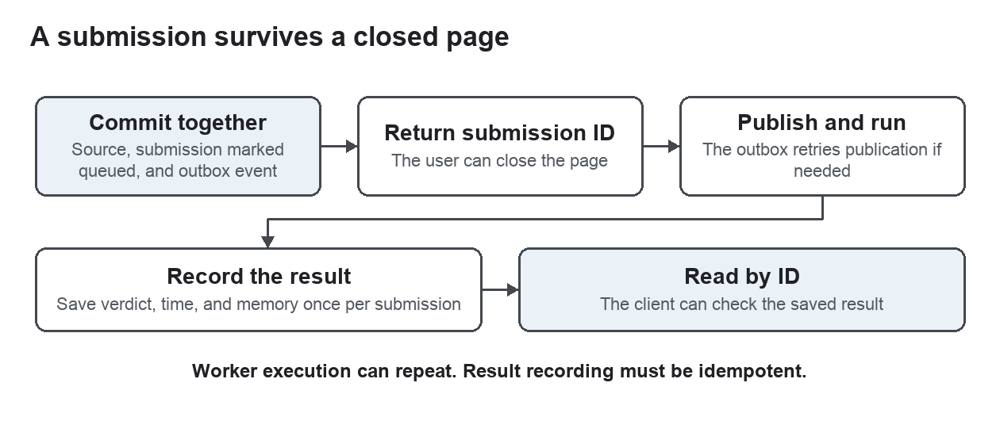

*The submission ID gives the user a way back to the result after leaving the page.*

At the 2 KB limit, we can store the source code in PostgreSQL alongside its status. S3 or MinIO is useful if we need independent storage for large volumes of source code and a separate retention policy. In that design, the database record points to an object that has already been stored. Handle failures between object storage and the metadata database with idempotent retries and cleanup of unreferenced objects. If we need to shard the history, `user_id` keeps all of a user’s submissions on the same shard.

Gateways, Task Service, and the Running Engine can each run in multiple instances. If the test cache fails, the service falls back to the problem catalog within its load limits. Reliably accepting submissions depends on metadata database availability and the durability of acknowledged source code. Broker replication and an appropriate producer acknowledgment policy protect queued jobs. Retries and reconciliation of unfinished submissions are still necessary with a broker, since a failure can occur between running the job and saving the result. [Apache Kafka producer configuration](https://kafka.apache.org/42/configuration/producer-configs/)

## Messaging

### Traffic, latency, and retention

We’ll support one-on-one conversations and group chats of up to 500 participants. Messages contain up to 2,000 characters of text and remain available in the conversation history indefinitely. Users need new-message notifications and read state shared across devices. The sender should receive acknowledgment within one second. Delivery over an active connection should take no more than three seconds. Some delay in event propagation is acceptable. The exercise assumes no seasonality or geographic distribution.

At 50 million active users sending 20 messages per user **per week**, we get 1 billion new messages a week, or about 1,653 writes per second. At 100 messages read per user each week, the service serves about 8,267 message reads per second. For this estimate, we assume an audience of that size stays active. Each message read can be part of a page of conversation history fetched in a single HTTP request. A single send to a group can produce several deliveries, so we estimate notification traffic separately based on chat size, the share of participants online, and the number of devices.

A UTF-8 code point takes one to four bytes. If the limit counts code points, 2,000 code points give an upper bound of 8 KB of text. Using 4 KB per message as a planning assumption, we get about 4 TB per week and 209 TB over 365 days. At 8 KB, that doubles. This is the message body volume before compression, indexes, replication, and metadata. For a more accurate estimate, define what the interface considers a character, then measure the distribution of message lengths in bytes. [RFC 3629 on UTF-8 encoding](https://www.rfc-editor.org/rfc/rfc3629.html)

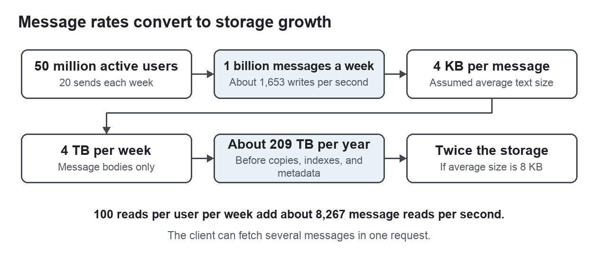

*Message body volume comes from the number of messages and their average size in bytes.*

### Chats, ordering, and read state

We can represent one-on-one conversations and groups with a single entity, `Channel`. The `Membership` table tracks participants, with each record defining a user’s permissions in the chat. `Message` stores the chat ID, message ID, sequence position within the chat, author, timestamp, and text. The service checks membership before sending a message or returning history.

A send request carries a stable ID generated by the client. If a connection drops before the sender receives a response and the client retries, the server returns the message already stored for that ID. A sequence position assigned by the server within each chat gives us a useful ordering for history. Device clocks can disagree, and two messages can have the same timestamp. We page through history by position. The transaction that writes a new message can also update the chat’s latest message position.

We’ll store one `last_read_seq` cursor for each `(user_id, channel_id)` pair. It records the last position through which the user has read the chat. If the cursor is at message five and the latest message is at position ten, some messages are still unread. Subtracting the positions gives an exact unread count only if numbering is continuous and the user can see every message in that range. The cursor moves forward only. A late update from a phone can’t overwrite a higher read position already sent by a laptop.

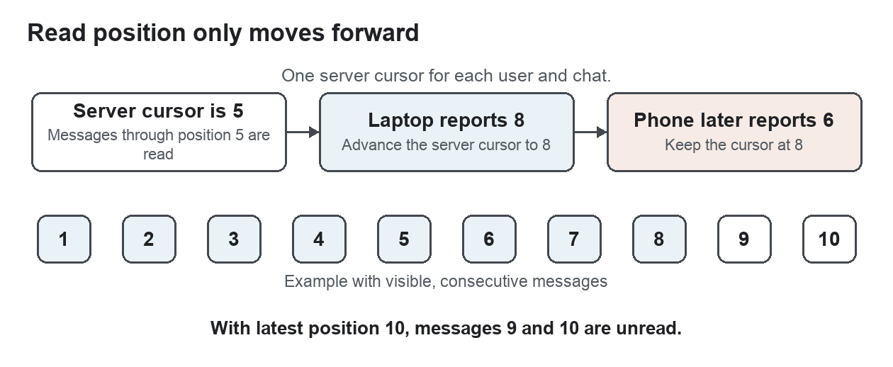

*The shared cursor ignores older progress reported by another device.*

The home screen lists a user’s chats and the latest message in each. While the data lives together, we can fetch memberships and chat summaries. After sharding, the query can touch many shards. Fetching in parallel reduces wait time, but it scales poorly for long chat lists and gives a slow shard more influence over the overall response time. A separate projection of the chat list keyed by `user_id` can quickly return the chat name and the latest message’s author, preview, and sequence position. Events update the projection, so it can briefly lag behind the conversation history.

### Delivery across devices

The client sends text through API Gateway to Message Service. The service saves the message and an event to publish, then acknowledges the send. The broker delivers the event to the notification service. An outbox is useful here too. Otherwise, a failure between the database write and broker publication would leave the message in the history without notifying connected recipients. With a stable partition assignment, a `channel_id` key keeps a chat’s events in one Kafka partition. If several publishers work concurrently, the order in which the producers append events can differ from database commit order. The chat sequence position lets the client detect a gap and fetch the missing history. [Apache Kafka event and partition model](https://kafka.apache.org/42/getting-started/introduction/)

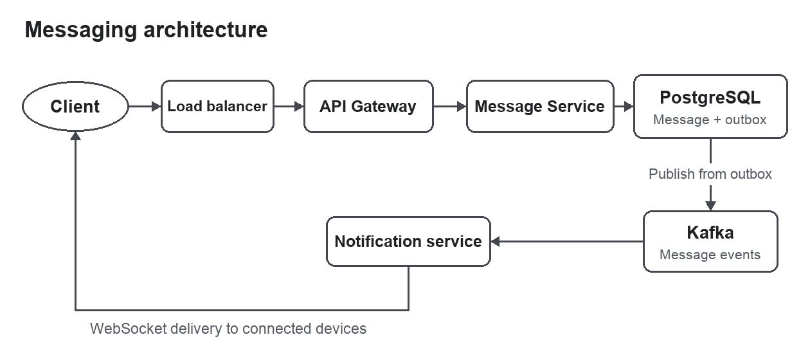

*Adapted from the course whiteboard at 01:03:00. Saving a message and delivering the event to connected devices are separate steps.*

The app keeps a WebSocket open with one notification service instance. A simple approach broadcasts the event to every instance. Each instance checks whether any members of the chat are connected to it. In Kafka, each broadcast recipient needs its own copy of the stream. Instances in a single consumer group share the work, so one instance may receive an event while the user it’s for is connected to another instance. As the number of instances grows, it makes more sense to maintain a connection registry such as `user_id → (device_id, instance_id, connection_id)` and route each event to the right nodes. Registry entries expire. Ping and Pong frames and connection-close events help detect stale connections. [WebSocket Protocol, RFC 6455](https://www.rfc-editor.org/rfc/rfc6455.html#section-5.5.2) · [Apache Kafka consumer group model](https://kafka.apache.org/42/design/design/#the-consumer)

If a user reads a chat on their laptop, the service updates `last_read_seq` and sends an event to their other active devices. On reconnect, every device can recover from the server’s read cursor. A phone that has been offline fetches newer messages and the current read state. For example, suppose a device had saved the history through position 40 and received position 44 after reconnecting its WebSocket. It fetches messages after 40 and discards the duplicate at 44. The same process works if the notification itself is lost and the client learns about new messages by requesting the chat summary. Messages and notifications can arrive more than once, so the client deduplicates by ID or position and only moves read cursors forward.

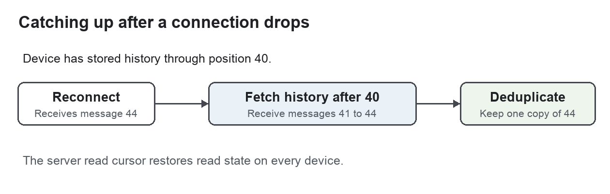

*The client uses the last stored position to recover missing messages after reconnecting.*

Measure the sender’s acknowledgment and delivery to the recipient separately. The one-second budget includes the round trip to the gateway, validation, and the database commit. The three-second budget starts at the original send and covers the commit, publication, queue wait, routing to the WebSocket server, and delivery to an online device. An offline client catches up when it reconnects. To validate these targets, measure end-to-end latency at a chosen percentile and track replication lag, commit latency, broker lag, and WebSocket health. The speed of an individual SSD tells us little about overall response time.

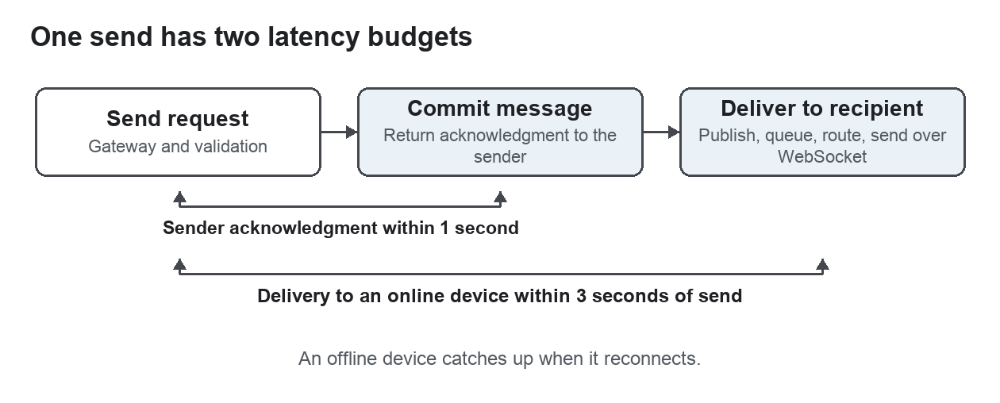

*The sender acknowledgment and online delivery targets start at the same send.*

### Shards, archives, and database failover

The first version can use a relational database with tables for messages, chats, and membership. Later we can shard messages by `channel_id` to keep a chat’s history and sequence state local. A uniform hash distributes IDs, but active chats can still overload individual shards. In an enterprise messaging app, an organization can serve as the shard key to keep its data together. A large organization can itself need further partitioning.

Once load imbalance becomes noticeable, we can add a routing table that maps chats to shards and move hot chats between nodes. A migration must coordinate copying the history, handling new writes, and switching the route. We can start with manual migrations and automate them once we have reliable metrics. Diagnose hot Kafka partitions separately. Watch how quickly consumer lag grows and which keys account for most events. Before moving data, determine whether the load comes from many moderately active chats placed together or from a single busy chat. Reassigning a partition to another broker and splitting a hot key solve different problems. Splitting the key requires revisiting how we preserve event order within the chat.

Within each shard, we can partition messages by time. Recent partitions handle frequent queries from fast storage. Older ones can move to cheaper disks or be exported as compressed objects with an index of data ranges. With tiered storage, decide how to locate the right archive segment and how long users can wait for older history. Verify the export before removing local data. Indefinite retention means the total volume keeps growing even after migration to an archive. PostgreSQL can place partitions in different tablespaces. [PostgreSQL table partitioning](https://www.postgresql.org/docs/current/ddl-partitioning.html) · [PostgreSQL tablespaces](https://www.postgresql.org/docs/current/manage-ag-tablespaces.html)

If the primary acknowledges a write before streaming the log to an asynchronous replica, the message can disappear after failover. Automatic retries help when the client doesn’t know the outcome of a request. To preserve an already acknowledged message if the primary fails, wait for the required number of durable copies before acknowledging it, and promote a standby that has the data. PostgreSQL streaming replication provides a mechanism for shipping the log and promoting a standby. Detecting failure, choosing a new primary, and fencing off the old primary require external coordination, such as Patroni or the failover mechanism of a managed database. Write acknowledgments can be delayed when the required synchronous standbys are unavailable. [PostgreSQL replication](https://www.postgresql.org/docs/current/warm-standby.html#SYNCHRONOUS-REPLICATION) · [PostgreSQL failover](https://www.postgresql.org/docs/current/warm-standby-failover.html) · [Patroni replication modes](https://patroni.readthedocs.io/en/latest/replication_modes.html)

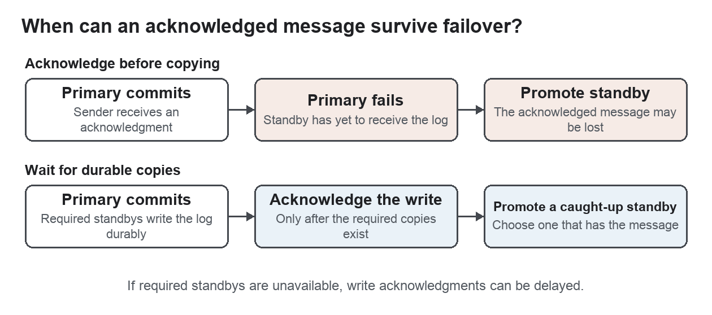

*Write durability depends on when the service acknowledges and which standby it promotes.*