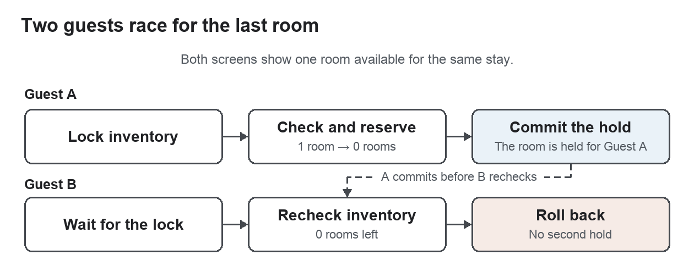

# System Design Illustrated

Seven English lessons with 119 diagrams and worked examples. Each chapter starts with a visual overview, then follows the request paths, state changes, and failure cases in more detail.

## Lessons

1. [Core Concepts and Components](01-core-concepts-and-components.md)
2. [Data Storage](02-data-storage.md)
3. [Distributed Data Storage](03-distributed-data-storage.md)
4. [System Design Patterns and Techniques](04-system-design-patterns-and-techniques.md)
5. [Social Feeds and Ride-Hailing](05-social-feeds-and-ride-hailing.md)
6. [File Storage and Hotel Reservations](06-file-storage-and-hotel-reservations.md)
7. [Code Judging and Messaging](07-code-judging-and-messaging.md)

## Example

## Source

Adapted from Vladimir Balun’s 2023 **System Design** course (Balun.Courses). Figures drawn from or adapted from the course are credited in the lesson captions. The lessons also link to the specifications and documentation used to check technical details.
